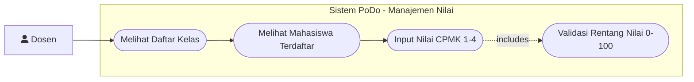
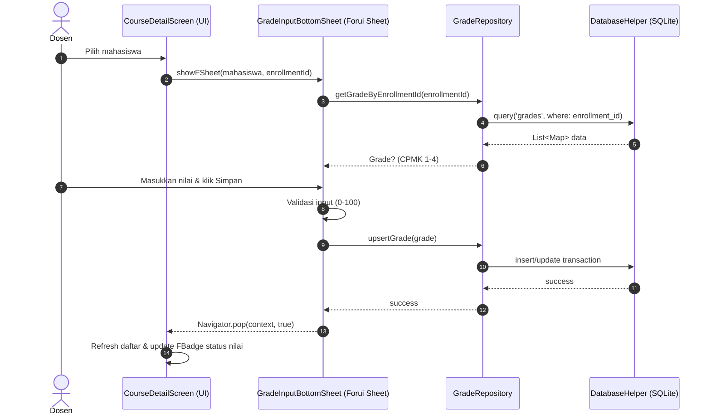

# Custom Writing Plans for PoDo

## Overview

Use this skill when preparing implementation plans for **PoDo (Portal Dosen)** or related Flutter features before writing or editing code.

This skill adapts the principles of `/writing-plans` and the strict architectural rules of `AGENTS.md`:
1. **Visual Documentation First**: Every plan MUST include a **Use Case Diagram** and a **Sequence Diagram** rendered via Mermaid.
2. **Widget Selection Hierarchy**: Every UI element must follow: `lib/core/widgets/` -> Forui library (`forui`) -> Custom Widget (only if absent in both, with documented justification).
3. **Data Layer Discipline**: Respect the pattern **Hardcoded Seed Data -> SQLite -> Repository -> UI**. All data operations go through SQLite via Repositories.
4. **Flutter TDD & Atomic Steps**: Bite-sized tasks ending with concrete test verification (`flutter test`) and static analysis (`flutter analyze`).

**Announce at start:**
> "I'm using the custom-writing-plans skill to create the implementation plan."

**Save plans to:** `docs/plans/YYYY-MM-DD-<feature-name>.md`

---

## Mandatory Sections in Every Plan

Every implementation plan generated with this skill **MUST** contain the following structural sections in order:

1. **Plan Header**: Goal, Architecture, Tech Stack, Spec/Rule References.
2. **Use Case Diagram (Mermaid `flowchart LR`)**: Visual representation of actors, system boundaries, and user interactions.
3. **Sequence Diagram (Mermaid `sequenceDiagram`)**: Interaction flow across User -> UI -> Repository -> SQLite.
4. **Widget & Component Decision Matrix**: Explicit mapping of every UI element following the 3-step hierarchy.
5. **Data Layer & SQLite Contract**: Affected tables, foreign keys, constraints, and Repository method signatures.
6. **Task Breakdown**: Atomic tasks following Flutter TDD cycles.
7. **Self-Review Checklist & Execution Handoff**.

---

## 1. Mermaid Diagram Standards

### A. Use Case Diagram
Mermaid does not have a native `usecaseDiagram` keyword. Render use case diagrams using **`flowchart LR`** with standard conventions:
- **Actor**: Represented with node syntax, e.g. `User["fa:fa-user Dosen"]` or `Dosen["Dosen (Pengguna)"]`.
- **System Boundary**: Group use cases inside a `subgraph` representing the application or feature scope.
- **Use Cases**: Represented as oval/pill nodes `([Nama Kasus Penggunaan])`.
- **Relationships**: Simple arrows `-->` or dotted lines `-.->` for includes/extends.



### B. Sequence Diagram
Must use standard `sequenceDiagram` showing the separation of concerns:
- **Actor / User**: Dosen
- **UI Layer**: Screen atau Modal Sheet (Forui)
- **Data Access Layer**: Feature Repository
- **Persistence Layer**: DatabaseHelper (SQLite)



---

## 2. Widget Selection Hierarchy (Policy AGENTS.md Bagian 5)

When planning any UI screen, form, or dialog, you **MUST** evaluate each visual element against this 3-tier hierarchy:

```
[1. lib/core/widgets/]
       │ (Ada komponen reusable yang sudah dibuat?)
       ├─ YA  ──> Gunakan widget dari lib/core/widgets/
       └─ TIDAK ──> [2. Forui Library (forui)]
                         │ (Ada komponen Forui yang relevan?)
                         ├─ YA  ──> Gunakan komponen Forui (FButton, FTextFormField, dll.)
                         └─ TIDAK ──> [3. Bikin Custom Widget]
                                           (Wajib dokumentasikan alasan ketidakcocokan Forui)
```

### Component Decision Matrix Template

Setiap plan yang memuat UI wajib menyertakan tabel ini:

| Elemen UI | Sumber Komponen | Komponen Terpilih | Alasan Pemilihan & Referensi |
|---|---|---|---|
| Header Halaman | Forui | `FHeader` | Komponen standar Forui untuk judul dan navigasi atas |
| Tombol Simpan | Forui | `FButton` | Primary action button standar Forui |
| Form Input Teks | Forui | `FTextFormField` | Input teks yang terintegrasi dengan validasi Form Flutter |
| Status Nilai | Forui | `FBadge` | Menampilkan label singkat "Sudah Dinilai" / "Belum Dinilai" |
| Modal Input Nilai | Forui | `showFSheet` | Bottom sheet overlay kontekstual dari Forui (bukan route baru) |
| Ringkasan SKS | Core Widgets | `StatSummaryCard` | Komponen reusable kustom PoDo yang sudah ada di `lib/core/widgets/` |
| Kartu Nilai CPMK | Custom Widget | `CpmkScoreRow` | Tidak tersedia di Core maupun Forui (layout khusus 4 grid input angka) |

> [!IMPORTANT]
> **Larangan:** Jangan pernah menggunakan Material (`ElevatedButton`, `TextField`, `Card`) atau Cupertino sebagai jalan pintas. Widget dasar Flutter (`Padding`, `Column`, `Row`, `ListView`) hanya digunakan untuk layout dan struktur tata letak.

---

## 3. Data Layer & SQLite Contract

Sebelum menyusun task, tentukan relasi database dan method repository:

1. **SQLite Tables Involved**:
   - Skema tabel (`lecturers`, `students`, `courses`, `course_offerings`, `teaching_schedules`, `course_enrollments`, `grades`).
   - Foreign key & unique constraints (misal: `PRAGMA foreign_keys = ON`, unique `offering_id + student_nim`).
2. **Repository Contract**:
   - Tentukan nama class dan signature method secara eksplisit:
     ```dart
     Future<List<CourseOffering>> getOfferingsByLecturer(String lecturerId);
     Future<void> upsertGrade(Grade grade);
     ```
3. **Hardcoded Seed Integrity**:
   - Pastikan data awal diisi via seed ke SQLite (`ConflictAlgorithm.ignore`), bukan dibaca langsung oleh Screen.

---

## 4. Format Dokumen Plan Lengkap

Setiap plan yang disimpan di `docs/plans/YYYY-MM-DD-<feature-name>.md` harus mengikuti format persis berikut:

````markdown
# [Feature Name] Implementation Plan

> **For agentic workers:** REQUIRED SUB-SKILL: Use superpowers:subagent-driven-development (recommended) or superpowers:executing-plans to implement this plan task-by-task. Steps use checkbox (`- [ ]`) syntax for tracking.

**Goal:** [Satu kalimat ringkas tentang apa yang dibangun]

**Architecture:** [2-3 kalimat tentang arsitektur feature-based, repository, dan SQLite]

**Tech Stack:** Flutter, Dart, Forui (`forui`), SQLite (`sqflite`), `path`

**Spec / Rules:** `AGENTS.md` (Bagian [X])

---

## 1. Use Case Diagram

```mermaid
flowchart LR
    %% Mermaid Use Case Diagram
```

---

## 2. Sequence Diagram

```mermaid
sequenceDiagram
    %% Mermaid Sequence Diagram
```

---

## 3. Widget & Component Decision Matrix

| Elemen UI | Sumber Komponen | Komponen Terpilih | Alasan Pemilihan & Referensi |
|---|---|---|---|
| ... | Core / Forui / Custom | ... | ... |

---

## 4. Data Layer & SQLite Contract

- **Tables:** `[nama_tabel]`
- **Constraints / Index:** `[constraint]`
- **Repository Methods:**
  - `Future<ReturnType> methodName(params);`

---

## 5. Task Breakdown (Flutter TDD)

### Task 1: [Model / Repository Component]
**Files:**
- Create: `lib/features/[feature]/models/[model].dart`
- Create: `lib/features/[feature]/repositories/[repository].dart`
- Test: `test/features/[feature]/repositories/[repository]_test.dart`

**Interfaces:**
- Consumes: `DatabaseHelper`
- Produces: `RepositoryClass.methodName()`

- [ ] **Step 1: Write the failing test**
```dart
test('should return data from sqlite', () async {
  // test setup
});
```

- [ ] **Step 2: Run test to verify it fails**
Run: `flutter test test/features/[feature]/repositories/[repository]_test.dart`
Expected: Compilation error or FAIL

- [ ] **Step 3: Implement minimal code**
Implement repository and model classes.

- [ ] **Step 4: Run test to verify it passes**
Run: `flutter test test/features/[feature]/repositories/[repository]_test.dart`
Expected: ALL TESTS PASS

- [ ] **Step 5: Run static analysis**
Run: `flutter analyze`
Expected: No issues found

- [ ] **Step 6: Commit**
```bash
git add lib/features/... test/features/...
git commit -m "feat([feature]): add repository and tests"
```

### Task 2: [UI Screen / Widget Component]
**Files:**
- Create/Modify: `lib/features/[feature]/screens/[screen].dart`
- Test: `test/features/[feature]/screens/[screen]_test.dart`

**Component Mapping Applied:**
- Menggunakan `[FWidget / CoreWidget]` sesuai Decision Matrix.

- [ ] **Step 1: Write widget test / golden test / interaction test**
- [ ] **Step 2: Verify test fails**
- [ ] **Step 3: Implement Screen using Forui & Core Widgets**
- [ ] **Step 4: Verify test passes (`flutter test`)**
- [ ] **Step 5: Run `flutter analyze`**
- [ ] **Step 6: Commit**

---

## 6. Verification Checklist

- [ ] Seluruh diagram Mermaid dirender dengan benar tanpa sintaks error.
- [ ] Tidak ada penggunaan widget Material/Cupertino yang menggantikan Forui.
- [ ] Data dibaca melalui Repository -> SQLite, bukan langsung dari konstanta seed.
- [ ] `flutter analyze` tidak menghasilkan error atau warning baru.
- [ ] `flutter test` lulus 100%.
````

---

## 5. Self-Review Sebelum Menyimpan Plan

Sebelum menyerahkan plan kepada pengguna, lakukan pengecekan berikut:
1. **Sintaks Mermaid**: Apakah Use Case menggunakan `flowchart LR` (bukan sintaks tidak dikenal seperti `useCaseDiagram`)? Apakah Sequence Diagram lengkap antar layer?
2. **Audit Widget**: Apakah ada komponen buatan sendiri yang sebenarnya sudah ada di `lib/core/widgets/` atau `forui`? Jika ada custom widget, apakah alasannya sudah dijelaskan di tabel matrix?
3. **Database & Seed**: Apakah flow data sesuai `Hardcoded Seed -> SQLite -> Repository -> UI`?
4. **Verifikasi Perintah**: Apakah langkah verifikasi memuat `flutter test <path>` dan `flutter analyze`?
5. **Path File**: Apakah plan disimpan di `docs/plans/YYYY-MM-DD-<feature-name>.md`?

---

## 6. Execution Handoff

Setelah plan dibuat dan disimpan di `docs/plans/`:
1. Berikan link file markdown plan kepada pengguna.
2. Tampilkan ringkasan singkat diagram dan component matrix.
3. Tanyakan persetujuan eksekusi:
   > "Plan telah dibuat dan disimpan di `docs/plans/YYYY-MM-DD-<feature-name>.md`. Silakan review. Apakah plan ini sudah sesuai untuk mulai dieksekusi?"
