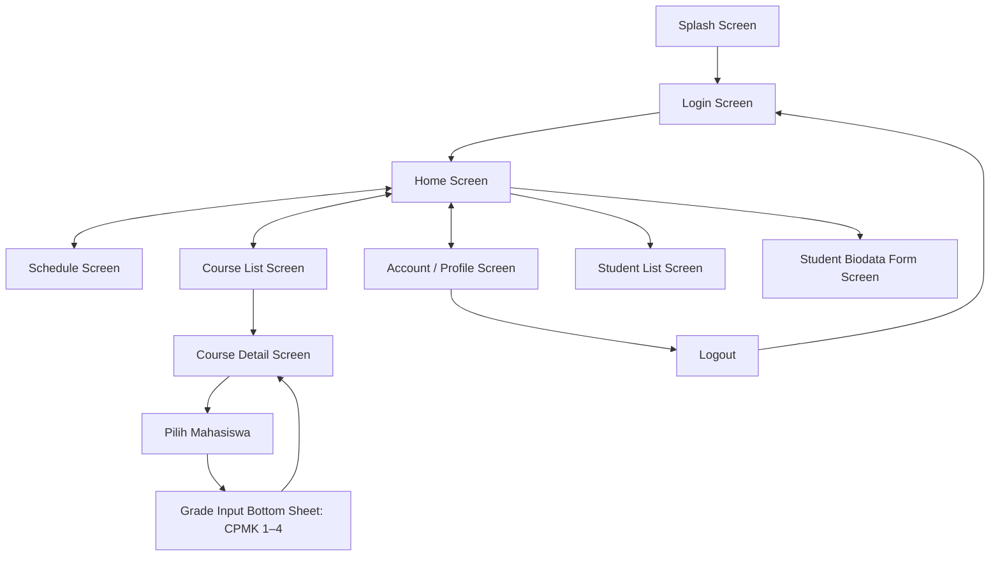
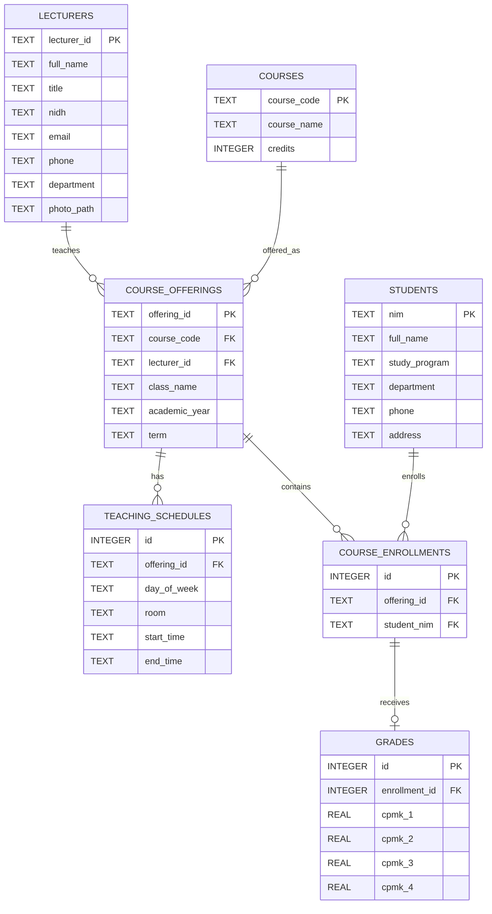

# AGENTS.md — PoDo (Portal Dosen)

Panduan ini berlaku untuk AI coding agent dan developer yang mengerjakan **PoDo**, aplikasi Portal Dosen berbasis Flutter. Dokumen rancangan UI/user flow dari tim design menjadi acuan visual awal, dengan keputusan pengembangan terbaru pada dokumen ini sebagai sumber kebenaran ketika ada perbedaan.

## 1. Tujuan dan ruang lingkup

Bangun aplikasi mobile **PoDo (Portal Dosen)** untuk membantu dosen mengakses informasi akademik, melihat jadwal mengajar, mengelola biodata mahasiswa, serta memasukkan nilai mahasiswa berdasarkan CPMK.

Persyaratan tugas:

- Minimal **7 screen fungsional**, tidak termasuk Splash Screen.
- Memiliki Splash Screen.
- Memiliki Login Screen dengan email/username dan password yang ditanam langsung dalam source code.
- Memiliki form biodata mahasiswa.
- Memiliki alur input nilai mata kuliah dan mahasiswa.
- Laporan progress project memuat nama project, anggota kelompok, deskripsi aplikasi, dan screenshot tahapan/screen yang benar-benar sudah dibuat.

Jangan menambah fitur yang tidak diperlukan sebelum seluruh alur utama selesai dan berfungsi.

## 2. Keputusan produk yang sudah ditetapkan

| Aspek | Keputusan |
|---|---|
| Nama aplikasi | **PoDo (Portal Dosen)** |
| Pengguna utama | Dosen |
| Framework | Flutter |
| Bahasa | Dart |
| UI component library | Forui |
| Database lokal | SQLite melalui `sqflite` |
| Login | Kredensial demo hardcoded di source code |
| Data dosen | Beberapa record dosen awal berasal dari hardcoded seed dan otomatis dimasukkan ke SQLite |
| Data mahasiswa | Beberapa mahasiswa awal berasal dari hardcoded seed; dosen tetap dapat menambah/mengubah data melalui aplikasi |
| Data mata kuliah | Beberapa mata kuliah awal berasal dari hardcoded seed; dosen dapat menambahkan mata kuliah/kelas baru dan menyimpannya ke SQLite |
| Profil | Menampilkan data dosen yang sedang login dan diambil dari database |
| Komponen penilaian | CPMK 1, CPMK 2, CPMK 3, CPMK 4 |
| Navigasi utama | Forui Bottom Navigation: **Home → Jadwal → Mata Kuliah → Akun** |
| State management awal | `setState` dan state Flutter bawaan |

Login hardcoded hanya untuk memenuhi tugas/demo, bukan autentikasi aman untuk produksi. Kredensial harus dipetakan ke `lecturer_id` agar halaman profil menampilkan data dosen yang tepat.

## 3. Screen dan user flow

### 3.1 Screen fungsional

Splash Screen tidak dihitung dalam persyaratan minimal 7 screen. Target implementasi saat ini adalah **8 screen fungsional + 1 Splash Screen**. Grade Input Bottom Sheet adalah komponen overlay, bukan screen/route mandiri.

| No. | Screen / UI | Fungsi |
|---|---|---|
| 1 | Splash Screen | Menampilkan logo dan branding PoDo, lalu menuju Login. Tidak dihitung sebagai screen fungsional. |
| 2 | Login Screen | Autentikasi dosen menggunakan email/username dan password hardcoded. |
| 3 | Home Screen | Dashboard, sapaan dosen, quick actions, dan informasi/pengumuman kampus. |
| 4 | Schedule Screen | Jadwal mengajar dosen dengan filter hari, mata kuliah, kelas, ruangan, dan jam. |
| 5 | Account/Profile Screen | Profil dosen aktif, ringkasan akademik, dan logout. |
| 6 | Student List Screen | Daftar seluruh mahasiswa atau mahasiswa bimbingan, pencarian nama/NIM. |
| 7 | Student Biodata Form Screen | Form tambah dan edit biodata mahasiswa. |
| 8 | Course List Screen | Daftar mata kuliah/kelas yang diampu dosen aktif. |
| 9 | Course Detail Screen | Detail mata kuliah/kelas dan daftar mahasiswa yang terdaftar. |
| - | Grade Input Bottom Sheet | Form CPMK 1–4 yang muncul ketika dosen memilih mahasiswa pada Course Detail. Bukan screen navigasi mandiri. |

### 3.2 Bottom navigation

Bottom navigation utama **WAJIB memiliki empat item dengan urutan berikut**:

1. **Home** — dashboard dan informasi kampus.
2. **Jadwal** — jadwal mengajar dosen.
3. **Mata Kuliah** — daftar mata kuliah/kelas dan akses pengelolaan nilai.
4. **Akun** — profil dosen aktif dan logout.

Gunakan komponen bottom navigation dari Forui. Jangan menambahkan Student atau Nilai sebagai tab utama kelima. Akses daftar mahasiswa dan input biodata dapat dilakukan dari Home, sedangkan input nilai dilakukan melalui Mata Kuliah.

### 3.3 User flow utama



Ketentuan alur:

- Splash mengarahkan pengguna ke Login.
- Login berhasil mengarahkan pengguna ke Home.
- Quick action **Isi Biodata Mahasiswa** mengarahkan ke Student Biodata Form.
- Quick action **Informasi Mahasiswa** mengarahkan ke Student List.
- Quick action **Input Nilai** mengarahkan ke Course List, bukan langsung ke form nilai.
- Dari Course List, dosen memilih mata kuliah/kelas untuk membuka Course Detail.
- Course Detail menampilkan mahasiswa yang terdaftar pada kelas tersebut, termasuk mahasiswa yang belum memiliki nilai.
- Ketika dosen memilih mahasiswa, tampilkan Grade Input Bottom Sheet untuk memasukkan atau memperbarui CPMK 1–4.
- Setelah nilai disimpan, tutup bottom sheet dan perbarui status nilai mahasiswa pada Course Detail.
- Logout mengakhiri sesi lokal dan mengembalikan pengguna ke Login.
- Jangan membuat Grade List atau Grade Form route terpisah kecuali diminta secara eksplisit.

## 4. Teknologi dan dependency

- **Flutter** sebagai framework dan **Dart** sebagai bahasa.
- **Forui (`forui`)** sebagai UI component library utama.
- **SQLite (`sqflite`)** sebagai database lokal.
- **`path`** untuk pengelolaan path file database.
- Gunakan state Flutter bawaan (`setState`) selama kebutuhan masih sederhana. Jangan menambahkan Riverpod, BLoC, Provider, atau package state management lain tanpa alasan teknis yang jelas.

Dependency awal:

```bash
flutter pub add forui sqflite path
```

Sebelum memasang atau memperbarui dependency:

1. Jalankan `flutter --version`.
2. Periksa `pubspec.yaml` dan `pubspec.lock`.
3. Pastikan versi package kompatibel dengan Flutter SDK proyek.
4. Gunakan dokumentasi/API sesuai versi Forui yang benar-benar terpasang. Jangan menebak API dari contoh versi lain.

Forui memiliki integrasi Lucide. Ikuti petunjuk resmi versi package proyek untuk import dan penggunaan icon. Jangan memasang `lucide_icons`, `font_awesome_flutter`, `iconsax`, atau icon library lain kecuali ada kebutuhan spesifik yang tidak dipenuhi Forui.

Referensi resmi:

- Getting started: <https://forui.dev/docs/getting-started>
- Widgets: <https://forui.dev/docs/widgets>
- Bottom navigation: <https://forui.dev/docs/widgets/navigation/bottom-navigation-bar>
- Icon library: <https://forui.dev/docs/reference/icon-library>
- Theming: <https://forui.dev/docs/concepts/themes>
- API reference: <https://pub.dev/documentation/forui/latest/>

Jangan menambahkan `flutter_animate`, `fl_chart`, atau package lain hanya untuk dekorasi. Tambahkan dependency khusus hanya jika fitur yang benar-benar diminta membutuhkannya.

## 5. Kebijakan wajib: Forui-first dan pemilihan komponen

AI coding agent **WAJIB memeriksa dan menggunakan komponen Forui yang sesuai sebelum membuat komponen UI sendiri**. Menyebut Forui sebagai dependency tetapi membangun seluruh UI interaktif dengan widget Flutter dasar atau Material bukan implementasi yang sesuai dengan keputusan proyek.

### 5.1 Prosedur sebelum implementasi UI

Untuk setiap screen atau perubahan UI:

1. Periksa versi `forui` yang terpasang melalui `pubspec.lock` atau `flutter pub deps`.
2. Buka dokumentasi resmi/API reference Forui yang sesuai dengan versi tersebut.
3. Inventarisasi elemen UI yang diperlukan.
4. Petakan setiap elemen ke komponen Forui berdasarkan **fungsi, konteks, dan perilaku interaksinya**, bukan sekadar kemiripan nama atau tampilan.
5. Verifikasi nama class, constructor, parameter, callback, state, dan contoh penggunaan sebelum coding.
6. Implementasikan komponen Forui yang paling tepat. Gunakan widget dasar Flutter untuk layout dan komposisi.

Jangan mulai membuat custom button, text field, card, dialog, select, atau navigation bar sebelum memastikan Forui tidak menyediakan komponen yang sesuai.

### 5.2 Panduan pemilihan komponen

Nama API di bawah adalah panduan awal. Selalu verifikasi ketersediaan dan API persisnya pada versi Forui proyek.

| Kebutuhan | Pilihan utama | Pertimbangan |
|---|---|---|
| Tombol aksi utama/sekunder/destruktif | `FButton` | Pilih varian dan ukuran berdasarkan hierarki aksi. |
| Input teks dalam form | `FTextFormField` | Gunakan untuk field yang berpartisipasi dalam validasi `Form`. |
| Input teks di luar form | `FTextField` | Gunakan ketika state input dikelola langsung. |
| Input password | Password variant dari text field/form field Forui | Pastikan obscuring, toggle visibility, dan validasi sesuai kebutuhan. |
| Memilih satu opsi | `FSelect` atau komponen pilihan Forui yang paling cocok | Pertimbangkan jumlah opsi, kebutuhan pencarian, dan kemudahan penggunaan di ponsel. |
| Memilih banyak opsi | Komponen multi-select Forui yang tersedia pada versi proyek | Jangan menggunakan single-select untuk pilihan jamak. |
| Pilihan independen | `FCheckbox` | Cocok untuk opsi yang dapat dicentang secara independen. |
| Status on/off | `FSwitch` | Gunakan untuk toggle, bukan untuk memilih satu item dari daftar. |
| Mengelompokkan informasi | `FCard` | Gunakan hanya jika konten memang membentuk satu kelompok informasi. |
| Label status singkat | `FBadge` | Untuk status seperti Sudah Dinilai/Belum Dinilai; hindari badge dekoratif berlebihan. |
| Konfirmasi atau keputusan singkat | `FDialog` / API dialog Forui | Cocok untuk konfirmasi logout atau tindakan penting. |
| Overlay kontekstual dari bawah | `showFSheet` atau API sheet Forui versi proyek | Cocok untuk form input CPMK dari Course Detail. |
| Navigasi utama bawah | `FBottomNavigationBar` dan item terkait | Wajib untuk Home → Jadwal → Mata Kuliah → Akun. |
| Header halaman | `FHeader` atau komponen header Forui yang sesuai | Jaga konsistensi antarhalaman. |
| Loading/progress | Komponen progress/feedback Forui yang tersedia | Bedakan loading tak tentu dan progress bernilai. |

Contoh mapping khusus PoDo:

| Elemen | Komponen yang dipilih | Alasan |
|---|---|---|
| Tombol Simpan | `FButton` | Aksi utama form. |
| Field Nama/NIM | `FTextFormField` | Input teks dengan validasi. |
| Pilihan Program Studi/Kelas/Mata Kuliah | `FSelect` atau komponen pilihan yang sesuai | Pengguna memilih satu opsi dari daftar. |
| Status nilai | `FBadge` | Status singkat yang mudah dipindai. |
| Form CPMK 1–4 | `FTextFormField` dengan input/keyboard numerik sesuai API | Nilai angka memerlukan validasi. |
| Modal input nilai | `showFSheet` atau sheet Forui yang tersedia | Form kontekstual dari bawah tanpa route baru. |
| Navigasi utama | `FBottomNavigationBar` | Navigasi empat area utama PoDo. |

Mapping harus disesuaikan dengan kebutuhan layar aktual. Jangan menyalin tabel secara membabi buta.

### 5.3 Aturan memilih komponen yang tepat

Sebelum memilih komponen, pertimbangkan:

- **Tujuan interaksi:** memasukkan teks, memilih satu opsi, memilih beberapa opsi, mengaktifkan status, menjalankan aksi, atau mengonfirmasi keputusan.
- **Konteks:** form, daftar, detail, navigasi utama, atau overlay.
- **Jumlah/karakter data:** jumlah opsi, kebutuhan pencarian, serta apakah pilihan perlu terlihat sekaligus.
- **Pengalaman mobile:** mudah dijangkau, tidak menutupi konteks penting, dan nyaman saat keyboard terbuka.
- **State dan feedback:** selected, disabled, loading, validation error, dan feedback sukses.
- **Konsistensi:** gunakan theme, variant, ukuran, radius, dan token Forui yang konsisten dengan PoDo.

Jangan memilih komponen hanya karena namanya tampak cocok atau kodenya paling mudah disalin. Jangan menggunakan satu tipe komponen untuk seluruh interaksi.

### 5.4 Widget dasar dan custom widget

- Widget dasar Flutter seperti `Padding`, `SizedBox`, `Row`, `Column`, `Stack`, `Expanded`, `Flexible`, `ListView`, `CustomScrollView`, `Text`, dan `Image` boleh digunakan untuk layout, scrolling, dan konten dasar.
- Untuk elemen interaktif/visual yang sudah memiliki padanan Forui, prioritaskan komponen Forui.
- Custom widget diperbolehkan untuk komposisi khusus PoDo, misalnya ringkasan statistik dosen atau item jadwal. Bagian interaktif di dalamnya tetap menggunakan komponen Forui jika padanannya tersedia.
- Jangan membangun ulang komponen Forui hanya untuk mengubah warna, radius, padding, atau ukuran. Gunakan theme, style, atau extension point resmi.
- Jangan menggunakan Material, Cupertino, atau UI kit lain sebagai jalan pintas untuk menggantikan komponen Forui.
- `GestureDetector`, `InkWell`, atau `Container` bukan pengganti otomatis untuk button, selectable item, atau komponen interaktif Forui.
- Jika Forui tidak menyediakan komponen yang sesuai, custom widget boleh dibuat. Sebutkan komponen Forui yang sudah diperiksa dan alasan ketidakcocokannya.

### 5.5 Component mapping dan audit wajib

Sebelum mengimplementasikan screen, buat mapping singkat dalam rencana kerja atau ringkasan implementasi: elemen UI, komponen Forui yang dipilih, dan alasan pemilihannya.

Setelah implementasi:

1. Audit setiap tombol, field, select, card, overlay, dan navigasi.
2. Ganti custom widget yang menduplikasi komponen Forui dengan komponen Forui, kecuali ada alasan teknis yang terdokumentasi.
3. Periksa bahwa komponen sesuai dengan perilaku interaksinya, bukan sekadar tampilannya.
4. Pastikan tidak ada widget Material/Cupertino yang menggantikan komponen UI Forui.
5. Jalankan `flutter analyze`.
6. Dalam ringkasan hasil kerja, sebutkan komponen Forui utama yang digunakan dan pengecualian custom widget beserta alasannya.

**Larangan:** Jangan menyelesaikan screen dengan mayoritas komponen interaktif buatan sendiri atau widget Material sambil hanya menggunakan Forui pada satu-dua bagian sebagai formalitas.

## 6. Theming dan visual design

- Gunakan Forui sebagai design system utama.
- Pusatkan konfigurasi theme/token aplikasi di `core/theme/`.
- Gunakan `FTheme` dan token theme Forui sesuai API versi yang terpasang.
- Jangan hardcode warna, spacing, radius, atau typography berulang pada setiap screen.
- Ikuti rancangan visual tim design. Jika detail belum ditentukan, pilih default sederhana dan konsisten, lalu dokumentasikan asumsi.
- Gunakan Lucide icons dari integrasi Forui.
- Pastikan layout responsif untuk ukuran layar Android berbeda, form dapat di-scroll, dan keyboard tidak menutupi field maupun tombol submit.
- Sediakan loading, empty state, validation/error state, dan feedback sukses bila relevan.
- Hindari dekorasi yang tidak membantu hierarki atau pemahaman informasi.

## 7. Arsitektur dan struktur folder

Gunakan **feature-based architecture**. Folder `screens`, `repositories`, dan `models` ditempatkan langsung di dalam feature masing-masing. `models` dipisahkan dari `repositories` karena tanggung jawab keduanya berbeda.

Struktur yang disarankan:

```text
lib/
├── main.dart
├── app/
│   ├── app.dart
│   └── routes.dart
├── core/
│   ├── database/
│   │   ├── database_helper.dart
│   │   └── seed/
│   │       ├── seed_data.dart
│   │       ├── seed_lecturers.dart
│   │       ├── seed_students.dart
│   │       ├── seed_courses.dart
│   │       ├── seed_offerings.dart
│   │       ├── seed_enrollments.dart
│   │       └── seed_schedules.dart
│   ├── theme/
│   │   ├── app_theme.dart
│   │   ├── app_colors.dart
│   │   ├── app_spacing.dart
│   │   └── app_radius.dart
│   ├── utils/
│   │   ├── validators.dart
│   │   └── formatters.dart
│   └── widgets/
│       └── shared reusable widgets
└── features/
    ├── splash/
    │   └── screens/
    │       └── splash_screen.dart
    ├── auth/
    │   ├── repositories/
    │   │   └── auth_repository.dart
    │   └── screens/
    │       └── login_screen.dart
    ├── dashboard/
    │   └── screens/
    │       └── home_screen.dart
    ├── schedule/
    │   ├── models/
    │   │   └── teaching_schedule.dart
    │   ├── repositories/
    │   │   └── schedule_repository.dart
    │   └── screens/
    │       └── schedule_screen.dart
    ├── lecturers/
    │   ├── models/
    │   │   └── lecturer.dart
    │   ├── repositories/
    │   │   └── lecturer_repository.dart
    │   └── screens/
    │       └── account_screen.dart
    ├── students/
    │   ├── models/
    │   │   └── student.dart
    │   ├── repositories/
    │   │   └── student_repository.dart
    │   └── screens/
    │       ├── student_list_screen.dart
    │       └── student_biodata_form_screen.dart
    ├── courses/
    │   ├── models/
    │   │   ├── course.dart
    │   │   └── course_offering.dart
    │   ├── repositories/
    │   │   └── course_repository.dart
    │   └── screens/
    │       ├── course_list_screen.dart
    │       └── course_detail_screen.dart
    └── grades/
        ├── models/
        │   └── grade.dart
        ├── repositories/
        │   ├── grade_repository.dart
        │   └── enrollment_repository.dart
        └── widgets/
            └── grade_input_bottom_sheet.dart
```

Ketentuan struktur:

- `screens/`: halaman UI milik feature.
- `models/`: model data dan serialisasi/deserialisasi.
- `repositories/`: akses dan manipulasi data.
- `core/`: kode yang dipakai lintas feature.
- `app/`: konfigurasi root aplikasi dan routing.
- Jangan membuat `domain/`, `usecases/`, atau lapisan abstraksi lain sebelum ada kebutuhan nyata.
- Widget yang hanya digunakan satu feature dapat berada pada folder `widgets/` feature tersebut. Pindahkan ke `core/widgets/` hanya jika digunakan lintas feature.
- Course List dan Course Detail berada di feature `courses`.
- Grade Input Bottom Sheet berada di `grades/widgets/`, bukan route atau tab navigasi tersendiri.

## 8. Autentikasi dan identitas dosen

- Login harus memakai kredensial email/username dan password hardcoded sesuai persyaratan tugas.
- Letakkan kredensial demo di satu konfigurasi atau `AuthRepository`, bukan di widget Login.
- Jangan menyimpan password ke SQLite dan jangan membuat tabel akun untuk mengganti mekanisme hardcoded yang diminta.
- Data beberapa dosen disimpan di tabel `lecturers`. Data awal dosen berasal dari hardcoded seed yang otomatis dimasukkan ke SQLite saat inisialisasi database.
- Setiap pasangan kredensial demo harus dipetakan ke `lecturer_id` yang valid.
- Setelah login, simpan hanya identitas dosen aktif yang diperlukan untuk sesi lokal.
- Account/Profile Screen mengambil data dosen aktif dari `LecturerRepository` berdasarkan `lecturer_id`, bukan menggunakan biodata mahasiswa atau profil statis yang ditulis langsung di screen.
- Logout menghapus state sesi lokal dan mengarahkan pengguna ke Login.
- Jangan mengarang identitas/kredensial final. Gunakan data demo yang jelas ditandai dan mudah diganti, atau data yang diberikan pemilik proyek.

## 9. Database dan model data

Gunakan SQLite melalui `sqflite`. Screen tidak boleh menjalankan query SQLite langsung. Semua akses data melalui repository yang menggunakan `DatabaseHelper` dari `core/database/`.

### 9.1 `lecturers`

Menyimpan beberapa data dosen.

- `lecturer_id` — TEXT, primary key.
- `full_name` — TEXT, wajib.
- `title` — TEXT, gelar akademik jika ada.
- `nidh` — TEXT, nomor induk dosen sesuai data yang tersedia.
- `email` — TEXT.
- `phone` — TEXT.
- `department` — TEXT.
- `photo_path` — TEXT, opsional.

### 9.2 `students`

Mengikuti field form biodata pada rancangan tim.

- `nim` — TEXT, primary key.
- `full_name` — TEXT, wajib.
- `study_program` — TEXT.
- `department` — TEXT.
- `phone` — TEXT.
- `address` — TEXT.

### 9.3 `courses`

Master data mata kuliah.

- `course_code` — TEXT, primary key.
- `course_name` — TEXT, wajib.
- `credits` — INTEGER.

### 9.4 `course_offerings`

Merepresentasikan mata kuliah yang dibuka untuk dosen, kelas, dan periode akademik tertentu.

- `offering_id` — TEXT atau INTEGER, primary key.
- `course_code` — TEXT, foreign key ke `courses.course_code`.
- `lecturer_id` — TEXT, foreign key ke `lecturers.lecturer_id`.
- `class_name` — TEXT.
- `academic_year` — TEXT.
- `term` — TEXT.

Course List menampilkan offering milik dosen aktif, bukan seluruh master mata kuliah tanpa konteks pengampu.

### 9.5 `teaching_schedules`

Menyimpan jadwal untuk offering tertentu.

- `id` — INTEGER, primary key autoincrement.
- `offering_id` — foreign key ke `course_offerings.offering_id`.
- `day_of_week` — INTEGER atau TEXT dengan format konsisten.
- `room` — TEXT.
- `start_time` — TEXT.
- `end_time` — TEXT.

Jadwal difilter berdasarkan dosen aktif dan hari yang dipilih, lalu diurutkan berdasarkan waktu mulai.

### 9.6 `course_enrollments`

Menghubungkan mahasiswa dengan offering/kelas. Tabel ini menjadi sumber daftar mahasiswa pada Course Detail, termasuk mahasiswa yang belum memiliki nilai.

- `id` — INTEGER, primary key autoincrement.
- `offering_id` — foreign key ke `course_offerings.offering_id`.
- `student_nim` — TEXT, foreign key ke `students.nim`.
- Unique constraint pada kombinasi `offering_id` dan `student_nim`.

### 9.7 `grades`

Simpan empat komponen penilaian: **CPMK 1, CPMK 2, CPMK 3, CPMK 4**. Jangan menggunakan UTS, UAS, kehadiran, atau tugas sebagai pengganti CPMK.

- `id` — INTEGER, primary key autoincrement.
- `enrollment_id` — INTEGER, foreign key ke `course_enrollments.id` dan unique agar satu enrollment memiliki satu record nilai yang dapat diperbarui.
- `cpmk_1` — REAL.
- `cpmk_2` — REAL.
- `cpmk_3` — REAL.
- `cpmk_4` — REAL.

Nilai setiap CPMK divalidasi dalam rentang 0–100, kecuali pemilik proyek menentukan skala lain. Nilai tersimpan untuk mahasiswa pada offering tertentu. Dosen penginput dapat diketahui melalui offering terkait.

### 9.8 ERD



Aturan database:

- Aktifkan foreign key SQLite dengan `PRAGMA foreign_keys = ON`.
- Gunakan unique constraint `offering_id + student_nim` pada `course_enrollments`.
- Gunakan unique constraint pada `grades.enrollment_id`.
- Tambahkan index untuk pencarian/filter yang sering digunakan, misalnya NIM, nama mahasiswa, `lecturer_id`, `course_code`, dan `offering_id` bila diperlukan.
- Gunakan transaksi untuk operasi yang memerlukan beberapa query terkait.
- Kelola perubahan skema menggunakan `version` dan `onUpgrade` pada `openDatabase`.
- Jangan menghapus atau membuat ulang database setiap aplikasi dibuka.
- Hardcoded seed adalah **data awal yang ditulis sebagai konstanta/map/list Dart di source code**, bukan sumber data yang dibaca langsung oleh screen.
- Saat database baru dibuat, buat seluruh tabel terlebih dahulu, lalu jalankan seed secara otomatis dalam transaksi dan urutan yang memenuhi foreign key: `lecturers`, `students`, `courses`, `course_offerings`, `course_enrollments`, lalu `teaching_schedules`. Seed `grades` boleh kosong pada instalasi awal.
- Setelah seed berhasil dimasukkan, seluruh screen wajib membaca data dari SQLite melalui repository. Jangan menggunakan list seed secara langsung untuk mengisi UI, dropdown, daftar mata kuliah, daftar mahasiswa, atau profil.
- Data yang ditambahkan atau diubah oleh dosen melalui form harus disimpan ke tabel SQLite melalui repository. Data tersebut harus tetap tersedia setelah aplikasi ditutup dan dibuka kembali.
- Seeder harus idempotent. Gunakan primary key/unique key yang stabil dan strategi insert-if-absent, misalnya `ConflictAlgorithm.ignore` atau `INSERT OR IGNORE`. Jangan menggunakan `ConflictAlgorithm.replace` untuk seed karena dapat menghapus/menimpa data yang sudah diedit pengguna.
- Jangan menjalankan ulang seed dengan operasi yang menimpa data pengguna. Bila ada seed baru pada versi aplikasi berikutnya, gunakan seed version/metadata atau mekanisme migrasi additive yang hanya memasukkan record yang belum ada.
- Bedakan **database schema version** dengan **seed data version**. Perubahan struktur tabel ditangani oleh `onUpgrade`; penambahan record demo dapat ditangani oleh seed version. Gunakan tabel metadata internal seperti `seed_metadata` (`key`, `value`) untuk mencatat versi seed yang sudah diterapkan. Tabel metadata ini tidak perlu ditampilkan ke pengguna atau dimasukkan ke ERD domain. Jangan menaikkan schema version hanya untuk menambah satu record seed jika struktur tabel tidak berubah.
- Jika database sudah ada, jangan mengasumsikan callback `onCreate` akan berjalan lagi. Gunakan mekanisme seed version yang eksplisit untuk penambahan seed berikutnya. Dokumentasi `sqflite` menjelaskan bahwa `onCreate` berjalan ketika database belum ada, sedangkan `onUpgrade` berjalan ketika database yang ada dibuka dengan schema version lebih tinggi.
- Semua operasi pembuatan data yang membutuhkan beberapa insert terkait harus memakai transaksi. Contohnya membuat master course baru dan course offering-nya, atau menambahkan mahasiswa ke offering melalui `course_enrollments`.
- Data seed harus diberi identitas tetap dan ditandai sebagai data demo di dokumentasi. Jangan mengarang atau menggunakan data pribadi nyata tanpa izin.
- Pengumuman Home boleh menggunakan data demo statis terlebih dahulu karena hanya bersifat konten informasi. Jangan membuat backend atau tabel pengumuman kecuali diminta.

### 9.9 Mekanisme hardcoded seed dan sinkronisasi SQLite

PoDo menggunakan pola **Hardcoded Seed Data → SQLite → Repository → UI**. Hardcoded hanya berlaku untuk data demo awal yang disiapkan developer. Setelah proses seed, SQLite menjadi satu-satunya sumber data operasional aplikasi.

#### Lokasi dan isi seed

Simpan data awal sebagai konstanta Dart di `core/database/seed/`, dipisahkan berdasarkan entitas:

- `seed_lecturers.dart`: beberapa record dosen demo.
- `seed_students.dart`: beberapa record mahasiswa demo.
- `seed_courses.dart`: beberapa master mata kuliah demo.
- `seed_offerings.dart`: kelas/offering awal yang menghubungkan mata kuliah dengan dosen.
- `seed_enrollments.dart`: mahasiswa demo yang terdaftar pada offering tertentu.
- `seed_schedules.dart`: jadwal mengajar demo.
- `seed_data.dart`: orchestrator yang menjalankan seed dalam urutan yang benar.

Gunakan ID/kode yang stabil agar seed dapat dikenali pada setiap instalasi. Data seed harus jelas merupakan data demo dan mudah diganti.

#### Siklus inisialisasi

1. Aplikasi membuka database melalui `DatabaseHelper`.
2. Jika database belum ada, buat tabel dan constraint.
3. Jalankan seed awal secara otomatis dalam satu transaksi setelah tabel siap.
4. Masukkan data sesuai urutan foreign key: dosen dan mahasiswa, master mata kuliah, offering, enrollment, lalu jadwal.
5. Catat versi seed yang sudah diterapkan.
6. Repository membaca data dari SQLite untuk seluruh screen.

Saat database sudah ada, aplikasi tidak membuat ulang database dan tidak menimpa isi tabel dengan konstanta seed. Untuk menambah seed demo pada update aplikasi, tambahkan seed version baru dan jalankan hanya insert additive untuk record yang belum ada. Jangan mengubah record yang mungkin sudah diedit atau dihapus pengguna. Jika memang harus mengubah data demo yang sudah ada, buat aturan migrasi data yang eksplisit dan aman, bukan overwrite umum.

Contoh konsep implementasi (sesuaikan API `sqflite` versi proyek):

```dart
Future<void> seedInitialData(Database db) async {
  await db.transaction((txn) async {
    final batch = txn.batch();

    for (final lecturer in seedLecturers) {
      batch.insert(
        'lecturers',
        lecturer,
        conflictAlgorithm: ConflictAlgorithm.ignore,
      );
    }

    // Lanjutkan students, courses, offerings, enrollments, dan schedules
    // sesuai urutan foreign key.

    await batch.commit(noResult: true);
  });
}
```

Contoh di atas hanya menunjukkan pola dasar. Pastikan orchestrator memasukkan seluruh entitas seed dalam urutan foreign key dan mencatat seed version dalam transaksi yang sama. Jangan menelan error seed secara diam-diam; kegagalan inisialisasi harus dapat didiagnosis.

#### Sumber data saat runtime

- **Benar:** Screen → Repository → SQLite.
- **Benar:** Form tambah/edit → Repository → SQLite → refresh query/list.
- **Tidak boleh:** Screen membaca `seedStudents`, `seedCourses`, atau konstanta seed lain secara langsung sebagai data aplikasi.
- **Tidak boleh:** Menambahkan data baru hanya ke list in-memory tanpa menyimpannya di SQLite.

#### Penambahan mata kuliah

- Master `courses` dapat berisi beberapa record awal dari seed.
- Course List menyediakan aksi **Tambah Mata Kuliah/Kelas**.
- Dosen dapat memilih master mata kuliah yang sudah ada, lalu membuat `course_offerings` dengan kelas, tahun akademik, dan semester untuk dosen aktif.
- Dosen juga dapat membuat master mata kuliah baru dengan mengisi kode, nama, dan SKS, lalu membuat offering-nya. Simpan master course dan offering dalam satu transaksi agar tidak ada master tanpa offering akibat proses gagal di tengah jalan.
- Jika kode mata kuliah sudah ada, jangan membuat duplikat; arahkan pengguna memilih master course yang tersedia atau tampilkan validasi.
- Data master dan offering baru harus tersimpan di SQLite dan langsung muncul melalui `CourseRepository`.

#### Penambahan mahasiswa

- Tabel `students` dapat diisi beberapa mahasiswa demo melalui seed.
- Dosen dapat menambahkan mahasiswa baru melalui Student Biodata Form; data disimpan melalui `StudentRepository` ke SQLite.
- Dari Course Detail, sediakan aksi **Tambah Mahasiswa** untuk memilih satu atau beberapa mahasiswa yang sudah ada di tabel `students` tetapi belum terdaftar pada offering tersebut.
- Simpan relasi melalui `course_enrollments` dan refresh daftar mahasiswa Course Detail. Gunakan unique constraint `offering_id + student_nim` untuk mencegah pendaftaran ganda.
- Menambahkan mahasiswa ke offering tidak otomatis membuat record nilai. Record `grades` dibuat saat dosen pertama kali menyimpan nilai CPMK, atau diperbarui jika sudah ada.

### 9.9 Nilai akhir dan huruf mutu

Bobot CPMK dan rentang konversi nilai huruf belum ditentukan.

- Jangan mengarang bobot CPMK 1–4.
- Jangan mengarang batas A/B/C dan seterusnya.
- Jangan menghitung atau menampilkan nilai akhir/huruf mutu seolah-olah resmi sebelum aturan ditentukan.
- Untuk sementara, tampilkan nilai CPMK yang tersimpan atau placeholder yang jelas.
- Buat perhitungan nilai akhir sebagai fungsi terpisah setelah aturan resmi diberikan.

## 10. Perilaku screen

### Splash Screen

- Menampilkan branding **PoDo / Portal Dosen** dan identitas institusi jika tersedia.
- Lanjut ke Login setelah durasi singkat.
- Tidak dihitung sebagai screen fungsional.

### Login Screen

- Field email/username dan password.
- Validasi input dan feedback kredensial salah.
- Kredensial diverifikasi melalui `AuthRepository`.
- Login berhasil menentukan dosen aktif dan membuka Home.

### Home Screen

- Menampilkan foto dan sapaan dosen yang sedang login.
- Quick actions: Isi Biodata Mahasiswa, Input Nilai, dan Informasi Mahasiswa.
- Input Nilai membuka Course List.
- Menampilkan pengumuman/informasi kampus dengan thumbnail jika aset tersedia. Data demo statis diperbolehkan.
- Navigasi utama Forui berurutan Home, Jadwal, Mata Kuliah, Akun.

### Schedule Screen

- Menampilkan filter hari.
- Menampilkan mata kuliah, kelas, ruangan, dan jam mengajar.
- Mengambil data jadwal berdasarkan dosen aktif melalui repository.
- Urutkan jadwal berdasarkan waktu mulai.

### Account/Profile Screen

- Mengambil data dosen aktif dari `LecturerRepository` berdasarkan `lecturer_id` sesi.
- Menampilkan foto, nama/gelar, NIDH, jumlah mahasiswa bimbingan, jumlah kelas/jadwal mengajar, dan total SKS jika data tersedia.
- Statistik dihitung dari data terkait atau ditandai sebagai data demo. Jangan menampilkan angka acak seolah data nyata.
- Menyediakan tombol Keluar.

### Student List Screen

- Menampilkan daftar mahasiswa dari database.
- Menyediakan pencarian berdasarkan nama atau NIM.
- Menampilkan nama, NIM, dan informasi nilai bila tersedia.
- Menampilkan empty state yang jelas jika belum ada data.

### Student Biodata Form Screen

- Field: Nama Lengkap, NIM, Program Studi, Jurusan, Nomor Telepon, dan Alamat Lengkap.
- Mendukung tambah data dan pembaruan data bila mahasiswa yang dipilih sudah ada.
- NIM wajib divalidasi dan tidak boleh duplikat saat membuat record baru.
- Simpan/perbarui melalui `StudentRepository`; data harus masuk SQLite dan tetap ada setelah aplikasi dibuka kembali.

### Course List Screen

- Menampilkan mata kuliah/kelas yang diampu dosen aktif dari `course_offerings`, yang terkait dengan master data `courses`.
- Menampilkan nama dan kode mata kuliah, kelas, SKS, periode akademik, serta jumlah mahasiswa jika tersedia.
- Menyediakan aksi **Tambah Mata Kuliah/Kelas**: dosen dapat memilih master course yang sudah ada atau membuat master course baru, lalu membuat offering untuk dosen aktif.
- Simpan master course baru dan offering terkait melalui `CourseRepository` dalam transaksi SQLite.
- Validasi kode mata kuliah agar tidak duplikat.
- Ketika offering dipilih, buka Course Detail Screen.
- Quick action Input Nilai dari Home juga membuka screen ini.

### Course Detail Screen

- Menampilkan informasi offering: mata kuliah, kelas, dosen, periode akademik, jadwal/ruangan, dan jumlah mahasiswa jika tersedia.
- Menampilkan daftar mahasiswa dari `course_enrollments`, bukan dari tabel `grades`, sehingga mahasiswa yang belum dinilai tetap muncul.
- Menampilkan nama, NIM, dan status nilai (Sudah Dinilai/Belum Dinilai).
- Sediakan pencarian nama/NIM jika daftar cukup panjang.
- Sediakan aksi **Tambah Mahasiswa** untuk memilih satu atau beberapa mahasiswa yang sudah ada di tabel `students` tetapi belum terdaftar pada offering tersebut.
- Simpan penambahan melalui `EnrollmentRepository` ke `course_enrollments`; cegah duplikasi dan refresh daftar setelah berhasil.
- Menambahkan mahasiswa tidak otomatis membuat record nilai.
- Ketika mahasiswa dipilih, buka Grade Input Bottom Sheet.

### Grade Input Bottom Sheet

- Merupakan modal bottom sheet, bukan route atau tab navigasi.
- Menampilkan identitas mahasiswa dan mata kuliah/kelas sebagai konteks.
- Menyediakan empat field: CPMK 1, CPMK 2, CPMK 3, dan CPMK 4.
- Jika nilai sudah tersimpan, isi field dengan data tersebut agar dosen dapat memperbaruinya.
- Validasi setiap nilai dan simpan/perbarui melalui `GradeRepository` berdasarkan `enrollment_id`.
- Setelah berhasil, tutup bottom sheet dan refresh status nilai pada Course Detail.
- Jangan menampilkan field UTS, UAS, kehadiran, atau tugas.

## 11. Form, validasi, dan penanganan error

- Gunakan `Form` dan `GlobalKey<FormState>` atau pendekatan validasi Flutter yang sesuai, dengan field UI Forui.
- Validasi field wajib, email (jika ada), NIM, nomor telepon, dan rentang nilai CPMK.
- Berikan pesan error spesifik dan dekat dengan field terkait.
- Pastikan `TextEditingController` dan `FocusNode` di-dispose dengan benar.
- Tampilkan loading atau cegah submit berulang saat operasi penyimpanan berlangsung.
- Setelah penyimpanan berhasil, tampilkan feedback dan refresh data terkait.
- Tangani error database dengan pesan yang dapat dipahami pengguna; jangan tampilkan stack trace kepada pengguna.

## 12. Kualitas kode

- Ikuti Dart style guide: file `snake_case.dart`, class `PascalCase`, variable/function `camelCase`.
- Utamakan widget kecil dengan satu tanggung jawab.
- Gunakan `const` constructor bila memungkinkan.
- Hindari duplikasi validasi, formatting, dan komponen UI.
- Hindari `dynamic` jika tipe data yang jelas tersedia.
- Tangani error repository/database dengan baik.
- Jangan menambahkan dependency untuk fungsi sederhana yang sudah tersedia di Flutter atau Forui.
- Jangan mengubah dependency, struktur folder, atau API package secara besar-besaran tanpa alasan yang jelas.

## 13. Pengujian dan pemeriksaan

Setelah perubahan kode, jalankan perintah yang relevan:

```bash
dart format .
flutter analyze
flutter test
```

Tambahkan pengujian untuk:

- `AuthRepository`: kredensial valid/tidak valid dan pemetaan dosen aktif.
- `LecturerRepository`: mengambil profil dosen yang sesuai.
- `StudentRepository`: tambah, ubah, pencarian, dan validasi NIM.
- `CourseRepository`: daftar offering dosen aktif, detail offering, tambah master course, dan buat offering.
- Seed initialization: seed hanya masuk sekali/per seed version, relasi foreign key valid, seed tidak menggandakan atau menimpa data yang sudah diubah pengguna.
- `EnrollmentRepository`: daftar mahasiswa per offering, tambah mahasiswa ke offering, cegah enrollment ganda, termasuk mahasiswa yang belum memiliki nilai.
- `GradeRepository`: penyimpanan/pembaruan CPMK 1–4 berdasarkan enrollment.
- `ScheduleRepository`: filter hari dan dosen aktif.
- Navigasi utama dan logout jika memungkinkan.

Jangan menyatakan implementasi selesai jika `flutter analyze` memiliki error yang diperkenalkan oleh perubahan tersebut.

## 14. Progress report dan screenshot

Ketika diminta membuat laporan progress:

- Nama project: **PoDo (Portal Dosen)**.
- Sediakan bagian anggota kelompok; jangan mengarang nama anggota yang belum diberikan.
- Jelaskan tujuan aplikasi sebagai portal akademik untuk dosen.
- Dokumentasikan tahapan implementasi dan status setiap screen.
- Sertakan screenshot aktual dari aplikasi yang dijalankan, bukan mockup atau ilustrasi yang seolah-olah merupakan hasil aplikasi.
- Gunakan nama screenshot yang mudah dikenali, misalnya `01-splash.png`, `02-login.png`, `03-home.png`, `04-schedule.png`, `05-course-list.png`, `06-course-detail.png`, `07-grade-input-sheet.png`, `08-account.png`, `09-student-list.png`, dan `10-student-biodata-form.png`.
- Bottom sheet dapat didokumentasikan sebagai screenshot interaksi, bukan screen navigasi mandiri.
- Jangan mengklaim fitur selesai apabila belum diimplementasikan atau diuji.

## 15. Cara bekerja sebagai coding agent

1. Periksa struktur proyek dan file yang sudah ada sebelum mengubah apa pun.
2. Baca `pubspec.yaml`, versi Flutter, dan dependency sebelum menambahkan package.
3. Baca rancangan UI/user flow tim ketika mengerjakan tampilan/navigasi; ikuti keputusan terbaru pada dokumen ini jika flow sudah diperbarui.
4. Pertahankan perubahan pengguna; jangan menimpa atau menghapus file tanpa alasan.
5. Implementasikan fitur bertahap dan pastikan proyek tetap dapat dijalankan.
6. Ikuti dokumentasi resmi Forui untuk setup theme, komponen, bottom navigation, sheet, dan icon yang sesuai dengan versi dependency proyek.
7. Jangan mengarang detail bisnis yang belum ditentukan. Dokumentasikan asumsi dan hindari hasil hitung yang tidak memiliki aturan.
8. Sebelum coding UI, lakukan component mapping sesuai Bagian 5. Setelah coding, lakukan Forui component audit.
9. Setelah implementasi, berikan ringkasan file yang diubah, fitur selesai, command pengujian, hasil pengujian, dan masalah yang tersisa.

---

**Prinsip utama:** PoDo harus konsisten dengan rancangan tim dan flow terbaru: Home → Mata Kuliah → Detail Mata Kuliah → pilih mahasiswa → Grade Input Bottom Sheet (CPMK 1–4). Navigasi utama Forui berurutan Home → Jadwal → Mata Kuliah → Akun. Aplikasi berfokus pada kebutuhan dosen, menggunakan Forui sebagai UI component library, dan mengelola data akademik secara lokal dengan SQLite. Jaga implementasi tetap sederhana dan jangan menambahkan kompleksitas atau dependency tanpa manfaat nyata.

## Referensi teknis database

- `sqflite` memanggil `onCreate` ketika database belum ada; `onUpgrade` digunakan ketika schema version database yang sudah ada dinaikkan. Jangan mengandalkan `onCreate` untuk memasukkan seed baru ke database pengguna yang sudah terbentuk. Lihat <https://pub.dev/documentation/sqflite/latest/sqflite/openDatabase.html>.
- `ConflictAlgorithm.ignore` melewati insert yang melanggar constraint tanpa mengubah row yang sudah ada. Ini lebih aman untuk seed additive daripada `replace`. Lihat <https://pub.dev/documentation/sqflite/latest/sqflite/ConflictAlgorithm.html>.
- Panduan SQLite Flutter: <https://docs.flutter.dev/cookbook/persistence/sqlite>.
