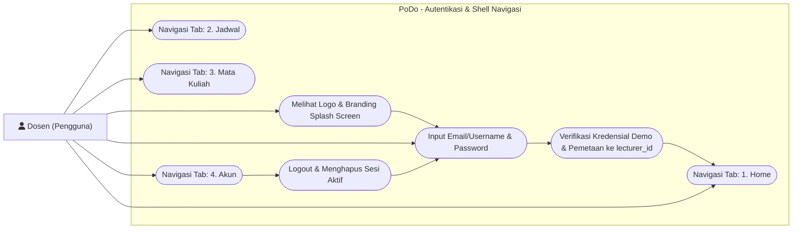
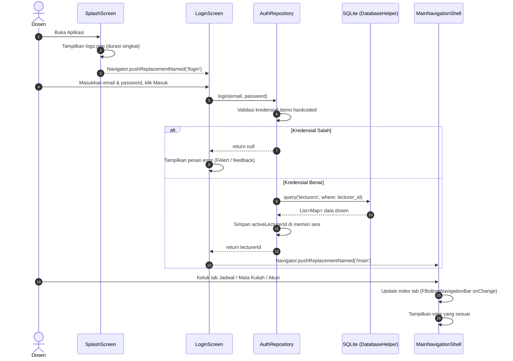

# Auth & Main Navigation Shell Implementation Plan

> **For agentic workers:** REQUIRED SUB-SKILL: Use superpowers:subagent-driven-development (recommended) or superpowers:executing-plans to implement this plan task-by-task. Steps use checkbox (`- [ ]`) syntax for tracking.

**Goal:** Membangun alur autentikasi dosen (Splash Screen & Login Screen dengan kredensial hardcoded yang dipetakan ke `lecturer_id`), sesi aktif dosen, serta shell navigasi utama dengan Forui Bottom Navigation Bar (**Home → Jadwal → Mata Kuliah → Akun**).

**Architecture:** Feature-based architecture (`features/splash`, `features/auth`, `features/dashboard`, `features/schedule`, `features/courses`, `features/lecturers`). Root routing dan shell navigasi utama dikelola di `lib/app/` (`routes.dart` & `main_screen.dart`) sesuai struktur folder AGENTS.md. State sesi aktif disimpan di memori via singleton `AuthRepository`.

**Tech Stack:** Flutter, Dart, Forui (`forui`, `forui/assets.dart`), SQLite (`sqflite`).

**Spec / Rules:** `AGENTS.md` (Bagian 2, 3, 5, 7, 8, 10).

---

## 1. Use Case Diagram

Diagram Use Case untuk alur startup, autentikasi, dan navigasi tab utama:



---

## 2. Sequence Diagram

Alur interaksi mulai dari Splash Screen, Login, hingga Shell Navigasi Utama:



---

## 3. Widget & Component Decision Matrix

Pemetaan elemen UI sesuai kebijakan *Forui-first* (AGENTS.md Bagian 5):

| Elemen UI | Sumber Komponen | Komponen Terpilih | Alasan Pemilihan & Referensi |
|---|---|---|---|
| Splash Branding & Logo | Flutter Core | `Image.asset('assets/images/logo.png')` | Menampilkan aset logo resmi aplikasi |
| Layout Splash & Login | Forui | `FScaffold` | Kontainer halaman standar Forui dengan safe area |
| Field Email/Username | Forui | `FTextField` | Input teks terkelola dengan label dan placeholder |
| Field Password | Forui | `FTextField.password` | Input password bawaan Forui lengkap dengan toggle visibilitas ikon mata |
| Tombol Masuk | Forui | `FButton` | Tombol aksi utama form dengan variant primary |
| Pesan Kesalahan Login | Forui | `FAlert` | Banner feedback kesalahan kredensial yang jelas dan mudah dibaca |
| Shell Navigasi Bawah | Forui | `FBottomNavigationBar` | Komponen navigasi bawah resmi Forui dengan parameter `index`, `onChange`, `children` |
| Item Navigasi Bawah | Forui | `FBottomNavigationBarItem` | Item tab dengan `icon` dan `label` |
| Ikon Tab Navigasi | Forui Lucide | `FLucideIcons.house`, `calendar`, `bookOpen`, `user` | Ikon resmi dari integrasi Lucide Forui via `package:forui/assets.dart` |

---

## 4. Data Layer & Auth Contract

Kredensial demo hardcoded dikelola di `AuthRepository` dan dipetakan ke `lecturer_id` yang ada di database SQLite:

### Demo Credentials Mapping:
- `dosen@kampus.id` / `password123` ➔ `lecturer_id`: `'L001'` (Dr. Eng. Muhammad Rizki, M.T.)
- `siti@kampus.id` / `password123` ➔ `lecturer_id`: `'L002'` (Prof. Dr. Ir. Siti Nurhaliza, M.Sc.)

### Contract Interface (`AuthRepository`):
```dart
abstract class IAuthRepository {
  Future<String?> login(String emailOrUsername, String password);
  Future<void> logout();
  String? get activeLecturerId;
  bool get isAuthenticated;
}
```

> [!NOTE]
> Sesuai AGENTS.md Bagian 8: Password **TIDAK** disimpan di SQLite dan tidak membuat tabel akun di database.

---

## 5. Task Breakdown (Flutter TDD)

### Task 1: Implementasi AuthRepository & Session Management
**Files:**
- Create: `lib/features/auth/repositories/auth_repository.dart`
- Test: `test/features/auth/repositories/auth_repository_test.dart`

**Interfaces:**
- Consumes: `DatabaseHelper`
- Produces: `AuthRepository.instance` (`login`, `logout`, `activeLecturerId`, `isAuthenticated`).

- [ ] **Step 1: Tulis failing test untuk `AuthRepository`**
  Verifikasi:
  - Login dengan kredensial demo valid mengembalikan `lecturer_id` yang sesuai dan mengeset `activeLecturerId`.
  - Login dengan email/password salah mengembalikan `null` dan `activeLecturerId` tetap `null`.
  - `logout()` mereset `activeLecturerId` menjadi `null`.
- [ ] **Step 2: Jalankan test dan pastikan gagal**
  Run: `flutter test test/features/auth/repositories/auth_repository_test.dart`
  Expected: FAIL.
- [ ] **Step 3: Implementasikan `AuthRepository`**
  Implementasikan pemetaan kredensial demo ke `'L001'` & `'L002'`, validasi ketersediaan dosen di SQLite, dan state sesi in-memory.
- [ ] **Step 4: Jalankan test dan pastikan lolos**
  Run: `flutter test test/features/auth/repositories/auth_repository_test.dart`
  Expected: PASS.
- [ ] **Step 5: Jalankan static analysis**
  Run: `flutter analyze`
  Expected: No issues found.
- [ ] **Step 6: Commit**
  ```bash
  git add lib/features/auth/ test/features/auth/
  git commit -m "feat(auth): implement AuthRepository with demo credentials mapping and session state"
  ```

---

### Task 2: Implementasi Splash Screen
**Files:**
- Create: `lib/features/splash/screens/splash_screen.dart`
- Modify: `lib/app/routes.dart` (atau rute di `lib/app/app.dart`)
- Test: `test/features/splash/screens/splash_screen_test.dart`

**Interfaces:**
- Consumes: `assets/images/logo.png`
- Produces: `SplashScreen` widget yang menampilkan branding dan berpindah ke rute `/login`.

- [ ] **Step 1: Tulis failing test untuk `SplashScreen`**
  Test memverifikasi `SplashScreen` me-render logo PoDo dan judul branding.
- [ ] **Step 2: Jalankan test dan pastikan gagal**
  Run: `flutter test test/features/splash/screens/splash_screen_test.dart`
  Expected: FAIL.
- [ ] **Step 3: Implementasikan `SplashScreen`**
  Gunakan `FScaffold`, `Image.asset('assets/images/logo.png')`, dan timer singkat / callback navigasi ke `/login`.
- [ ] **Step 4: Jalankan test dan pastikan lolos**
  Run: `flutter test test/features/splash/screens/splash_screen_test.dart`
  Expected: PASS.
- [ ] **Step 5: Jalankan static analysis**
  Run: `flutter analyze`
  Expected: No issues found.
- [ ] **Step 6: Commit**
  ```bash
  git add lib/features/splash/ lib/app/ test/features/splash/
  git commit -m "feat(splash): implement SplashScreen with branding and navigation transition"
  ```

---

### Task 3: Implementasi Login Screen
**Files:**
- Create: `lib/features/auth/screens/login_screen.dart`
- Test: `test/features/auth/screens/login_screen_test.dart`

**Interfaces:**
- Consumes: `AuthRepository`, Forui (`FTextField`, `FTextField.password`, `FButton`, `FAlert`)
- Produces: `LoginScreen` widget yang melakukan autentikasi dosen.

- [ ] **Step 1: Tulis failing test untuk `LoginScreen`**
  Test memverifikasi:
  - Form input email/username dan password tampil dengan benar.
  - Menampilkan pesan error ketika submit kredensial yang salah.
  - Berpindah ke rute `/main` ketika kredensial benar.
- [ ] **Step 2: Jalankan test dan pastikan gagal**
  Run: `flutter test test/features/auth/screens/login_screen_test.dart`
  Expected: FAIL.
- [ ] **Step 3: Implementasikan `LoginScreen`**
  Gunakan `FScaffold`, `FTextField`, `FTextField.password`, dan `FButton`. Tampilkan `FAlert` jika gagal login. Integrasikan dengan `AuthRepository`.
- [ ] **Step 4: Jalankan test dan pastikan lolos**
  Run: `flutter test test/features/auth/screens/login_screen_test.dart`
  Expected: PASS.
- [ ] **Step 5: Jalankan static analysis**
  Run: `flutter analyze`
  Expected: No issues found.
- [ ] **Step 6: Commit**
  ```bash
  git add lib/features/auth/ test/features/auth/
  git commit -m "feat(auth): implement LoginScreen with Forui text fields and validation"
  ```

---

### Task 4: Implementasi Main Screen Shell (4 Tab Wajib) Sesuai Struktur AGENTS.md
**Files:**
- Create: `lib/app/main_screen.dart`
- Create: `lib/features/dashboard/screens/home_screen.dart` (tab 1 placeholder)
- Create: `lib/features/schedule/screens/schedule_screen.dart` (tab 2 placeholder)
- Create: `lib/features/courses/screens/course_list_screen.dart` (tab 3 placeholder)
- Create: `lib/features/lecturers/screens/account_screen.dart` (tab 4 placeholder)
- Create/Modify: `lib/app/routes.dart` & `lib/app/app.dart`
- Test: `test/app/main_screen_test.dart`

**Interfaces:**
- Consumes: Forui (`FScaffold`, `FBottomNavigationBar`, `FBottomNavigationBarItem`), `FLucideIcons`
- Produces: `MainScreen` di `lib/app/` dengan 4 tab berurutan: **Home → Jadwal → Mata Kuliah → Akun** sesuai struktur folder resmi AGENTS.md.

- [ ] **Step 1: Tulis failing test untuk `MainScreen`**
  Test memverifikasi:
  - Terdapat 4 tab dengan label dan ikon: Home, Jadwal, Mata Kuliah, Akun.
  - Memilih item tab mengubah index aktif dan menampilkan view dari feature terkait:
    1. `HomeScreen` (`features/dashboard`)
    2. `ScheduleScreen` (`features/schedule`)
    3. `CourseListScreen` (`features/courses`)
    4. `AccountScreen` (`features/lecturers`)
- [ ] **Step 2: Jalankan test dan pastikan gagal**
  Run: `flutter test test/app/main_screen_test.dart`
  Expected: FAIL.
- [ ] **Step 3: Implementasikan `MainScreen` dan hubungkan di `lib/app/routes.dart`**
  Implementasikan `FBottomNavigationBar` di `lib/app/main_screen.dart` dengan 4 child `FBottomNavigationBarItem` berurutan sesuai AGENTS.md Bagian 3.2. Buat widget dasar untuk keempat screen pada feature masing-masing agar alur navigasi langsung hidup.
- [ ] **Step 4: Jalankan test dan pastikan lolos**
  Run: `flutter test test/app/main_screen_test.dart`
  Expected: PASS.
- [ ] **Step 5: Jalankan static analysis & full test suite**
  Run: `flutter analyze && flutter test`
  Expected: All tests pass, 0 analysis issues.
- [ ] **Step 6: Commit**
  ```bash
  git add lib/app/ lib/features/ test/app/
  git commit -m "feat(navigation): implement MainScreen shell with 4 required tabs matching AGENTS.md"
  ```

---

## 6. Verification Checklist

- [ ] Tidak ada penggunaan widget Material button/input/bottom nav sebagai pengganti Forui.
- [ ] Bottom navigation bar secara tepat memiliki 4 tab dengan urutan wajib: **Home → Jadwal → Mata Kuliah → Akun**.
- [ ] Password demo tidak disimpan di database SQLite.
- [ ] Login sukses memetakan dan menyimpan `lecturer_id` aktif di sesi.
- [ ] Seluruh unit & widget tests lolos 100%.
- [ ] `flutter analyze` 0 issues / errors.
