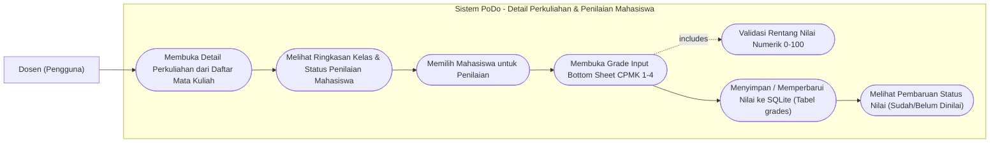
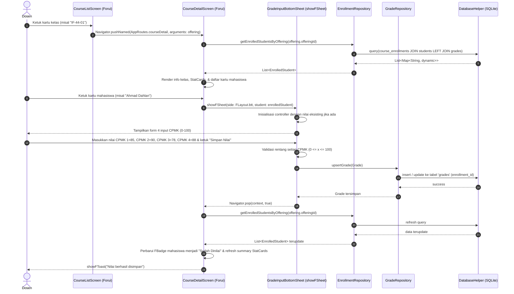

# Tahap 7: Detail Perkuliahan & Pengelolaan Nilai CPMK (Course Detail & Grade Bottom Sheet) Implementation Plan

> **For agentic workers:** REQUIRED SUB-SKILL: Use superpowers:subagent-driven-development (recommended) or superpowers:executing-plans to implement this plan task-by-task. Steps use checkbox (`- [ ]`) syntax for tracking.

**Goal:** Membangun `CourseDetailScreen` yang menampilkan informasi perkuliahan lengkap serta daftar mahasiswa terdaftar dari database SQLite, terintegrasi langsung dengan modal overlay `GradeInputBottomSheet` berbasis Forui untuk menginput dan memperbarui nilai 4 komponen CPMK (CPMK 1–4) secara real-time.

**Architecture:** Menerapkan arsitektur *feature-based* (`lib/features/courses/` dan `lib/features/grades/`) dengan pemisahan tanggung jawab yang terstruktur: `Grade` & `EnrolledStudent` models, `GradeRepository` & `EnrollmentRepository` untuk kueri relasional SQLite (`course_enrollments` JOIN `students` LEFT JOIN `grades`), serta antarmuka visual berbasis Forui (`FScaffold`, `FHeader.nested`, `showFSheet`, `FTextField`, `FButton`, `FBadge`, `FAvatar`, `StatCard`).

**Tech Stack:** Flutter, Dart, Forui (`forui`), SQLite (`sqflite` & `sqflite_common_ffi`), `path`.

**Spec / Rules:** `AGENTS.md` (Bagian 1, 2, 3.1, 3.2, 3.3, 5, 7, 9.6, 9.7).

---

## 1. Use Case Diagram



---

## 2. Sequence Diagram



---

## 3. Widget & Component Decision Matrix

Sesuai kebijakan Forui-first pada **AGENTS.md Bagian 5**, seluruh elemen UI interaktif dan struktural dipetakan dengan hierarki: `lib/core/widgets/` $\rightarrow$ Forui (`forui`) $\rightarrow$ Custom Widget.

| Elemen UI | Sumber Komponen | Komponen Terpilih | Alasan Pemilihan & Referensi |
|---|---|---|---|
| Page Scaffold | Forui | `FScaffold` | Scaffold standar Forui untuk safe area, layout, dan latar belakang |
| Header Halaman | Forui | `FHeader.nested` + `FHeaderAction.back` | Header standar Forui dengan aksi kembali yang konsisten |
| Ringkasan Metrik Kelas | Core Widgets | `StatCard` | Komponen PoDo reusable (`lib/core/widgets/stat_card.dart`) untuk total mahasiswa, sudah dinilai, dan belum dinilai |
| Kartu Info Perkuliahan | Forui | `FCard` | Mengelompokkan info kelas, kode matkul, SKS, tahun akademik, dan semester |
| Badge SKS & Status Nilai | Forui | `FBadge` | `FBadgeVariant.secondary` untuk SKS & "Sudah Dinilai", `FBadgeVariant.outline` untuk "Belum Dinilai" |
| Kartu Mahasiswa | Forui | `FTappable` wrapping `FCard` | Kartu interaktif resmi Forui yang dapat diketuk untuk membuka overlay penilaian |
| Avatar Inisial Mahasiswa | Forui | `FAvatar.raw` | Avatar lingkaran resmi Forui menampilkan inisial 1-2 huruf mahasiswa |
| Modal Penilaian CPMK | Forui | `showFSheet` (`side: FLayout.btt`) | Bottom sheet modal resmi Forui untuk input form kontekstual dari bawah tanpa rute baru |
| Input Nilai CPMK 1–4 | Forui | `FTextField` + `FTextFieldControl.managed` | Input teks numerik resmi Forui dengan validasi angka desimal rentang 0–100 |
| Tombol Simpan Nilai | Forui | `FButton` (`variant: FButtonVariant.primary`) | Primary action button standar Forui untuk submit nilai |
| Tombol Batal | Forui | `FButton` (`variant: FButtonVariant.outline`) | Secondary action button standar Forui untuk menutup sheet |
| Notifikasi Toast | Forui | `showFToast` | Notifikasi umpan balik sukses setelah nilai berhasil tersimpan di SQLite |
| Ikon Informasi | Forui Assets | `FLucideIcons.users`, `FLucideIcons.award`, `FLucideIcons.checkCircle`, `FLucideIcons.clock`, `FLucideIcons.chevronRight`, `FLucideIcons.bookOpen` | Ikon resmi Forui Lucide sesuai design system PoDo |
| Layout Primitives | Flutter Core | `Padding`, `Column`, `Row`, `SingleChildScrollView`, `ListView.builder`, `SizedBox`, `Expanded` | Diizinkan oleh AGENTS.md Bagian 5.4 untuk komposisi tata letak dasar |

> [!IMPORTANT]
> **Larangan:** Tidak diperkenankan menggunakan widget Material (`ElevatedButton`, `TextField`, `Card`, `showModalBottomSheet`) atau Cupertino sebagai pengganti komponen Forui.

---

## 4. Data Layer & SQLite Contract

### 4.1 Tabel Terlibat

1. **`course_enrollments`**:
   - `id` (INTEGER, PK AUTOINCREMENT)
   - `offering_id` (TEXT, FK ke `course_offerings.offering_id`)
   - `student_nim` (TEXT, FK ke `students.nim`)
   - Constraint: `UNIQUE(offering_id, student_nim)`

2. **`students`**:
   - `nim` (TEXT, PK)
   - `full_name` (TEXT, NOT NULL)
   - `study_program` (TEXT)
   - `department` (TEXT)
   - `phone` (TEXT)
   - `address` (TEXT)

3. **`grades`**:
   - `id` (INTEGER, PK AUTOINCREMENT)
   - `enrollment_id` (INTEGER, NOT NULL UNIQUE, FK ke `course_enrollments.id`)
   - `cpmk_1` (REAL, range 0–100)
   - `cpmk_2` (REAL, range 0–100)
   - `cpmk_3` (REAL, range 0–100)
   - `cpmk_4` (REAL, range 0–100)

### 4.2 Query Relasional Mahasiswa Terdaftar & Nilai

```sql
SELECT 
  ce.id as enrollment_id,
  ce.offering_id,
  ce.student_nim,
  s.full_name as student_name,
  s.study_program,
  g.id as grade_id,
  g.cpmk_1,
  g.cpmk_2,
  g.cpmk_3,
  g.cpmk_4
FROM course_enrollments ce
JOIN students s ON ce.student_nim = s.nim
LEFT JOIN grades g ON ce.id = g.enrollment_id
WHERE ce.offering_id = ?
ORDER BY s.full_name ASC
```

### 4.3 Repository Contracts

```dart
class EnrollmentRepository {
  EnrollmentRepository._();
  static final EnrollmentRepository instance = EnrollmentRepository._();

  Future<List<EnrolledStudent>> getEnrolledStudentsByOffering(String offeringId);
  Future<EnrolledStudent?> getEnrolledStudentById(int enrollmentId);
}

class GradeRepository {
  GradeRepository._();
  static final GradeRepository instance = GradeRepository._();

  Future<Grade?> getGradeByEnrollmentId(int enrollmentId);
  Future<void> upsertGrade(Grade grade);
  Future<void> deleteGrade(int enrollmentId);
}
```

---

## 5. Task Breakdown (Flutter TDD)

### Task 1: Grade & EnrolledStudent Models
**Files:**
- Create: `lib/features/grades/models/grade.dart`
- Create: `lib/features/grades/models/enrolled_student.dart`
- Test: `test/features/grades/models/grade_test.dart`
- Test: `test/features/grades/models/enrolled_student_test.dart`

**Interfaces:**
- Produces: `Grade` entity (dengan `cpmk1`–`cpmk4`, `averageScore`, `isFullyGraded`) dan `EnrolledStudent` entity (dengan relasi mahasiswa, enrollment, dan grade).

- [ ] **Step 1: Write failing unit tests for Grade and EnrolledStudent**
  - Buat `test/features/grades/models/grade_test.dart` menguji instansiasi, parsing `fromMap`, `toMap`, `copyWith`, perhitungan `averageScore`, status `isFullyGraded`, serta `==` & `hashCode`.
  - Buat `test/features/grades/models/enrolled_student_test.dart` menguji parsing data join SQLite (enrollment + student + grade columns), helper `isGraded`, `copyWith`, dan kesetaraan nilai.
- [ ] **Step 2: Run test to verify it fails**
  - Run: `flutter test test/features/grades/models/`
  - Expected: Compilation error (classes not found).
- [ ] **Step 3: Implement Grade & EnrolledStudent models**
  - Implementasikan `lib/features/grades/models/grade.dart`.
  - Implementasikan `lib/features/grades/models/enrolled_student.dart`.
- [ ] **Step 4: Run test to verify it passes**
  - Run: `flutter test test/features/grades/models/`
  - Expected: ALL TESTS PASS.
- [ ] **Step 5: Run static analysis**
  - Run: `flutter analyze`
  - Expected: No issues found.
- [ ] **Step 6: Commit**
  - Run:
    ```bash
    git add lib/features/grades/models/ test/features/grades/models/
    git commit -m "feat(grades): implement Grade and EnrolledStudent models with CPMK calculation"
    ```

---

### Task 2: EnrollmentRepository & GradeRepository with Relational SQLite Queries
**Files:**
- Create: `lib/features/grades/repositories/enrollment_repository.dart`
- Create: `lib/features/grades/repositories/grade_repository.dart`
- Test: `test/features/grades/repositories/enrollment_repository_test.dart`
- Test: `test/features/grades/repositories/grade_repository_test.dart`

**Interfaces:**
- Consumes: `DatabaseHelper.instance.database`
- Produces: `EnrollmentRepository.instance.getEnrolledStudentsByOffering(offeringId)` & `GradeRepository.instance.upsertGrade(grade)`.

- [ ] **Step 1: Write failing tests for repositories**
  - Buat `test/features/grades/repositories/enrollment_repository_test.dart`:
    - Test case 1: Mengambil mahasiswa terdaftar untuk offering `OFF001` (mengembalikan 3 mahasiswa: Ahmad Dahlan, Siti Aisyah, Budi Santoso) dengan status grade awal `null` / belum dinilai.
    - Test case 2: Mengambil mahasiswa terdaftar untuk offering `OFF003` (1 mahasiswa).
    - Test case 3: Mengambil offering tanpa enrollment menghasilkan list kosong.
  - Buat `test/features/grades/repositories/grade_repository_test.dart`:
    - Test case 1: `upsertGrade` memasukkan nilai baru CPMK 1–4 untuk enrollment tertentu ke tabel `grades`.
    - Test case 2: `getGradeByEnrollmentId` mengembalikan nilai yang baru disimpan.
    - Test case 3: `upsertGrade` kedua kalinya memperbarui nilai CPMK tanpa duplikasi record (idempotent / update).
    - Test case 4: Memverifikasi `EnrollmentRepository` kini merefleksikan nilai grade terupdate untuk mahasiswa terkait.
- [ ] **Step 2: Run test to verify it fails**
  - Run: `flutter test test/features/grades/repositories/`
  - Expected: Compilation error (repositories not found).
- [ ] **Step 3: Implement EnrollmentRepository and GradeRepository**
  - Implementasikan `lib/features/grades/repositories/enrollment_repository.dart`.
  - Implementasikan `lib/features/grades/repositories/grade_repository.dart` menggunakan operasi `insert` / `update` berbasis parameterized query SQLite.
- [ ] **Step 4: Run test to verify it passes**
  - Run: `flutter test test/features/grades/repositories/`
  - Expected: ALL TESTS PASS.
- [ ] **Step 5: Run static analysis**
  - Run: `flutter analyze`
  - Expected: No issues found.
- [ ] **Step 6: Commit**
  - Run:
    ```bash
    git add lib/features/grades/repositories/ test/features/grades/repositories/
    git commit -m "feat(grades): implement EnrollmentRepository and GradeRepository with SQLite upsert"
    ```

---

### Task 3: GradeInputBottomSheet Component with CPMK 1–4 Form & Validation
**Files:**
- Create: `lib/features/grades/widgets/grade_input_bottom_sheet.dart`
- Test: `test/features/grades/widgets/grade_input_bottom_sheet_test.dart`

**Component Mapping Applied:**
- Container: Sheet body dengan padding responsif (`SingleChildScrollView` + `Column`).
- Info Mahasiswa: Nama mahasiswa bold & NIM.
- Input CPMK: 4 field `FTextField` (`keyboardType: TextInputType.numberWithOptions(decimal: true)`).
- Validasi: Angka numerik wajib dalam rentang 0.0 – 100.0. Menampilkan pesan error spesifik jika field kosong atau di luar rentang.
- Aksi: `FButton(variant: FButtonVariant.primary)` untuk Simpan Nilai, `FButton(variant: FButtonVariant.outline)` untuk Batal.

- [ ] **Step 1: Write failing widget tests for GradeInputBottomSheet**
  - Buat `test/features/grades/widgets/grade_input_bottom_sheet_test.dart`:
    - Test case 1: Menampilkan form 4 field CPMK dengan nama dan NIM mahasiswa.
    - Test case 2: Menampilkan nilai lama jika mahasiswa sudah pernah dinilai (pre-filled).
    - Test case 3: Validasi form gagal dan menampilkan error saat input kosong atau di luar rentang (< 0 atau > 100).
    - Test case 4: Input valid (misal: 85, 90, 75, 80) menyimpan nilai ke `GradeRepository` dan menutup sheet dengan nilai kembalian `true`.
- [ ] **Step 2: Run test to verify it fails**
  - Run: `flutter test test/features/grades/widgets/grade_input_bottom_sheet_test.dart`
  - Expected: Compilation error (GradeInputBottomSheet not found).
- [ ] **Step 3: Implement GradeInputBottomSheet**
  - Implementasikan `lib/features/grades/widgets/grade_input_bottom_sheet.dart` berbasis Forui.
- [ ] **Step 4: Run test to verify it passes**
  - Run: `flutter test test/features/grades/widgets/grade_input_bottom_sheet_test.dart`
  - Expected: ALL TESTS PASS.
- [ ] **Step 5: Run static analysis**
  - Run: `flutter analyze`
  - Expected: No issues found.
- [ ] **Step 6: Commit**
  - Run:
    ```bash
    git add lib/features/grades/widgets/ test/features/grades/widgets/
    git commit -m "feat(grades): implement GradeInputBottomSheet with numeric validation and upsert"
    ```

---

### Task 4: CourseDetailScreen UI (Info Kelas, Daftar Mahasiswa, Status Nilai, & Sheet Trigger)
**Files:**
- Modify: `lib/features/courses/screens/course_detail_screen.dart`
- Test: `test/features/courses/screens/course_detail_screen_test.dart`

**Component Mapping Applied:**
- Header: `FHeader.nested` dengan judul nama mata kuliah & tombol kembali `FHeaderAction.back`.
- Kartu Perkuliahan: `FCard` menampilkan nama matkul, kode, kelas, tahun akademik, semester, dan `FBadge` SKS.
- Ringkasan Statistik: 3 `StatCard` (Total Mahasiswa, Sudah Dinilai, Belum Dinilai).
- Daftar Mahasiswa: `ListView.builder` menampilkan `FTappable` wrapping `FCard`:
  - `FAvatar.raw` menampilkan inisial nama mahasiswa.
  - Nama dan NIM mahasiswa.
  - Status nilai: `FBadge(label: Text('Sudah Dinilai'))` jika sudah dinilai, atau `FBadge(label: Text('Belum Dinilai'))` jika belum.
  - Jika sudah dinilai, tampilkan ringkasan nilai CPMK / rata-rata nilai.
- Trigger Penilaian: Mengetuk kartu mahasiswa memanggil `showFSheet(context: context, side: FLayout.btt, builder: ...)` menampilkan `GradeInputBottomSheet`. Setelah sheet ditutup (`result == true`), reload daftar mahasiswa dan tampilkan `showFToast`.

- [ ] **Step 1: Write failing widget tests for CourseDetailScreen**
  - Buat `test/features/courses/screens/course_detail_screen_test.dart`:
    - Test case 1: Menampilkan info kelas perkuliahan (nama, kode, kelas, SKS badge).
    - Test case 2: Menampilkan 3 kartu metrik statistik (Total Mahasiswa: 3, Sudah Dinilai: 0, Belum Dinilai: 3 untuk OFF001 awal).
    - Test case 3: Menampilkan daftar 3 mahasiswa dengan badge "Belum Dinilai".
    - Test case 4: Mengetuk mahasiswa membuka modal sheet `GradeInputBottomSheet`.
    - Test case 5: Setelah nilai disimpan dari sheet, status badge mahasiswa berubah menjadi "Sudah Dinilai" dan ringkasan metrik terupdate (Sudah Dinilai: 1, Belum Dinilai: 2).
- [ ] **Step 2: Run test to verify it fails**
  - Run: `flutter test test/features/courses/screens/course_detail_screen_test.dart`
  - Expected: FAIL (stub belum menampilkan daftar mahasiswa dan integrasi sheet).
- [ ] **Step 3: Implement full CourseDetailScreen**
  - Perbarui `lib/features/courses/screens/course_detail_screen.dart` dengan integrasi `EnrollmentRepository`, `showFSheet`, dan `showFToast`.
- [ ] **Step 4: Run test to verify it passes**
  - Run: `flutter test test/features/courses/screens/course_detail_screen_test.dart`
  - Expected: ALL TESTS PASS.
- [ ] **Step 5: Run static analysis**
  - Run: `flutter analyze`
  - Expected: No issues found.
- [ ] **Step 6: Commit**
  - Run:
    ```bash
    git add lib/features/courses/screens/course_detail_screen.dart test/features/courses/screens/course_detail_screen_test.dart
    git commit -m "feat(courses): implement CourseDetailScreen with student roster and grade sheet trigger"
    ```

---

### Task 5: End-to-End Course & Grade Management Flow Test
**Files:**
- Create: `test/features/grades/grade_flow_test.dart`

**Interfaces:**
- Menguji alur lengkap end-to-end:
  Login dosen L001 $\rightarrow$ Buka `CourseListScreen` $\rightarrow$ Pilih kelas "Pemrograman Mobile (IF-44-01)" $\rightarrow$ Terbuka `CourseDetailScreen` $\rightarrow$ Verifikasi 3 mahasiswa terdaftar dengan status "Belum Dinilai" $\rightarrow$ Ketuk mahasiswa pertama ("Ahmad Dahlan") $\rightarrow$ Sheet penilaian terbuka $\rightarrow$ Input CPMK 1=85, CPMK 2=90, CPMK 3=78, CPMK 4=88 $\rightarrow$ Ketuk Simpan Nilai $\rightarrow$ Sheet tertutup $\rightarrow$ Status Ahmad Dahlan berubah menjadi "Sudah Dinilai" $\rightarrow$ Summary metric terupdate (Sudah Dinilai: 1, Belum: 2) $\rightarrow$ Ketuk Ahmad Dahlan lagi $\rightarrow$ Nilai 85, 90, 78, 88 terisi otomatis $\rightarrow$ Ubah CPMK 1=95 $\rightarrow$ Simpan $\rightarrow$ Verifikasi nilai terupdate di database SQLite.

- [ ] **Step 1: Write integration flow test**
  - Buat `test/features/grades/grade_flow_test.dart`.
- [ ] **Step 2: Run test to verify it passes**
  - Run: `flutter test test/features/grades/grade_flow_test.dart`
  - Expected: ALL TESTS PASS.
- [ ] **Step 3: Run full project test suite & static analysis**
  - Run: `flutter test && flutter analyze`
  - Expected: ALL TESTS PASS (100%), 0 issues found.
- [ ] **Step 4: Commit**
  - Run:
    ```bash
    git add test/features/grades/grade_flow_test.dart
    git commit -m "test(grades): add end-to-end integration flow test for course detail and grading"
    ```

---

## 6. Verification Checklist

- [ ] Seluruh diagram Mermaid dirender valid tanpa sintaks error (`flowchart LR` & `sequenceDiagram`).
- [ ] Tidak ada penggunaan widget Material/Cupertino yang menggantikan komponen Forui (`FScaffold`, `FHeader.nested`, `showFSheet`, `FTextField`, `FButton`, `FBadge`, `FAvatar`, `showFToast`).
- [ ] Data mahasiswa dan nilai dibaca murni melalui `EnrollmentRepository` dan `GradeRepository` $\rightarrow$ SQLite.
- [ ] Nilai disimpan ke tabel `grades` dengan referensi `enrollment_id`.
- [ ] 4 komponen penilaian yang digunakan murni **CPMK 1, CPMK 2, CPMK 3, CPMK 4** (tanpa UTS/UAS/kehadiran).
- [ ] Validasi rentang nilai angka 0–100 berfungsi dengan pesan error yang jelas.
- [ ] Status nilai mahasiswa ditampilkan dengan `FBadge` yang jelas ("Sudah Dinilai" vs "Belum Dinilai").
- [ ] Form sheet dapat mengedit nilai yang sudah ada sebelumnya (pre-filled).
- [ ] `flutter analyze` menghasilkan **0 issues**.
- [ ] `flutter test` lulus **100%**.
- [ ] Tidak ada `Co-authored-by:` atau atribusi AI pada commit git.
