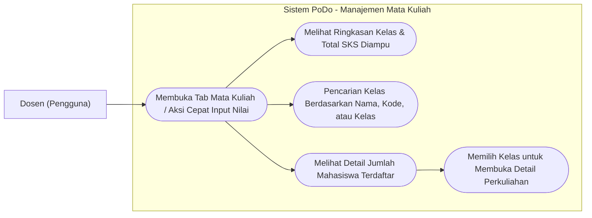
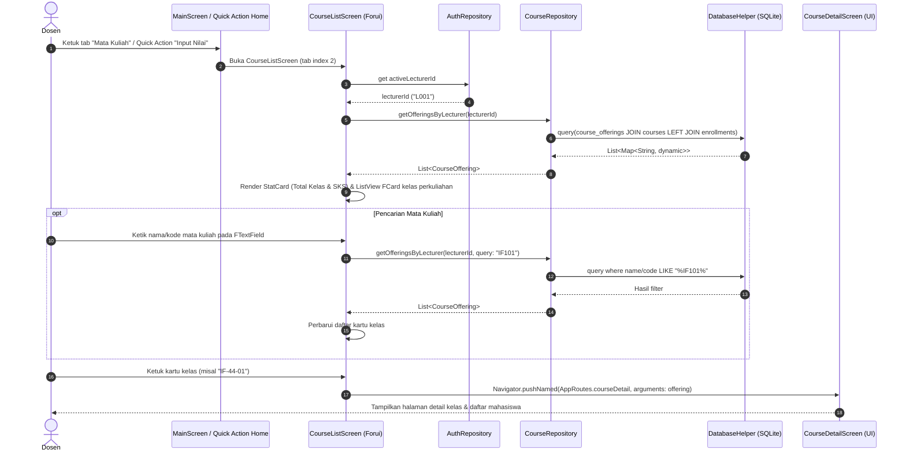

# Tahap 6: Manajemen Mata Kuliah (CourseListScreen) Implementation Plan

> **For agentic workers:** REQUIRED SUB-SKILL: Use superpowers:subagent-driven-development (recommended) or superpowers:executing-plans to implement this plan task-by-task. Steps use checkbox (`- [ ]`) syntax for tracking.

**Goal:** Membangun `CourseListScreen` (Tab ke-3 di Bottom Navigation dan target navigasi Quick Action "Input Nilai") yang menyajikan daftar mata kuliah dan kelas yang diampu oleh dosen aktif dari database SQLite, dilengkapi pencarian real-time, ringkasan akademik (total kelas & SKS), informasi jumlah mahasiswa terdaftar, dan navigasi ke `CourseDetailScreen`.

**Architecture:** Menggunakan *feature-based architecture* (`lib/features/courses/`) dengan pemisahan tanggung jawab yang rapi: `models/course.dart` & `models/course_offering.dart` merepresentasikan entitas mata kuliah dan kelas perkuliahan, `repositories/course_repository.dart` mengelola query relasional SQLite (`course_offerings` JOIN `courses` LEFT JOIN `course_enrollments`), dan `screens/course_list_screen.dart` menampilkan antarmuka berbasis Forui.

**Tech Stack:** Flutter, Dart, Forui (`forui`), SQLite (`sqflite` & `sqflite_common_ffi`), `path`.

**Spec / Rules:** `AGENTS.md` (Bagian 2, 3.1, 3.2, 3.3, 5, 7, 9.3, 9.4).

---

## 1. Use Case Diagram



---

## 2. Sequence Diagram



---

## 3. Widget & Component Decision Matrix

Sesuai kebijakan Forui-first pada **AGENTS.md Bagian 5**, seluruh elemen UI interaktif dan struktural dipetakan dengan hierarki: `lib/core/widgets/` $\rightarrow$ Forui (`forui`) $\rightarrow$ Custom Widget.

| Elemen UI | Sumber Komponen | Komponen Terpilih | Alasan Pemilihan & Referensi |
|---|---|---|---|
| Page Scaffold | Forui | `FScaffold` | Scaffold resmi Forui untuk konsistensi layout, safe area, dan background |
| Header Halaman | Forui | `FHeader` | Header standar Forui menampilkan judul "Mata Kuliah" dan subtitle semester |
| Search Input | Forui | `FTextField` + `prefixIconBuilder` | Komponen teks Forui dengan ikon pencarian `FLucideIcons.search` |
| Ringkasan SKS & Kelas | Core Widgets | `StatCard` | Komponen reusable PoDo di `lib/core/widgets/stat_card.dart` untuk metrik statistik |
| Kartu Kelas Mata Kuliah | Forui | `FTappable` wrapping `FCard` | Komponen resmi Forui untuk kartu interaktif yang dapat diketuk |
| Badge SKS | Forui | `FBadge(variant: FBadgeVariant.secondary)` | Menampilkan jumlah SKS (`3 SKS`) secara ringkas di kartu |
| Empty State | Forui | `FCard` | Kartu informasi dengan ikon kalender/buku kosong saat data tidak ditemukan |
| Ikon Informasi | Forui Assets | `FLucideIcons.bookOpen`, `FLucideIcons.users`, `FLucideIcons.calendar`, `FLucideIcons.chevronRight` | Ikon resmi Forui Lucide sesuai design system PoDo |
| Layout Primitives | Flutter Core | `Padding`, `Column`, `Row`, `ListView.builder`, `SizedBox` | Diizinkan oleh AGENTS.md Bagian 5.4 untuk komposisi tata letak dasar |

> [!IMPORTANT]
> **Larangan:** Tidak diperkenankan menggunakan widget Material (`Card`, `ListTile`, `TextField`, `InkWell`) atau Cupertino sebagai pengganti komponen Forui.

---

## 4. Data Layer & SQLite Contract

### 4.1 Tabel Terlibat

1. **`courses`**:
   - `course_code` (TEXT, PK)
   - `course_name` (TEXT, NOT NULL)
   - `credits` (INTEGER, NOT NULL)

2. **`course_offerings`**:
   - `offering_id` (TEXT, PK)
   - `course_code` (TEXT, FK ke `courses.course_code`)
   - `lecturer_id` (TEXT, FK ke `lecturers.lecturer_id`)
   - `class_name` (TEXT, NOT NULL)
   - `academic_year` (TEXT, NOT NULL)
   - `term` (TEXT, NOT NULL)

3. **`course_enrollments`**:
   - `id` (INTEGER, PK AUTOINCREMENT)
   - `offering_id` (TEXT, FK ke `course_offerings.offering_id`)
   - `student_nim` (TEXT, FK ke `students.nim`)
   - Constraint: `UNIQUE(offering_id, student_nim)`

### 4.2 Query Relasional Offering Dosen

```sql
SELECT 
  co.offering_id,
  co.course_code,
  co.lecturer_id,
  co.class_name,
  co.academic_year,
  co.term,
  c.course_name,
  c.credits,
  COUNT(ce.id) as enrolled_count
FROM course_offerings co
JOIN courses c ON co.course_code = c.course_code
LEFT JOIN course_enrollments ce ON co.offering_id = ce.offering_id
WHERE co.lecturer_id = ?
  AND (
    ? IS NULL 
    OR c.course_name LIKE ? 
    OR c.course_code LIKE ? 
    OR co.class_name LIKE ?
  )
GROUP BY co.offering_id
ORDER BY c.course_name ASC, co.class_name ASC
```

### 4.3 CourseRepository Contract

```dart
class CourseRepository {
  CourseRepository._();
  static final CourseRepository instance = CourseRepository._();

  Future<List<CourseOffering>> getOfferingsByLecturer(
    String lecturerId, {
    String? query,
  });

  Future<CourseOffering?> getOfferingById(String offeringId);

  Future<List<Course>> getAllCourses();

  Future<Course?> getCourseByCode(String courseCode);
}
```

---

## 5. Task Breakdown (Flutter TDD)

### Task 1: Course & CourseOffering Models
**Files:**
- Create: `lib/features/courses/models/course.dart`
- Create: `lib/features/courses/models/course_offering.dart`
- Test: `test/features/courses/models/course_test.dart`
- Test: `test/features/courses/models/course_offering_test.dart`

**Interfaces:**
- Produces: `Course` dan `CourseOffering` entities dengan serialisasi map, `fromMap`, `toMap`, `copyWith`, dan kesetaraan nilai.

- [ ] **Step 1: Write failing unit tests for Course and CourseOffering**
  - Buat `test/features/courses/models/course_test.dart`.
  - Buat `test/features/courses/models/course_offering_test.dart`.
  - Uji parsing map dengan relasi join fields (`course_name`, `credits`, `enrolled_count`).
  - Uji `copyWith` dan perbandingan equality.
- [ ] **Step 2: Run test to verify it fails**
  - Run: `flutter test test/features/courses/models/`
  - Expected: Compilation error (classes not found).
- [ ] **Step 3: Implement Course & CourseOffering models**
  - Buat `lib/features/courses/models/course.dart`.
  - Buat `lib/features/courses/models/course_offering.dart`.
- [ ] **Step 4: Run test to verify it passes**
  - Run: `flutter test test/features/courses/models/`
  - Expected: ALL TESTS PASS.
- [ ] **Step 5: Run static analysis**
  - Run: `flutter analyze`
  - Expected: No issues found.
- [ ] **Step 6: Commit**
  - Run:
    ```bash
    git add lib/features/courses/models/ test/features/courses/models/
    git commit -m "feat(courses): implement Course and CourseOffering models with relational fields"
    ```

---

### Task 2: CourseRepository with Relational SQLite Queries
**Files:**
- Create: `lib/features/courses/repositories/course_repository.dart`
- Test: `test/features/courses/repositories/course_repository_test.dart`

**Interfaces:**
- Consumes: `DatabaseHelper.instance.database`
- Produces: `CourseRepository.instance.getOfferingsByLecturer(lecturerId, {query})`

- [ ] **Step 1: Write failing integration test for CourseRepository**
  - Buat `test/features/courses/repositories/course_repository_test.dart` menggunakan `sqflite_common_ffi` dan database seed in-memory.
  - Test case 1: Mengambil offering untuk dosen L001 (mengembalikan 2 kelas: OFF001 dan OFF002) dengan hitungan mahasiswa terdaftar yang tepat (masing-masing 3 mahasiswa).
  - Test case 2: Memfilter offering dosen L001 berdasarkan query pencarian nama atau kode matkul (misal 'IF101' atau 'Mobile').
  - Test case 3: Mengambil offering untuk dosen L002 (hanya OFF003 yang muncul, 1 mahasiswa terdaftar).
  - Test case 4: Mengambil detail offering berdasarkan `offering_id`.
  - Test case 5: Mengambil master courses (`getAllCourses` dan `getCourseByCode`).
- [ ] **Step 2: Run test to verify it fails**
  - Run: `flutter test test/features/courses/repositories/course_repository_test.dart`
  - Expected: Compilation error (CourseRepository not found).
- [ ] **Step 3: Implement CourseRepository**
  - Buat `lib/features/courses/repositories/course_repository.dart` dengan SQL JOIN `course_offerings` $\bowtie$ `courses` $\bowtie$ `course_enrollments`.
- [ ] **Step 4: Run test to verify it passes**
  - Run: `flutter test test/features/courses/repositories/course_repository_test.dart`
  - Expected: ALL TESTS PASS.
- [ ] **Step 5: Run static analysis**
  - Run: `flutter analyze`
  - Expected: No issues found.
- [ ] **Step 6: Commit**
  - Run:
    ```bash
    git add lib/features/courses/repositories/course_repository.dart test/features/courses/repositories/course_repository_test.dart
    git commit -m "feat(courses): implement CourseRepository with relational SQLite queries and enrolled count"
    ```

---

### Task 3: CourseListScreen UI (Pencarian, Summary Cards, & Navigasi)
**Files:**
- Modify: `lib/features/courses/screens/course_list_screen.dart`
- Create stub: `lib/features/courses/screens/course_detail_screen.dart`
- Test: `test/features/courses/screens/course_list_screen_test.dart`

**Component Mapping Applied:**
- Header: `FHeader` ("Mata Kuliah").
- Ringkasan Metrik: `StatCard` (Total Kelas, Total SKS).
- Search Bar: `FTextField` dengan ikon `FLucideIcons.search`.
- Kartu Kelas: `FTappable` + `FCard` + `FBadge` (SKS) + `FLucideIcons.users` (mahasiswa terdaftar) + `FLucideIcons.calendar` + `FLucideIcons.chevronRight`.
- Empty State: `FCard` ramah saat hasil pencarian tidak ditemukan.

- [ ] **Step 1: Write failing widget tests for CourseListScreen**
  - Buat `test/features/courses/screens/course_list_screen_test.dart`.
  - Test case 1: Menampilkan header 'Mata Kuliah', summary card, search field, dan daftar kelas yang diampu dosen L001.
  - Test case 2: Menampilkan jumlah mahasiswa terdaftar dan badge SKS pada setiap kartu kelas.
  - Test case 3: Pencarian real-time memfilter daftar kelas berdasarkan nama matkul, kode, atau kelas.
  - Test case 4: Menampilkan empty state saat pencarian tidak menemukan hasil.
  - Test case 5: Mengetuk salah satu kartu kelas membuka `CourseDetailScreen`.
- [ ] **Step 2: Run test to verify it fails**
  - Run: `flutter test test/features/courses/screens/course_list_screen_test.dart`
  - Expected: FAIL.
- [ ] **Step 3: Implement CourseListScreen and CourseDetailScreen stub**
  - Implementasikan `CourseListScreen` lengkap dengan pembacaan asinkron dari `CourseRepository`.
  - Buat stub `CourseDetailScreen` di `lib/features/courses/screens/course_detail_screen.dart` menerima parameter `CourseOffering? offering`.
- [ ] **Step 4: Run test to verify it passes**
  - Run: `flutter test test/features/courses/screens/course_list_screen_test.dart`
  - Expected: ALL TESTS PASS.
- [ ] **Step 5: Run static analysis**
  - Run: `flutter analyze`
  - Expected: No issues found.
- [ ] **Step 6: Commit**
  - Run:
    ```bash
    git add lib/features/courses/screens/ test/features/courses/screens/
    git commit -m "feat(courses): implement CourseListScreen with search, metrics, and detail navigation"
    ```

---

### Task 4: Routes Configuration & Full Flow Integration Test
**Files:**
- Modify: `lib/app/routes.dart`
- Create: `test/features/courses/course_flow_test.dart`

**Interfaces:**
- Mendaftarkan rute `AppRoutes.courseDetail` (`/courses/detail`) dengan dukungan ekstraksi `ModalRoute.of(context)?.settings.arguments as CourseOffering?`.
- Menghubungkan alur Quick Action "Input Nilai" dari `HomeScreen` ke `CourseListScreen` hingga membuka detail kelas.

- [ ] **Step 1: Write integration flow test**
  - Buat `test/features/courses/course_flow_test.dart`.
  - Alur: Login dosen L001 $\rightarrow$ Buka `HomeScreen` $\rightarrow$ Ketuk Quick Action "Input Nilai" $\rightarrow$ Tab beralih ke index 2 (`CourseListScreen`) $\rightarrow$ Verifikasi daftar kelas L001 muncul $\rightarrow$ Ketuk kartu "Pemrograman Mobile" $\rightarrow$ Terbuka `CourseDetailScreen` dengan judul kelas yang sesuai.
- [ ] **Step 2: Run test to verify it passes**
  - Run: `flutter test test/features/courses/course_flow_test.dart`
  - Expected: ALL TESTS PASS.
- [ ] **Step 3: Run full project test suite & static analysis**
  - Run: `flutter test && flutter analyze`
  - Expected: ALL PASS (100%), 0 issues.
- [ ] **Step 4: Commit**
  - Run:
    ```bash
    git add lib/app/routes.dart test/features/courses/course_flow_test.dart
    git commit -m "feat(routes): register course detail route and verify end-to-end course management flow"
    ```

---

## 6. Verification Checklist

- [ ] Seluruh diagram Mermaid dirender valid tanpa sintaks error.
- [ ] Tidak ada penggunaan widget Material/Cupertino yang menggantikan Forui (`FScaffold`, `FHeader`, `FTextField`, `FTappable`, `FCard`, `FBadge`).
- [ ] Data kelas dibaca murni melalui `CourseRepository` $\rightarrow$ SQLite (`course_offerings` JOIN `courses` LEFT JOIN `course_enrollments`).
- [ ] Data difilter ketat berdasarkan dosen aktif (`co.lecturer_id = ?`).
- [ ] Menampilkan jumlah mahasiswa terdaftar (`COUNT(ce.id)`).
- [ ] Pencarian real-time responsif berdasarkan nama matkul, kode, atau kelas.
- [ ] Quick Action "Input Nilai" dari Home Screen mengarah dengan tepat ke Course List.
- [ ] `flutter analyze` menghasilkan **0 issues**.
- [ ] `flutter test` lulus **100%**.
- [ ] Tidak ada `Co-authored-by:` atau atribusi AI pada commit git.
