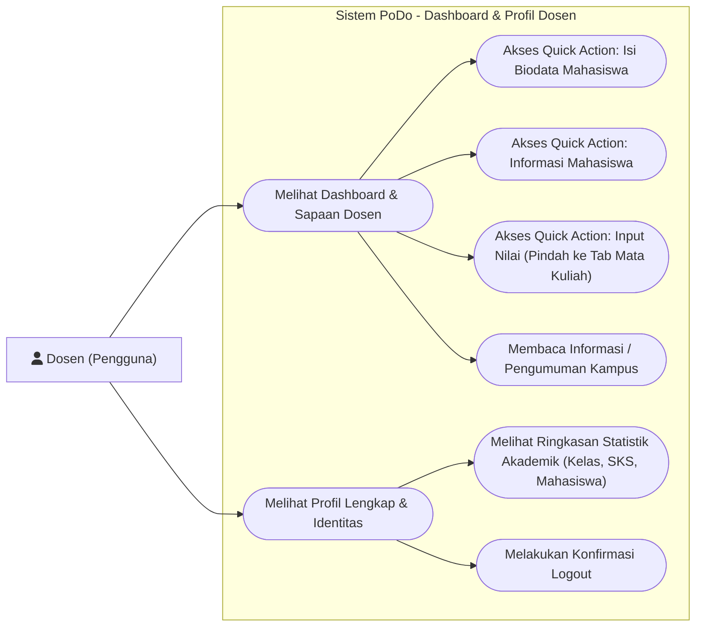
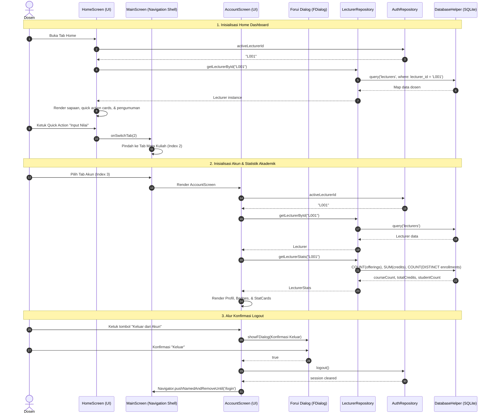

# Tahap 3: Dashboard (Home Screen) & Profil Dosen (Account Screen) Implementation Plan

> **For agentic workers:** REQUIRED SUB-SKILL: Use superpowers:subagent-driven-development (recommended) or superpowers:executing-plans to implement this plan task-by-task. Steps use checkbox (`- [ ]`) syntax for tracking.

**Goal:** Mengimplementasikan fitur Dashboard (Home Screen) dengan sapaan dosen aktif, quick actions, dan pengumuman kampus, serta Profil Dosen (Account Screen) dengan rincian identitas, statistik akademik terhitung dari SQLite, dan dialog konfirmasi logout Forui.

**Architecture:** Feature-based architecture (`features/dashboard/`, `features/lecturers/`, `features/students/`, `core/widgets/`). Seluruh data dosen aktif dan statistik akademik diambil dari SQLite melalui `LecturerRepository` menggunakan `lecturer_id` sesi `AuthRepository`. Navigasi quick action terintegrasi dengan tab shell `MainScreen` dan rute aplikasi.

**Tech Stack:** Flutter, Dart, Forui (`forui` 0.27.7), Lucide Icons (`FLucideIcons`), SQLite (`sqflite`), `sqflite_common_ffi` (testing).

**Spec / Rules:** [AGENTS.md](file:///home/muzaaqi/Learn/podo/AGENTS.md) (Bagian 2, 3, 5, 7, 8, 9, 10, 11, 13).

---

## 1. Use Case Diagram



---

## 2. Sequence Diagram



---

## 3. Widget & Component Decision Matrix

Setiap elemen UI dipetakan sesuai hierarki:
`lib/core/widgets/` $\rightarrow$ Forui Library (`forui`) $\rightarrow$ Custom Widget (dengan justifikasi tertulis).

| Elemen UI | Sumber Komponen | Komponen Terpilih | Alasan Pemilihan & Referensi |
|---|---|---|---|
| Header Halaman Home & Akun | Forui | `FHeader` | Standar Forui untuk judul aplikasi dan header konsisten |
| Foto Profil / Avatar Dosen | Forui | `FAvatar` / `FAvatar.raw` | Menampilkan avatar lingkaran dengan inisial atau fallback ikon `FLucideIcons.user` |
| Sapaan & Banner Dashboard | Forui | `FCard` | Kontainer bergaya Forui untuk membungkus sapaan dan status selamat datang |
| Kartu Quick Action | Forui | `FCard` + `FTappable` | Menyediakan card interaktif dengan icon dan label navigasi |
| Badge Status / Kategori | Forui | `FBadge` | Menampilkan kategori pengumuman ("Akademik", "Penting") dan gelar dosen |
| Kartu Pengumuman Kampus | Forui | `FCard` | Kontainer resmi Forui untuk item pengumuman kampus |
| Kartu Statistik Akademik | Core Widgets | `StatCard` (`lib/core/widgets/stat_card.dart`) | Komponen reusable berbasis `FCard` untuk menampilkan angka ringkasan (SKS, Kelas, Mahasiswa) |
| Tombol Logout | Forui | `FButton` (`variant: FButtonVariant.destructive`) | Standar Forui untuk tombol aksi destruktif |
| Dialog Konfirmasi Keluar | Forui | `showFDialog` & `FDialog` | Dialog modal resmi Forui dengan animasi dan styling Shadcn/ui |
| Tombol Dialog Batal / Ya | Forui | `FButton` (`outline` & `destructive`) | Pasangan tombol aksi dialog modal |
| Layout / List / Spacing | Flutter Core | `Padding`, `Column`, `Row`, `ListView`, `SizedBox` | Widget dasar Flutter untuk tata letak dan scroll responsif |

> [!IMPORTANT]
> **Larangan:** Tidak ada penggunaan Material (`Card`, `ElevatedButton`, `AlertDialog`, `CircleAvatar`) atau Cupertino. Seluruh komponen interaktif menggunakan Forui.

---

## 4. Data Layer & SQLite Contract

### A. Tabel SQLite yang Digunakan

1. **`lecturers`**:
   - `lecturer_id` (TEXT, PK)
   - `full_name` (TEXT)
   - `title` (TEXT)
   - `nidh` (TEXT)
   - `email` (TEXT)
   - `phone` (TEXT)
   - `department` (TEXT)
   - `photo_path` (TEXT)
2. **`course_offerings`**:
   - Menghitung jumlah kelas yang diampu dosen: `COUNT(*) WHERE lecturer_id = ?`
3. **`courses`**:
   - Menghitung total SKS yang diampu dosen:
     `SELECT COALESCE(SUM(c.credits), 0) FROM course_offerings o JOIN courses c ON o.course_code = c.course_code WHERE o.lecturer_id = ?`
4. **`course_enrollments`**:
   - Menghitung jumlah mahasiswa bimbingan/terdaftar:
     `SELECT COUNT(DISTINCT e.student_nim) FROM course_enrollments e JOIN course_offerings o ON e.offering_id = o.offering_id WHERE o.lecturer_id = ?`

### B. Interface & Method Signatures

```dart
// lib/features/lecturers/models/lecturer.dart
class Lecturer {
  final String lecturerId;
  final String fullName;
  final String? title;
  final String? nidh;
  final String? email;
  final String? phone;
  final String? department;
  final String? photoPath;

  const Lecturer({
    required this.lecturerId,
    required this.fullName,
    this.title,
    this.nidh,
    this.email,
    this.phone,
    this.department,
    this.photoPath,
  });

  factory Lecturer.fromMap(Map<String, dynamic> map);
  Map<String, dynamic> toMap();
}

// lib/features/lecturers/models/lecturer_stats.dart
class LecturerStats {
  final int courseCount;
  final int totalCredits;
  final int studentCount;

  const LecturerStats({
    required this.courseCount,
    required this.totalCredits,
    required this.studentCount,
  });
}

// lib/features/lecturers/repositories/lecturer_repository.dart
class LecturerRepository {
  Future<Lecturer?> getLecturerById(String lecturerId);
  Future<LecturerStats> getLecturerStats(String lecturerId);
}
```

---

## 5. Task Breakdown (Flutter TDD)

### Task 1: Lecturer & LecturerStats Models
**Files:**
- Create: `lib/features/lecturers/models/lecturer.dart`
- Create: `lib/features/lecturers/models/lecturer_stats.dart`
- Test: `test/features/lecturers/models/lecturer_test.dart`

**Interfaces:**
- Produces: `Lecturer.fromMap()`, `Lecturer.toMap()`, `LecturerStats`

- [ ] **Step 1: Write failing tests for Lecturer and LecturerStats models**
  - Buat file `test/features/lecturers/models/lecturer_test.dart`.
  - Uji serialisasi/deserialisasi `Lecturer.fromMap` dan `Lecturer.toMap`.
  - Uji inisialisasi default `LecturerStats`.
- [ ] **Step 2: Run test to verify it fails**
  - Run: `flutter test test/features/lecturers/models/lecturer_test.dart`
  - Expected: Compilation error (file belum ada).
- [ ] **Step 3: Implement Lecturer and LecturerStats models**
  - Tulis `lib/features/lecturers/models/lecturer.dart` dengan field lengkap sesuai `AGENTS.md` 9.1.
  - Tulis `lib/features/lecturers/models/lecturer_stats.dart`.
- [ ] **Step 4: Run test to verify it passes**
  - Run: `flutter test test/features/lecturers/models/lecturer_test.dart`
  - Expected: ALL TESTS PASS.
- [ ] **Step 5: Run static analysis**
  - Run: `flutter analyze`
  - Expected: No issues found.
- [ ] **Step 6: Commit**
  - Run:
    ```bash
    git add lib/features/lecturers/models test/features/lecturers/models
    git commit -m "feat(lecturers): implement Lecturer and LecturerStats models"
    ```

---

### Task 2: LecturerRepository & SQLite Data Queries
**Files:**
- Create: `lib/features/lecturers/repositories/lecturer_repository.dart`
- Test: `test/features/lecturers/repositories/lecturer_repository_test.dart`

**Interfaces:**
- Consumes: `DatabaseHelper.instance.database`
- Produces: `LecturerRepository.getLecturerById()`, `LecturerRepository.getLecturerStats()`

- [ ] **Step 1: Write failing tests for LecturerRepository**
  - Buat file `test/features/lecturers/repositories/lecturer_repository_test.dart` menggunakan `sqflite_common_ffi`.
  - Test case 1: `getLecturerById` mengembalikan data `L001` dari seed SQLite dengan benar.
  - Test case 2: `getLecturerById` mengembalikan `null` jika ID tidak ditemukan.
  - Test case 3: `getLecturerStats` menghitung jumlah kelas, total SKS, dan jumlah mahasiswa bimbingan secara akurat sesuai data seed.
- [ ] **Step 2: Run test to verify it fails**
  - Run: `flutter test test/features/lecturers/repositories/lecturer_repository_test.dart`
  - Expected: Compilation error.
- [ ] **Step 3: Implement LecturerRepository**
  - Buat singleton/instantiable `LecturerRepository`.
  - Implementasikan query tabel `lecturers` untuk `getLecturerById`.
  - Implementasikan query agregat `COUNT(course_offerings)`, `SUM(credits)`, dan `COUNT(DISTINCT course_enrollments)` untuk `getLecturerStats`.
- [ ] **Step 4: Run test to verify it passes**
  - Run: `flutter test test/features/lecturers/repositories/lecturer_repository_test.dart`
  - Expected: ALL TESTS PASS.
- [ ] **Step 5: Run static analysis**
  - Run: `flutter analyze`
  - Expected: No issues found.
- [ ] **Step 6: Commit**
  - Run:
    ```bash
    git add lib/features/lecturers/repositories test/features/lecturers/repositories
    git commit -m "feat(lecturers): implement LecturerRepository with sqlite queries and stats aggregation"
    ```

---

### Task 3: Core Reusable Widget `StatCard`
**Files:**
- Create: `lib/core/widgets/stat_card.dart`
- Test: `test/core/widgets/stat_card_test.dart`

**Component Mapping Applied:**
- Menggunakan `FCard` Forui dengan layout custom untuk menampilkan angka ringkasan, label teks, dan ikon Lucide.

- [ ] **Step 1: Write failing widget test for StatCard**
  - Buat `test/core/widgets/stat_card_test.dart`.
  - Uji apakah widget merender `title`, `value`, dan `icon` yang diberikan.
- [ ] **Step 2: Run test to verify it fails**
  - Run: `flutter test test/core/widgets/stat_card_test.dart`
  - Expected: Compilation error.
- [ ] **Step 3: Implement StatCard using FCard**
  - Buat `lib/core/widgets/stat_card.dart` dengan padding rapi, typografi Forui `context.theme.typography`, dan border `FCard`.
- [ ] **Step 4: Run test to verify it passes**
  - Run: `flutter test test/core/widgets/stat_card_test.dart`
  - Expected: ALL TESTS PASS.
- [ ] **Step 5: Run static analysis**
  - Run: `flutter analyze`
  - Expected: No issues found.
- [ ] **Step 6: Commit**
  - Run:
    ```bash
    git add lib/core/widgets/stat_card.dart test/core/widgets/stat_card_test.dart
    git commit -m "feat(core): implement reusable StatCard widget with Forui card"
    ```

---

### Task 4: Quick Action Routing & Placeholder Student Screens
**Files:**
- Create: `lib/features/students/screens/student_list_screen.dart`
- Create: `lib/features/students/screens/student_biodata_form_screen.dart`
- Modify: `lib/app/routes.dart`
- Modify: `lib/app/main_screen.dart`
- Test: `test/app/routes_test.dart`

**Component Mapping Applied:**
- `StudentListScreen` & `StudentBiodataFormScreen` menggunakan `FScaffold` dan `FHeader` dengan pesan placeholder untuk rute navigasi.
- `MainScreen` menyediakan mekanisme callback `onSwitchTab` atau `MainScreenScope` agar inner screen (Home) dapat memicu pergantian tab ke Mata Kuliah (index 2).

- [ ] **Step 1: Write failing test for routes and navigation trigger**
  - Buat `test/app/routes_test.dart` untuk memverifikasi rute `/students` dan `/students/form`.
- [ ] **Step 2: Run test to verify it fails**
  - Run: `flutter test test/app/routes_test.dart`
  - Expected: Compilation error (rute belum terdaftar).
- [ ] **Step 3: Implement placeholder student screens and update routes**
  - Buat `lib/features/students/screens/student_list_screen.dart`.
  - Buat `lib/features/students/screens/student_biodata_form_screen.dart`.
  - Daftarkan konstanta `AppRoutes.studentList` dan `AppRoutes.studentBiodataForm` di `lib/app/routes.dart`.
  - Update `MainScreen` untuk meneruskan callback `onSwitchTab` ke `HomeScreen`.
- [ ] **Step 4: Run test to verify it passes**
  - Run: `flutter test test/app/routes_test.dart`
  - Expected: ALL TESTS PASS.
- [ ] **Step 5: Run static analysis**
  - Run: `flutter analyze`
  - Expected: No issues found.
- [ ] **Step 6: Commit**
  - Run:
    ```bash
    git add lib/features/students lib/app test/app
    git commit -m "feat(navigation): register student placeholder routes and main tab switching mechanism"
    ```

---

### Task 5: HomeScreen (Dashboard dengan Sapaan, Quick Actions, & Pengumuman)
**Files:**
- Create: `lib/features/dashboard/models/announcement.dart`
- Modify: `lib/features/dashboard/screens/home_screen.dart`
- Test: `test/features/dashboard/screens/home_screen_test.dart`

**Component Mapping Applied:**
- Header: `FHeader`
- Banner Sapaan: `FCard` + `FAvatar` Forui + text greeting.
- Quick Actions: 3 `FCard` tappable (*Isi Biodata Mahasiswa*, *Input Nilai*, *Informasi Mahasiswa*) dengan icon Lucide.
- Pengumuman: `FCard` + `FBadge` kategori info kampus.

- [ ] **Step 1: Write failing widget test for HomeScreen**
  - Buat `test/features/dashboard/screens/home_screen_test.dart`.
  - Test case 1: Menampilkan nama dosen aktif dari repository.
  - Test case 2: Menampilkan 3 quick action card (*Isi Biodata*, *Input Nilai*, *Informasi Mahasiswa*).
  - Test case 3: Mengetuk "Input Nilai" memicu `onSwitchTab(2)`.
  - Test case 4: Menampilkan daftar kartu pengumuman kampus.
- [ ] **Step 2: Run test to verify it fails**
  - Run: `flutter test test/features/dashboard/screens/home_screen_test.dart`
  - Expected: FAIL.
- [ ] **Step 3: Implement HomeScreen**
  - Buat model `Announcement` dengan beberapa data demo statis di `lib/features/dashboard/models/announcement.dart`.
  - Implementasikan `HomeScreen` mengambil data dosen aktif secara asinkron dari `LecturerRepository`.
  - Susun layout responsif menggunakan Forui cards, avatar, dan badges.
- [ ] **Step 4: Run test to verify it passes**
  - Run: `flutter test test/features/dashboard/screens/home_screen_test.dart`
  - Expected: ALL TESTS PASS.
- [ ] **Step 5: Run static analysis**
  - Run: `flutter analyze`
  - Expected: No issues found.
- [ ] **Step 6: Commit**
  - Run:
    ```bash
    git add lib/features/dashboard test/features/dashboard
    git commit -m "feat(dashboard): implement HomeScreen with lecturer greeting, quick actions, and announcements"
    ```

---

### Task 6: AccountScreen (Profil Dosen, Statistik Akademik, & Logout Dialog)
**Files:**
- Modify: `lib/features/lecturers/screens/account_screen.dart`
- Test: `test/features/lecturers/screens/account_screen_test.dart`

**Component Mapping Applied:**
- Header: `FHeader` ("Akun Dosen").
- Profile Card: `FCard` + `FAvatar` + `FBadge` (gelar/jabatan).
- Detail List: Nama Lengkap, NIDH, Email, Telepon, Departemen.
- Ringkasan Akademik: Row of `StatCard` (Kelas Mengajar, Total SKS, Mahasiswa).
- Tombol Keluar: `FButton(variant: FButtonVariant.destructive)`.
- Dialog Keluar: `showFDialog` Forui dengan konfirmasi batal dan keluar.

- [ ] **Step 1: Write failing widget test for AccountScreen**
  - Buat `test/features/lecturers/screens/account_screen_test.dart`.
  - Test case 1: Menampilkan profil dosen aktif (nama, NIDH, departemen).
  - Test case 2: Menampilkan 3 kartu statistik akademik dari SQLite.
  - Test case 3: Mengetuk tombol Keluar memunculkan dialog konfirmasi Forui.
  - Test case 4: Memilih konfirmasi "Keluar" memanggil `AuthRepository.logout()` dan bernavigasi ke `/login`.
  - Test case 5: Memilih "Batal" menutup dialog dan tetap di halaman akun.
- [ ] **Step 2: Run test to verify it fails**
  - Run: `flutter test test/features/lecturers/screens/account_screen_test.dart`
  - Expected: FAIL.
- [ ] **Step 3: Implement AccountScreen**
  - Ambil `activeLecturerId` dari `AuthRepository`.
  - Muat profil `Lecturer` dan `LecturerStats` dari `LecturerRepository`.
  - Susun UI profil menggunakan `FCard`, `FAvatar`, `FBadge`, dan `StatCard`.
  - Implementasikan aksi logout dengan dialog modal `showFDialog` Forui.
- [ ] **Step 4: Run test to verify it passes**
  - Run: `flutter test test/features/lecturers/screens/account_screen_test.dart`
  - Expected: ALL TESTS PASS.
- [ ] **Step 5: Run static analysis**
  - Run: `flutter analyze`
  - Expected: No issues found.
- [ ] **Step 6: Commit**
  - Run:
    ```bash
    git add lib/features/lecturers/screens test/features/lecturers/screens
    git commit -m "feat(lecturers): implement AccountScreen with academic stats and Forui logout dialog"
    ```

---

## 6. Verification Checklist

- [ ] Seluruh diagram Mermaid dirender valid tanpa sintaks error.
- [ ] Tidak ada penggunaan widget Material/Cupertino yang menggantikan Forui.
- [ ] Data dosen dan statistik akademik dibaca melalui `LecturerRepository` $\rightarrow$ SQLite, bukan hardcoded langsung di Screen.
- [ ] Seluruh quick action berfungsi: *Input Nilai* pindah ke tab Mata Kuliah, *Isi Biodata* & *Informasi Mahasiswa* membuka rute terkait.
- [ ] Dialog logout menggunakan `showFDialog` Forui dengan konfirmasi eksplisit.
- [ ] `flutter analyze` menghasilkan **0 issues**.
- [ ] `flutter test` lulus **100%**.
- [ ] Tidak ada `Co-authored-by:` atau atribusi AI pada commit git.
