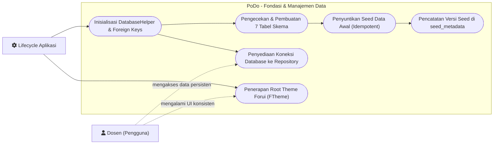
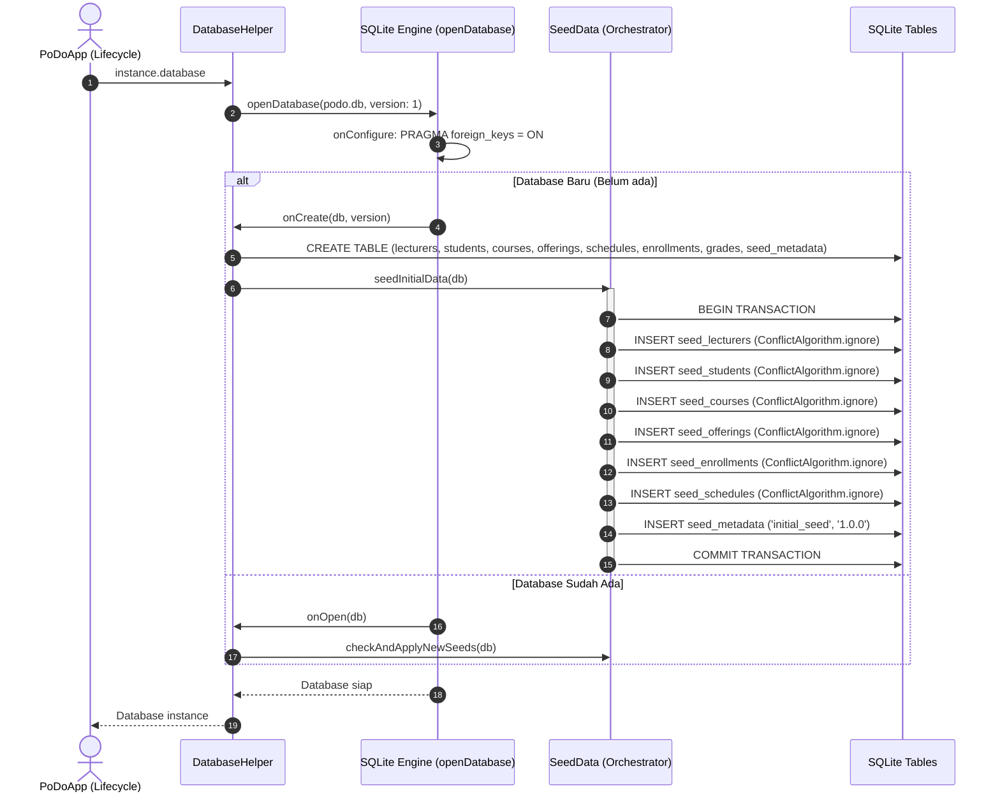

# Foundation & Database Implementation Plan

> **For agentic workers:** REQUIRED SUB-SKILL: Use superpowers:subagent-driven-development (recommended) or superpowers:executing-plans to implement this plan task-by-task. Steps use checkbox (`- [ ]`) syntax for tracking.

**Goal:** Menyiapkan fondasi proyek PoDo, mencakup instalasi dependencies (Forui, SQLite, Path), konfigurasi tema global Forui, pembuatan skema 7 tabel database SQLite dengan foreign key aktif, serta mekanisme seed data demo yang idempotent.

**Architecture:** Menggunakan arsitektur feature-based yang dipadukan dengan pola **Hardcoded Seed Data → SQLite → Repository → UI**. Seluruh akses data melalui `DatabaseHelper` dengan pelacakan metadata seed.

**Tech Stack:** Flutter, Dart, Forui (`forui`), SQLite (`sqflite`), `path`, dan `sqflite_common_ffi` (untuk pengujian unit test database di environment desktop/CLI).

**Spec / Rules:** `AGENTS.md` (Bagian 2, 4, 5, 7, 9).

---

## 1. Use Case Diagram

Diagram Use Case untuk inisialisasi sistem, database, dan penyediaan resource aplikasi:



---

## 2. Sequence Diagram

Alur inisialisasi database dan penyuntikan seed saat aplikasi pertama kali dijalankan:



---

## 3. Widget & Component Decision Matrix

Meskipun fase ini berfokus pada fondasi dan database, konfigurasi root widget dan tema global disiapkan pada tahap ini:

| Elemen UI | Sumber Komponen | Komponen Terpilih | Alasan Pemilihan & Referensi |
|---|---|---|---|
| Root App Theme | Forui | `FTheme` | Wrapper styling & token theme resmi Forui (`FThemes.zinc.light` / dark) |
| App Entry Root | Forui / Flutter | `MaterialApp` dengan builder `FTheme` | Sesuai panduan resmi Forui Getting Started agar semua sub-komponen Forui mewarisi tema yang valid |
| Font & Icon | Forui | Lucide Icons bawaan Forui | Menghindari icon library pihak ketiga sesuai AGENTS.md Bagian 4 |

---

## 4. Data Layer & SQLite Contract

### Tabel SQLite & Constraints:

1. **`lecturers`**:
   - `lecturer_id` (TEXT, PRIMARY KEY)
   - `full_name` (TEXT NOT NULL)
   - `title` (TEXT)
   - `nidh` (TEXT)
   - `email` (TEXT)
   - `phone` (TEXT)
   - `department` (TEXT)
   - `photo_path` (TEXT)

2. **`students`**:
   - `nim` (TEXT, PRIMARY KEY)
   - `full_name` (TEXT NOT NULL)
   - `study_program` (TEXT)
   - `department` (TEXT)
   - `phone` (TEXT)
   - `address` (TEXT)

3. **`courses`**:
   - `course_code` (TEXT, PRIMARY KEY)
   - `course_name` (TEXT NOT NULL)
   - `credits` (INTEGER NOT NULL)

4. **`course_offerings`**:
   - `offering_id` (TEXT, PRIMARY KEY)
   - `course_code` (TEXT NOT NULL, FOREIGN KEY → `courses.course_code`)
   - `lecturer_id` (TEXT NOT NULL, FOREIGN KEY → `lecturers.lecturer_id`)
   - `class_name` (TEXT NOT NULL)
   - `academic_year` (TEXT NOT NULL)
   - `term` (TEXT NOT NULL)

5. **`teaching_schedules`**:
   - `id` (INTEGER, PRIMARY KEY AUTOINCREMENT)
   - `offering_id` (TEXT NOT NULL, FOREIGN KEY → `course_offerings.offering_id`)
   - `day_of_week` (TEXT NOT NULL)
   - `room` (TEXT NOT NULL)
   - `start_time` (TEXT NOT NULL)
   - `end_time` (TEXT NOT NULL)

6. **`course_enrollments`**:
   - `id` (INTEGER, PRIMARY KEY AUTOINCREMENT)
   - `offering_id` (TEXT NOT NULL, FOREIGN KEY → `course_offerings.offering_id`)
   - `student_nim` (TEXT NOT NULL, FOREIGN KEY → `students.nim`)
   - `UNIQUE(offering_id, student_nim)`

7. **`grades`**:
   - `id` (INTEGER, PRIMARY KEY AUTOINCREMENT)
   - `enrollment_id` (INTEGER NOT NULL UNIQUE, FOREIGN KEY → `course_enrollments.id`)
   - `cpmk_1` (REAL)
   - `cpmk_2` (REAL)
   - `cpmk_3` (REAL)
   - `cpmk_4` (REAL)

8. **`seed_metadata`** (Internal):
   - `key` (TEXT, PRIMARY KEY)
   - `value` (TEXT NOT NULL)

---

## 5. Task Breakdown (Flutter TDD)

### Task 1: Inisialisasi Git & Dependensi Proyek
**Files:**
- Modify: `pubspec.yaml`
- Modify: `.gitignore`

**Interfaces:**
- Consumes: Flutter SDK
- Produces: `forui`, `sqflite`, `path` runtime packages, `sqflite_common_ffi` dev package.

- [ ] **Step 1: Inisialisasi Git repository**
  Jalankan `git init` dan pastikan `.gitignore` mengabaikan build artifacts dan file database lokal.
- [ ] **Step 2: Tambahkan dependencies ke `pubspec.yaml`**
  Tambahkan `forui`, `sqflite`, `path` dan di dev_dependencies `sqflite_common_ffi`.
- [ ] **Step 3: Jalankan `flutter pub get`**
  Pastikan resolusi package berhasil tanpa konflik.
- [ ] **Step 4: Verifikasi static analysis**
  Run: `flutter analyze`
  Expected: No issues found.
- [ ] **Step 5: Commit**
  ```bash
  git add .
  git commit -m "chore: initialize git repository and add core dependencies"
  ```

---

### Task 2: Setup Core Theme & Root Application Entry Point
**Files:**
- Create: `lib/core/theme/app_theme.dart`
- Create: `lib/app/app.dart`
- Modify: `lib/main.dart`
- Test: `test/app/app_test.dart`

**Interfaces:**
- Consumes: `forui` (`FTheme`, `FThemes`)
- Produces: `PoDoApp` root widget dengan konfigurasi tema Forui.

- [ ] **Step 1: Tulis failing test untuk `PoDoApp`**
  Buat test `test/app/app_test.dart` yang memverifikasi bahwa widget `PoDoApp` me-render `FTheme` wrapper dengan benar.
- [ ] **Step 2: Jalankan test dan pastikan gagal**
  Run: `flutter test test/app/app_test.dart`
  Expected: FAIL (class `PoDoApp` belum ada).
- [ ] **Step 3: Implementasi `lib/core/theme/app_theme.dart` & `lib/app/app.dart`**
  Buat konfigurasi tema Forui dan root widget `PoDoApp`. Perbarui `lib/main.dart`.
- [ ] **Step 4: Jalankan test dan pastikan lolos**
  Run: `flutter test test/app/app_test.dart`
  Expected: PASS.
- [ ] **Step 5: Verifikasi static analysis**
  Run: `flutter analyze`
  Expected: No issues found.
- [ ] **Step 6: Commit**
  ```bash
  git add lib/core/theme/ lib/app/ lib/main.dart test/app/
  git commit -m "feat(core): setup Forui theme and root application widget"
  ```

---

### Task 3: Inisialisasi Database Helper & Skema Tabel
**Files:**
- Create: `lib/core/database/database_helper.dart`
- Test: `test/core/database/database_helper_test.dart`

**Interfaces:**
- Consumes: `sqflite`, `path`, `sqflite_common_ffi`
- Produces: `DatabaseHelper.instance.database`, aktivasi `PRAGMA foreign_keys = ON`, dan seluruh skema tabel.

- [ ] **Step 1: Tulis failing test untuk DatabaseHelper**
  Buat test di `test/core/database/database_helper_test.dart` yang memverifikasi:
  - Database berhasil dibuka secara in-memory (menggunakan ffi).
  - `PRAGMA foreign_keys` bernilai 1.
  - Semua tabel (`lecturers`, `students`, `courses`, `course_offerings`, `teaching_schedules`, `course_enrollments`, `grades`, `seed_metadata`) terbuat dengan kolom yang sesuai.
- [ ] **Step 2: Jalankan test dan pastikan gagal**
  Run: `flutter test test/core/database/database_helper_test.dart`
  Expected: FAIL.
- [ ] **Step 3: Implementasikan `DatabaseHelper`**
  Implementasikan singleton `DatabaseHelper`, DDL skema 8 tabel, dan handler `onConfigure`.
- [ ] **Step 4: Jalankan test dan pastikan lolos**
  Run: `flutter test test/core/database/database_helper_test.dart`
  Expected: PASS.
- [ ] **Step 5: Verifikasi static analysis**
  Run: `flutter analyze`
  Expected: No issues found.
- [ ] **Step 6: Commit**
  ```bash
  git add lib/core/database/database_helper.dart test/core/database/
  git commit -m "feat(database): implement DatabaseHelper with 7 tables schema and foreign key pragma"
  ```

---

### Task 4: Pembuatan Seed Constants & Seeder Idempotent
**Files:**
- Create: `lib/core/database/seed/seed_lecturers.dart`
- Create: `lib/core/database/seed/seed_students.dart`
- Create: `lib/core/database/seed/seed_courses.dart`
- Create: `lib/core/database/seed/seed_offerings.dart`
- Create: `lib/core/database/seed/seed_enrollments.dart`
- Create: `lib/core/database/seed/seed_schedules.dart`
- Create: `lib/core/database/seed/seed_data.dart`
- Modify: `lib/core/database/database_helper.dart` (panggil `SeedData.seedInitialData`)
- Test: `test/core/database/seed_data_test.dart`

**Interfaces:**
- Consumes: Konstanta seed awal
- Produces: `SeedData.seedInitialData(Database db)` menggunakan transaksi & `ConflictAlgorithm.ignore`.

- [ ] **Step 1: Tulis failing test untuk SeedData**
  Buat test di `test/core/database/seed_data_test.dart`:
  - Menjalankan seed dan memverifikasi jumlah record pada setiap tabel terisi data demo.
  - Menjalankan ulang seed kedua kali dan memverifikasi data tidak duplikat (idempotent).
  - Memverifikasi `seed_metadata` mencatat versi seed awal.
- [ ] **Step 2: Jalankan test dan pastikan gagal**
  Run: `flutter test test/core/database/seed_data_test.dart`
  Expected: FAIL.
- [ ] **Step 3: Implementasikan file-file konstanta seed & `SeedData` orchestrator**
  - Buat data demo valid untuk dosen, mahasiswa, mata kuliah, offering, enrollment, dan jadwal.
  - Eksekusi insert dalam batch transaksi sesuai urutan dependensi foreign key.
- [ ] **Step 4: Jalankan test dan pastikan lolos**
  Run: `flutter test test/core/database/seed_data_test.dart`
  Expected: PASS.
- [ ] **Step 5: Verifikasi static analysis**
  Run: `flutter analyze`
  Expected: No issues found.
- [ ] **Step 6: Commit**
  ```bash
  git add lib/core/database/seed/ test/core/database/
  git commit -m "feat(database): implement idempotent seed data for demo academic records"
  ```

---

## 6. Verification Checklist

- [ ] Semua diagram Mermaid (`flowchart LR` & `sequenceDiagram`) valid dan terverifikasi.
- [ ] `PRAGMA foreign_keys = ON` aktif dan diverifikasi lewat unit test.
- [ ] `ConflictAlgorithm.ignore` digunakan agar data yang diedit pengguna tidak ter-overwrite.
- [ ] Seluruh unit test berjalan sukses via `flutter test`.
- [ ] `flutter analyze` menghasilkan 0 issues/errors.
