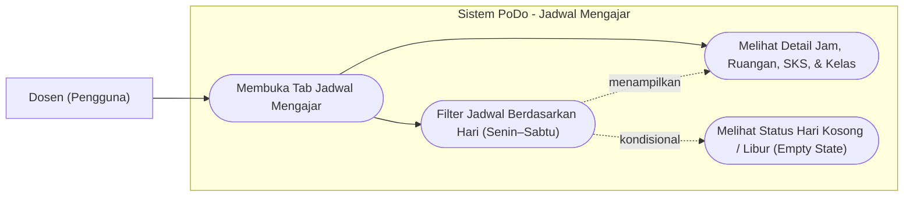
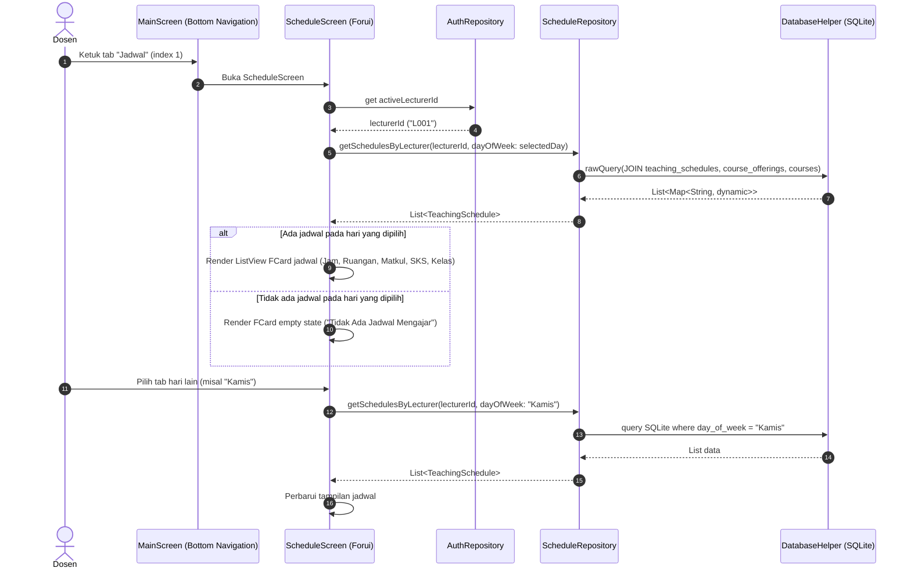

# Tahap 5: Jadwal Mengajar (Schedule Screen) Implementation Plan

> **For agentic workers:** REQUIRED SUB-SKILL: Use superpowers:subagent-driven-development (recommended) or superpowers:executing-plans to implement this plan task-by-task. Steps use checkbox (`- [ ]`) syntax for tracking.

**Goal:** Membangun `ScheduleScreen` (Tab ke-2 di Bottom Navigation) yang menampilkan jadwal mengajar dosen aktif dari database SQLite, dilengkapi filter hari perkuliahan (Senin–Sabtu), informasi detail mata kuliah, kelas, ruangan, jam perkuliahan, dan kartu empty state ketika tidak ada perkuliahan pada hari yang dipilih.

**Architecture:** Menggunakan *feature-based architecture* (`lib/features/schedule/`) dengan pemisahan tanggung jawab yang ketat: `models/teaching_schedule.dart` merepresentasikan data jadwal beserta informasi relasi mata kuliah/kelas, `repositories/schedule_repository.dart` mengelola query relasional SQLite (`teaching_schedules` JOIN `course_offerings` JOIN `courses`), dan `screens/schedule_screen.dart` menampilkan antarmuka berbasis Forui.

**Tech Stack:** Flutter, Dart, Forui (`forui`), SQLite (`sqflite` & `sqflite_common_ffi`), `path`.

**Spec / Rules:** `AGENTS.md` (Bagian 2, 3.1, 3.2, 5, 7, 9.5).

---

## 1. Use Case Diagram



---

## 2. Sequence Diagram



---

## 3. Widget & Component Decision Matrix

Sesuai kebijakan Forui-first pada **AGENTS.md Bagian 5**, seluruh elemen UI interaktif dan struktural dipetakan dengan hierarki: `lib/core/widgets/` $\rightarrow$ Forui (`forui`) $\rightarrow$ Custom Widget (hanya jika tidak tersedia).

| Elemen UI | Sumber Komponen | Komponen Terpilih | Alasan Pemilihan & Referensi |
|---|---|---|---|
| Page Scaffold | Forui | `FScaffold` | Scaffold resmi Forui untuk konsistensi layout, background, dan safe area |
| Header Halaman | Forui | `FHeader` | Header standar Forui menampilkan judul "Jadwal Mengajar" dan subtitle semester |
| Filter Pemilihan Hari | Forui | `FTabs(scrollable: true)` | Komponen resmi Forui untuk navigasi tab horizontal scrollable ('Senin', 'Selasa', 'Rabu', 'Kamis', 'Jumat', 'Sabtu') |
| Kartu Jadwal Mengajar | Forui | `FCard` | Mengelompokkan satu informasi jadwal perkuliahan secara modular dan rapi |
| Badge SKS / Status | Forui | `FBadge(variant: FBadgeVariant.secondary)` | Menampilkan jumlah SKS mata kuliah secara ringkas di kartu |
| Empty State Hari Kosong | Forui | `FCard` | Kartu informasi dengan ikon kalender kosong saat tidak ada jadwal kuliah |
| Ikon Waktu & Ruangan | Forui Assets | `FLucideIcons.clock`, `FLucideIcons.mapPin`, `FLucideIcons.bookOpen`, `FLucideIcons.calendarX` | Ikon resmi Forui Lucide sesuai design system PoDo |
| Layout Primitives | Flutter Core | `Padding`, `Column`, `Row`, `ListView.builder`, `SizedBox` | Diizinkan oleh AGENTS.md Bagian 5.4 untuk komposisi tata letak |

> [!IMPORTANT]
> **Larangan:** Tidak diperkenankan menggunakan widget Material (`Card`, `TabBar`, `ListTile`, `Chip`) atau Cupertino sebagai pengganti komponen Forui.

---

## 4. Data Layer & SQLite Contract

### 4.1 Tabel Terlibat

1. **`teaching_schedules`**:
   - `id` (INTEGER, PK AUTOINCREMENT)
   - `offering_id` (TEXT, FK ke `course_offerings.offering_id`)
   - `day_of_week` (TEXT: 'Senin', 'Selasa', 'Rabu', 'Kamis', 'Jumat', 'Sabtu')
   - `room` (TEXT: misal 'KU3.01')
   - `start_time` (TEXT: '08:00')
   - `end_time` (TEXT: '10:30')
   - Constraint: `UNIQUE(offering_id, day_of_week, start_time)`

2. **`course_offerings`**:
   - `offering_id` (TEXT, PK)
   - `course_code` (TEXT, FK ke `courses.course_code`)
   - `lecturer_id` (TEXT, FK ke `lecturers.lecturer_id`)
   - `class_name` (TEXT: 'IF-44-01')
   - `academic_year` (TEXT: '2024/2025')
   - `term` (TEXT: 'Ganjil')

3. **`courses`**:
   - `course_code` (TEXT, PK)
   - `course_name` (TEXT: 'Pemrograman Mobile')
   - `credits` (INTEGER: 3)

### 4.2 Query Relasional Jadwal Dosen

```sql
SELECT 
  ts.id,
  ts.offering_id,
  ts.day_of_week,
  ts.room,
  ts.start_time,
  ts.end_time,
  co.class_name,
  co.academic_year,
  co.term,
  c.course_code,
  c.course_name,
  c.credits
FROM teaching_schedules ts
JOIN course_offerings co ON ts.offering_id = co.offering_id
JOIN courses c ON co.course_code = c.course_code
WHERE co.lecturer_id = ?
  AND (? IS NULL OR ts.day_of_week = ?)
ORDER BY 
  CASE ts.day_of_week
    WHEN 'Senin' THEN 1
    WHEN 'Selasa' THEN 2
    WHEN 'Rabu' THEN 3
    WHEN 'Kamis' THEN 4
    WHEN 'Jumat' THEN 5
    WHEN 'Sabtu' THEN 6
    ELSE 7
  END,
  ts.start_time ASC
```

### 4.3 ScheduleRepository Contract

```dart
class ScheduleRepository {
  ScheduleRepository._();
  static final ScheduleRepository instance = ScheduleRepository._();

  Future<List<TeachingSchedule>> getSchedulesByLecturer(
    String lecturerId, {
    String? dayOfWeek,
  });

  Future<TeachingSchedule?> getScheduleById(int id);
}
```

---

## 5. Task Breakdown (Flutter TDD)

### Task 1: TeachingSchedule Model
**Files:**
- Create: `lib/features/schedule/models/teaching_schedule.dart`
- Test: `test/features/schedule/models/teaching_schedule_test.dart`

**Interfaces:**
- Produces: `TeachingSchedule` entity dengan deserialisasi map, serialisasi, copyWith, dan kesetaraan nilai.

- [ ] **Step 1: Write failing unit test for TeachingSchedule**
  - Buat `test/features/schedule/models/teaching_schedule_test.dart`.
  - Uji deserialisasi `fromMap()` dengan join fields (`course_name`, `class_name`, `credits`, dsb.).
  - Uji serialisasi `toMap()`.
  - Uji `copyWith()`.
- [ ] **Step 2: Run test to verify it fails**
  - Run: `flutter test test/features/schedule/models/teaching_schedule_test.dart`
  - Expected: Compilation error (class not found).
- [ ] **Step 3: Implement TeachingSchedule model**
  - Buat `lib/features/schedule/models/teaching_schedule.dart` dengan immutable fields, constructor, `fromMap`, `toMap`, `copyWith`, `operator ==`, dan `hashCode`.
- [ ] **Step 4: Run test to verify it passes**
  - Run: `flutter test test/features/schedule/models/teaching_schedule_test.dart`
  - Expected: ALL TESTS PASS.
- [ ] **Step 5: Run static analysis**
  - Run: `flutter analyze`
  - Expected: No issues found.
- [ ] **Step 6: Commit**
  - Run:
    ```bash
    git add lib/features/schedule/models/teaching_schedule.dart test/features/schedule/models/teaching_schedule_test.dart
    git commit -m "feat(schedule): implement TeachingSchedule model with relational fields and serialization"
    ```

---

### Task 2: ScheduleRepository with SQLite Queries
**Files:**
- Create: `lib/features/schedule/repositories/schedule_repository.dart`
- Test: `test/features/schedule/repositories/schedule_repository_test.dart`

**Interfaces:**
- Consumes: `DatabaseHelper.instance.database`
- Produces: `ScheduleRepository.instance.getSchedulesByLecturer(lecturerId, {dayOfWeek})`

- [ ] **Step 1: Write failing integration test for ScheduleRepository**
  - Buat `test/features/schedule/repositories/schedule_repository_test.dart` menggunakan `sqflite_common_ffi` dan seed database in-memory.
  - Test case 1: Mengambil seluruh jadwal untuk dosen L001 diurutkan berdasarkan hari dan jam.
  - Test case 2: Memfilter jadwal dosen L001 berdasarkan hari ('Senin' mengembalikan 1 jadwal, 'Rabu' mengembalikan list kosong).
  - Test case 3: Mengambil jadwal untuk dosen L002 (hanya jadwal L002 yang muncul).
  - Test case 4: Mengambil detail jadwal berdasarkan `id`.
- [ ] **Step 2: Run test to verify it fails**
  - Run: `flutter test test/features/schedule/repositories/schedule_repository_test.dart`
  - Expected: Compilation error (ScheduleRepository not found).
- [ ] **Step 3: Implement ScheduleRepository**
  - Buat `lib/features/schedule/repositories/schedule_repository.dart`.
  - Tulis SQL JOIN parameterized query antara `teaching_schedules`, `course_offerings`, dan `courses`.
- [ ] **Step 4: Run test to verify it passes**
  - Run: `flutter test test/features/schedule/repositories/schedule_repository_test.dart`
  - Expected: ALL TESTS PASS.
- [ ] **Step 5: Run static analysis**
  - Run: `flutter analyze`
  - Expected: No issues found.
- [ ] **Step 6: Commit**
  - Run:
    ```bash
    git add lib/features/schedule/repositories/schedule_repository.dart test/features/schedule/repositories/schedule_repository_test.dart
    git commit -m "feat(schedule): implement ScheduleRepository with relational SQLite queries"
    ```

---

### Task 3: ScheduleScreen UI (FTabs Day Filter, Schedule Cards, & Empty State)
**Files:**
- Modify: `lib/features/schedule/screens/schedule_screen.dart`
- Test: `test/features/schedule/screens/schedule_screen_test.dart`

**Component Mapping Applied:**
- Header: `FHeader` ("Jadwal Mengajar").
- Filter Hari: `FTabs(scrollable: true)` dengan entri: 'Senin', 'Selasa', 'Rabu', 'Kamis', 'Jumat', 'Sabtu'.
- Kartu Perkuliahan: `FCard` + `FBadge` (SKS) + `FLucideIcons.clock` (waktu) + `FLucideIcons.mapPin` (ruangan) + `FLucideIcons.bookOpen` (kelas & matkul).
- Empty State: `FCard` dengan pesan ramah saat hari tidak ada jadwal.

- [ ] **Step 1: Write failing widget tests for ScheduleScreen**
  - Buat `test/features/schedule/screens/schedule_screen_test.dart`.
  - Test case 1: Menampilkan header 'Jadwal Mengajar' dan tab filter hari.
  - Test case 2: Menampilkan kartu jadwal mengajar pada hari default ('Senin') untuk dosen aktif (L001 -> 'Pemrograman Mobile', 'KU3.01', '08:00 - 10:30').
  - Test case 3: Berpindah ke tab 'Selasa' memperbarui daftar menampilkan 'Rekayasa Perangkat Lunak' ('KU3.05').
  - Test case 4: Berpindah ke tab 'Rabu' menampilkan empty state "Tidak Ada Jadwal Mengajar".
  - Test case 5: Menampilkan badge SKS dan nama kelas dengan tepat.
- [ ] **Step 2: Run test to verify it fails**
  - Run: `flutter test test/features/schedule/screens/schedule_screen_test.dart`
  - Expected: FAIL.
- [ ] **Step 3: Implement ScheduleScreen**
  - Ganti stub `lib/features/schedule/screens/schedule_screen.dart` dengan implementasi lengkap menggunakan komponen Forui.
  - Integrasikan dengan `AuthRepository.instance.currentUser` untuk memperoleh ID dosen aktif.
  - Tangani perubahan tab hari dan pemuatan data asinkron dari `ScheduleRepository`.
- [ ] **Step 4: Run test to verify it passes**
  - Run: `flutter test test/features/schedule/screens/schedule_screen_test.dart`
  - Expected: ALL TESTS PASS.
- [ ] **Step 5: Run static analysis**
  - Run: `flutter analyze`
  - Expected: No issues found.
- [ ] **Step 6: Commit**
  - Run:
    ```bash
    git add lib/features/schedule/screens/schedule_screen.dart test/features/schedule/screens/schedule_screen_test.dart
    git commit -m "feat(schedule): implement ScheduleScreen with FTabs day filter, schedule cards, and empty state"
    ```

---

### Task 4: MainScreen Bottom Navigation & Full Flow Integration Test
**Files:**
- Create: `test/features/schedule/schedule_flow_test.dart`
- Verify: `test/app/main_screen_test.dart`

**Interfaces:**
- Memastikan navigasi tab ke-2 (`Jadwal`) di `MainScreen` memuat `ScheduleScreen` yang terhubung langsung ke SQLite dan menampilkan jadwal dosen aktif.

- [ ] **Step 1: Write integration flow test**
  - Buat `test/features/schedule/schedule_flow_test.dart`.
  - Alur integrasi: Login dosen L001 $\rightarrow$ Buka `MainScreen` $\rightarrow$ Ketuk tab 'Jadwal' pada `FBottomNavigationBar` $\rightarrow$ Verifikasi `ScheduleScreen` muncul $\rightarrow$ Cek jadwal hari Senin $\rightarrow$ Pindah ke hari Selasa $\rightarrow$ Cek jadwal terbarui $\rightarrow$ Pindah ke hari Rabu $\rightarrow$ Cek pesan jadwal kosong.
- [ ] **Step 2: Run test to verify it passes**
  - Run: `flutter test test/features/schedule/schedule_flow_test.dart`
  - Expected: ALL TESTS PASS.
- [ ] **Step 3: Run full project test suite & static analysis**
  - Run: `flutter test && flutter analyze`
  - Expected: ALL PASS (100%), 0 issues.
- [ ] **Step 4: Commit**
  - Run:
    ```bash
    git add test/features/schedule/schedule_flow_test.dart
    git commit -m "test(schedule): add integration flow test for ScheduleScreen tab in MainScreen"
    ```

---

## 6. Verification Checklist

- [ ] Seluruh diagram Mermaid dirender valid tanpa sintaks error.
- [ ] Tidak ada penggunaan widget Material/Cupertino yang menggantikan Forui (`FScaffold`, `FHeader`, `FTabs`, `FCard`, `FBadge`).
- [ ] Data jadwal dibaca murni melalui `ScheduleRepository` $\rightarrow$ SQLite (`teaching_schedules` JOIN `course_offerings` JOIN `courses`).
- [ ] Filter jadwal berdasarkan dosen aktif (`lecturer_id`) dan hari perkuliahan (`day_of_week`).
- [ ] Sorting jadwal mengajar berdasarkan jam mulai (`start_time ASC`).
- [ ] Empty state ditampilkan secara ramah saat hari tidak memiliki jadwal mengajar.
- [ ] `flutter analyze` menghasilkan **0 issues**.
- [ ] `flutter test` lulus **100%**.
- [ ] Tidak ada `Co-authored-by:` atau atribusi AI pada commit git.
