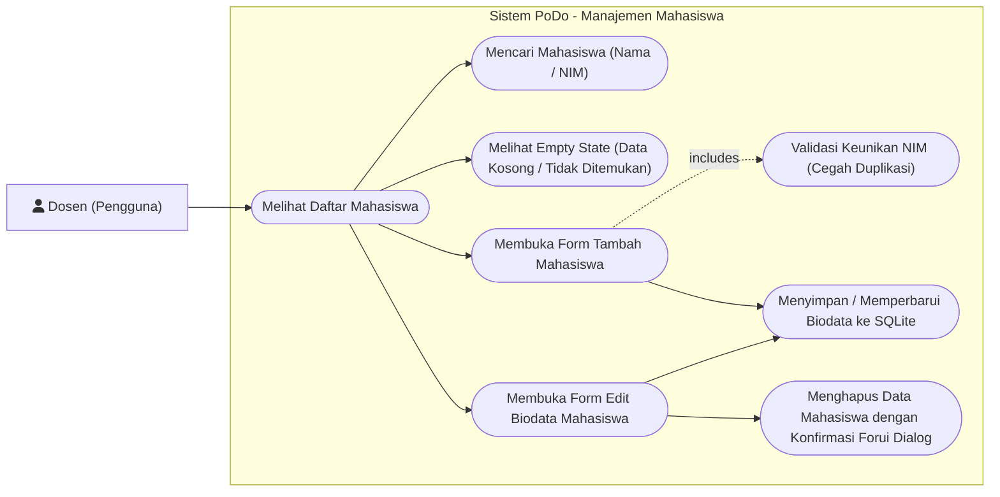
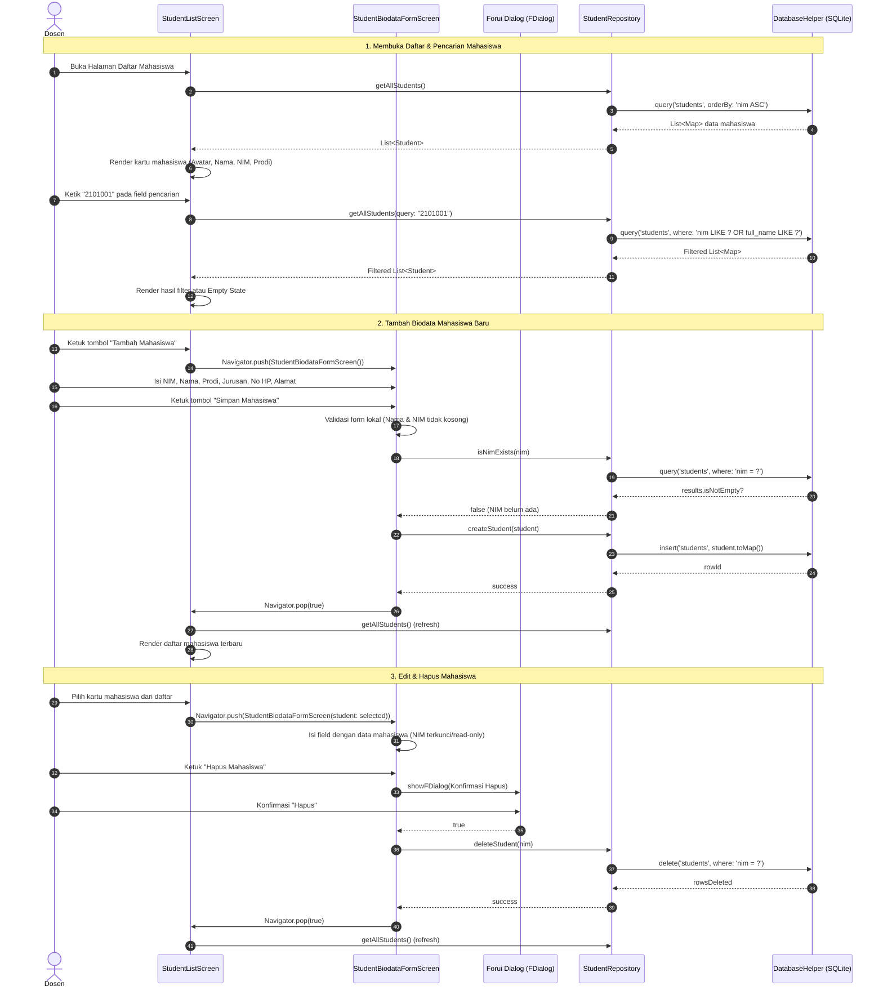

# Tahap 4: Manajemen Mahasiswa (Student List Screen & Student Biodata Form Screen) Implementation Plan

> **For agentic workers:** REQUIRED SUB-SKILL: Use superpowers:subagent-driven-development (recommended) or superpowers:executing-plans to implement this plan task-by-task. Steps use checkbox (`- [ ]`) syntax for tracking.

**Goal:** Mengimplementasikan fitur Manajemen Mahasiswa lengkap meliputi Daftar Mahasiswa (`StudentListScreen`) dengan pencarian real-time dan empty state, serta Form Biodata Mahasiswa (`StudentBiodataFormScreen`) untuk mode tambah dan ubah data dengan validasi keunikan NIM pada SQLite lokal.

**Architecture:** Feature-based architecture (`lib/features/students/models/`, `repositories/`, `screens/`). Seluruh data mahasiswa disimpan dan dikelola pada tabel SQLite `students` melalui `StudentRepository`. UI menggunakan komponen Forui murni (`FHeader.nested`, `FTextField`, `FCard`, `FTappable`, `FAvatar`, `FBadge`, `FButton`, `showFDialog`) tanpa widget Material/Cupertino.

**Tech Stack:** Flutter, Dart, Forui (`forui` 0.27.7), Lucide Icons (`FLucideIcons`), SQLite (`sqflite`), `sqflite_common_ffi` (testing).

**Spec / Rules:** [AGENTS.md](file:///home/muzaaqi/Learn/podo/AGENTS.md) (Bagian 2, 3, 5, 7, 9.2, 9.8, 10, 11, 13).

---

## 1. Use Case Diagram



---

## 2. Sequence Diagram



---

## 3. Widget & Component Decision Matrix

Setiap elemen antarmuka dipetakan sesuai hierarki:
`lib/core/widgets/` $\rightarrow$ Forui Library (`forui`) $\rightarrow$ Custom Widget (dengan justifikasi tertulis).

| Elemen UI | Sumber Komponen | Komponen Terpilih | Alasan Pemilihan & Referensi |
|---|---|---|---|
| Header Daftar Mahasiswa | Forui | `FHeader.nested` | Standar Forui untuk halaman turunan; dilengkapi tombol kembali (`prefixes`) dan tombol tambah (`suffixes`) |
| Field Pencarian Mahasiswa | Forui | `FTextField` | Input teks Forui dengan `prefix: Icon(FLucideIcons.search)` untuk pencarian instan nama/NIM |
| Kartu Item Mahasiswa | Forui | `FCard` + `FTappable` | Komponen Forui resmi untuk membungkus ringkasan mahasiswa secara tappable |
| Avatar Inisial Mahasiswa | Forui | `FAvatar.raw` | Menampilkan avatar lingkaran dengan inisial nama mahasiswa |
| Badge Program Studi | Forui | `FBadge` (`variant: FBadgeVariant.secondary`) | Menampilkan label program studi secara ringkas dan bersih |
| Empty State Banner | Forui | `FCard` | Kontainer bersih saat data mahasiswa kosong atau hasil pencarian nihil |
| Form Fields (NIM, Nama, dll) | Forui | `FTextField` | Input teks Forui dengan `FTextFieldControl.managed`, error state, dan keyboard type khusus |
| Tombol Simpan Form | Forui | `FButton` (`variant: FButtonVariant.primary`) | Tombol aksi utama untuk submit biodata |
| Tombol Hapus Mahasiswa | Forui | `FButton` (`variant: FButtonVariant.destructive`) | Tombol aksi destruktif untuk menghapus mahasiswa (hanya pada mode edit) |
| Dialog Konfirmasi Hapus | Forui | `showFDialog` + `FDialog` | Dialog konfirmasi modal resmi Forui sebelum menghapus data permanen |
| Layout & Scrolling | Flutter Core | `Padding`, `Column`, `Row`, `ListView`, `SingleChildScrollView`, `SizedBox` | Widget dasar Flutter untuk tata letak dan scroll responsif saat keyboard aktif |

> [!IMPORTANT]
> **Larangan:** Tidak ada penggunaan widget Material (`ElevatedButton`, `TextField`, `AlertDialog`, `ListTile`) atau Cupertino. Seluruh interaksi input dan dialog menggunakan Forui.

---

## 4. Data Layer & SQLite Contract

### A. Tabel SQLite yang Terlibat

Tabel **`students`** (sesuai `AGENTS.md` Bagian 9.2):
- `nim`: TEXT (PRIMARY KEY)
- `full_name`: TEXT (NOT NULL)
- `study_program`: TEXT
- `department`: TEXT
- `phone`: TEXT
- `address`: TEXT

### B. Interface & Method Signatures

```dart
// lib/features/students/models/student.dart
class Student {
  final String nim;
  final String fullName;
  final String? studyProgram;
  final String? department;
  final String? phone;
  final String? address;

  const Student({
    required this.nim,
    required this.fullName,
    this.studyProgram,
    this.department,
    this.phone,
    this.address,
  });

  factory Student.fromMap(Map<String, dynamic> map);
  Map<String, dynamic> toMap();
  Student copyWith({...});
}

// lib/features/students/repositories/student_repository.dart
class StudentRepository {
  Future<List<Student>> getAllStudents({String? query});
  Future<Student?> getStudentByNim(String nim);
  Future<bool> isNimExists(String nim);
  Future<void> createStudent(Student student);
  Future<void> updateStudent(Student student);
  Future<void> deleteStudent(String nim);
}
```

---

## 5. Task Breakdown (Flutter TDD)

### Task 1: Student Model
**Files:**
- Create: `lib/features/students/models/student.dart`
- Test: `test/features/students/models/student_test.dart`

**Interfaces:**
- Produces: `Student.fromMap()`, `Student.toMap()`, `Student.copyWith()`

- [ ] **Step 1: Write failing tests for Student model**
  - Buat file `test/features/students/models/student_test.dart`.
  - Uji serialisasi/deserialisasi `fromMap` dan `toMap`.
  - Uji perlakuan kolom opsional bernilai `null`.
  - Uji fungsi `copyWith`.
- [ ] **Step 2: Run test to verify it fails**
  - Run: `flutter test test/features/students/models/student_test.dart`
  - Expected: Compilation error (file model belum ada).
- [ ] **Step 3: Implement Student model**
  - Tulis `lib/features/students/models/student.dart` sesuai skema tabel `students`.
- [ ] **Step 4: Run test to verify it passes**
  - Run: `flutter test test/features/students/models/student_test.dart`
  - Expected: ALL TESTS PASS.
- [ ] **Step 5: Run static analysis**
  - Run: `flutter analyze`
  - Expected: No issues found.
- [ ] **Step 6: Commit**
  - Run:
    ```bash
    git add lib/features/students/models test/features/students/models
    git commit -m "feat(students): implement Student model with serialization and copyWith"
    ```

---

### Task 2: StudentRepository & SQLite CRUD Operations
**Files:**
- Create: `lib/features/students/repositories/student_repository.dart`
- Test: `test/features/students/repositories/student_repository_test.dart`

**Interfaces:**
- Consumes: `DatabaseHelper.instance.database`
- Produces: `StudentRepository.getAllStudents()`, `getStudentByNim()`, `isNimExists()`, `createStudent()`, `updateStudent()`, `deleteStudent()`

- [ ] **Step 1: Write failing tests for StudentRepository**
  - Buat file `test/features/students/repositories/student_repository_test.dart` menggunakan `sqflite_common_ffi` dan in-memory database.
  - Test case 1: `getAllStudents` mengembalikan data awal dari seed database.
  - Test case 2: `getAllStudents(query: ...)` memfilter berdasarkan nama atau NIM.
  - Test case 3: `isNimExists` mengembalikan `true` untuk NIM terdaftar dan `false` untuk NIM baru.
  - Test case 4: `createStudent` menambah record baru ke SQLite dan gagal jika NIM duplikat.
  - Test case 5: `updateStudent` memperbarui record mahasiswa yang ada.
  - Test case 6: `deleteStudent` menghapus record mahasiswa dari SQLite.
- [ ] **Step 2: Run test to verify it fails**
  - Run: `flutter test test/features/students/repositories/student_repository_test.dart`
  - Expected: Compilation error.
- [ ] **Step 3: Implement StudentRepository**
  - Implementasikan class `StudentRepository` dengan method CRUD SQLite lengkap dan sanitasi query.
- [ ] **Step 4: Run test to verify it passes**
  - Run: `flutter test test/features/students/repositories/student_repository_test.dart`
  - Expected: ALL TESTS PASS.
- [ ] **Step 5: Run static analysis**
  - Run: `flutter analyze`
  - Expected: No issues found.
- [ ] **Step 6: Commit**
  - Run:
    ```bash
    git add lib/features/students/repositories test/features/students/repositories
    git commit -m "feat(students): implement StudentRepository with sqlite CRUD queries and search"
    ```

---

### Task 3: Student Biodata Form Screen (Create & Edit Mode with NIM Validation)
**Files:**
- Modify: `lib/features/students/screens/student_biodata_form_screen.dart`
- Test: `test/features/students/screens/student_biodata_form_screen_test.dart`

**Component Mapping Applied:**
- Header: `FHeader.nested` dengan judul dinamis ('Tambah Mahasiswa' / 'Edit Biodata Mahasiswa').
- Form Inputs: `FTextField` (NIM, Nama Lengkap, Program Studi, Jurusan, Nomor Telepon, Alamat).
- Primary Button: `FButton` ('Simpan Mahasiswa' / 'Simpan Perubahan').
- Destructive Button: `FButton(variant: FButtonVariant.destructive)` ('Hapus Mahasiswa' pada mode edit) dengan konfirmasi modal `showFDialog`.

- [ ] **Step 1: Write failing widget tests for StudentBiodataFormScreen**
  - Buat `test/features/students/screens/student_biodata_form_screen_test.dart`.
  - Test case 1: Mode create menampilkan field kosong dan judul "Tambah Mahasiswa".
  - Test case 2: Validasi input: Nama dan NIM tidak boleh kosong.
  - Test case 3: Validasi keunikan NIM pada mode create: menolak penyimpanan jika NIM sudah terdaftar.
  - Test case 4: Berhasil menyimpan mahasiswa baru dan pop dengan hasil `true`.
  - Test case 5: Mode edit mengisi form dengan data mahasiswa, NIM terkunci (read-only), dan tombol simpan memperbarui data.
  - Test case 6: Mode edit menyediakan tombol Hapus yang memicu `showFDialog` dan menghapus data saat dikonfirmasi.
- [ ] **Step 2: Run test to verify it fails**
  - Run: `flutter test test/features/students/screens/student_biodata_form_screen_test.dart`
  - Expected: FAIL.
- [ ] **Step 3: Implement StudentBiodataFormScreen**
  - Bangun `StudentBiodataFormScreen` menerima parameter opsional `Student? student`.
  - Integrasikan controllers, validasi inline, dan interaksi dengan `StudentRepository`.
  - Tambahkan dialog modal `showFDialog` untuk konfirmasi hapus.
- [ ] **Step 4: Run test to verify it passes**
  - Run: `flutter test test/features/students/screens/student_biodata_form_screen_test.dart`
  - Expected: ALL TESTS PASS.
- [ ] **Step 5: Run static analysis**
  - Run: `flutter analyze`
  - Expected: No issues found.
- [ ] **Step 6: Commit**
  - Run:
    ```bash
    git add lib/features/students/screens/student_biodata_form_screen.dart test/features/students/screens/student_biodata_form_screen_test.dart
    git commit -m "feat(students): implement StudentBiodataFormScreen with validation, create/edit modes, and delete dialog"
    ```

---

### Task 4: Student List Screen (Pencarian, Empty State, & Navigasi ke Form)
**Files:**
- Modify: `lib/features/students/screens/student_list_screen.dart`
- Test: `test/features/students/screens/student_list_screen_test.dart`

**Component Mapping Applied:**
- Header: `FHeader.nested` dengan tombol back dan action `userPlus`.
- Search Bar: `FTextField` dengan ikon pencarian.
- Student Item: `FTappable` + `FCard` + `FAvatar.raw` + `FBadge` program studi.
- Empty State: `FCard` dengan pesan jelas saat data kosong / pencarian tidak ditemukan.

- [ ] **Step 1: Write failing widget tests for StudentListScreen**
  - Buat `test/features/students/screens/student_list_screen_test.dart`.
  - Test case 1: Menampilkan daftar seluruh mahasiswa dari database seed.
  - Test case 2: Pencarian real-time memfilter daftar mahasiswa berdasarkan Nama atau NIM.
  - Test case 3: Menampilkan empty state saat pencarian tidak menemukan hasil.
  - Test case 4: Mengetuk tombol tambah mahasiswa pada header menavigasikan ke `StudentBiodataFormScreen`.
  - Test case 5: Mengetuk salah satu kartu mahasiswa membuka `StudentBiodataFormScreen` dalam mode edit.
  - Test case 6: Kembali dari form dengan hasil `true` otomatis me-refresh daftar mahasiswa.
- [ ] **Step 2: Run test to verify it fails**
  - Run: `flutter test test/features/students/screens/student_list_screen_test.dart`
  - Expected: FAIL.
- [ ] **Step 3: Implement StudentListScreen**
  - Implementasikan `StudentListScreen` dengan pembacaan asinkron dari `StudentRepository`.
  - Tambahkan controller pencarian teks dengan filter responsif.
  - Susun kartu item mahasiswa dan empty state menggunakan komponen Forui.
- [ ] **Step 4: Run test to verify it passes**
  - Run: `flutter test test/features/students/screens/student_list_screen_test.dart`
  - Expected: ALL TESTS PASS.
- [ ] **Step 5: Run static analysis**
  - Run: `flutter analyze`
  - Expected: No issues found.
- [ ] **Step 6: Commit**
  - Run:
    ```bash
    git add lib/features/students/screens/student_list_screen.dart test/features/students/screens/student_list_screen_test.dart
    git commit -m "feat(students): implement StudentListScreen with real-time search, empty state, and form integration"
    ```

---

### Task 5: Routing Configuration & End-to-End Integration
**Files:**
- Modify: `lib/app/routes.dart`
- Create: `test/features/students/student_management_flow_test.dart`

**Interfaces:**
- Memastikan navigasi rute `AppRoutes.studentList` dan `AppRoutes.studentBiodataForm` mendukung pengiriman argumen `Student?` untuk mode edit.

- [ ] **Step 1: Write integration flow test**
  - Buat `test/features/students/student_management_flow_test.dart`.
  - Uji alur lengkap: Buka Home $\rightarrow$ Quick action Informasi Mahasiswa $\rightarrow$ Student List $\rightarrow$ Tambah Mahasiswa baru $\rightarrow$ Simpan $\rightarrow$ Mahasiswa muncul di list $\rightarrow$ Edit mahasiswa $\rightarrow$ Update tersimpan di SQLite.
- [ ] **Step 2: Run test to verify it fails**
  - Run: `flutter test test/features/students/student_management_flow_test.dart`
  - Expected: FAIL.
- [ ] **Step 3: Update routing and verify end-to-end flow**
  - Sesuaikan `AppRoutes.routes` agar `AppRoutes.studentBiodataForm` dapat mengekstrak `ModalRoute.of(context)?.settings.arguments as Student?`.
- [ ] **Step 4: Run test to verify it passes**
  - Run: `flutter test test/features/students/student_management_flow_test.dart`
  - Expected: ALL TESTS PASS.
- [ ] **Step 5: Run full test suite & static analysis**
  - Run: `flutter test && flutter analyze`
  - Expected: ALL PASS, 0 issues.
- [ ] **Step 6: Commit**
  - Run:
    ```bash
    git add lib/app/routes.dart test/features/students/student_management_flow_test.dart
    git commit -m "feat(routes): enable route arguments for student biodata form and verify full flow"
    ```

---

## 6. Verification Checklist

- [ ] Seluruh diagram Mermaid dirender valid tanpa sintaks error.
- [ ] Tidak ada penggunaan widget Material/Cupertino yang menggantikan Forui.
- [ ] Data mahasiswa disimpan dan dikelola pada tabel SQLite `students` melalui `StudentRepository`.
- [ ] Validasi keunikan NIM mencegah pendaftaran ganda pada pembuatan mahasiswa baru.
- [ ] Mode edit mengunci field NIM dan memperbarui data di SQLite saat disimpan.
- [ ] Dialog konfirmasi hapus mahasiswa menggunakan `showFDialog` Forui.
- [ ] Pencarian mahasiswa real-time berfungsi untuk nama maupun NIM.
- [ ] `flutter analyze` menghasilkan **0 issues**.
- [ ] `flutter test` lulus **100%**.
- [ ] Tidak ada `Co-authored-by:` atau atribusi AI pada commit git.
