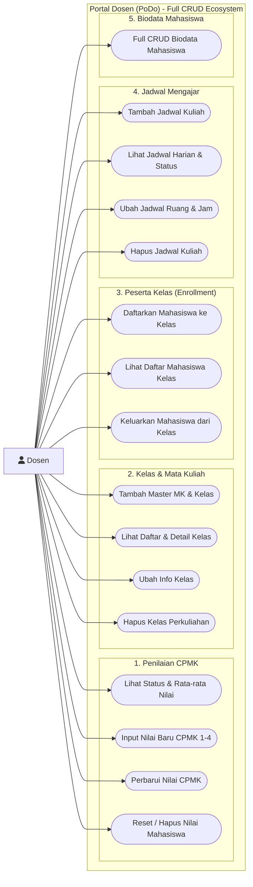
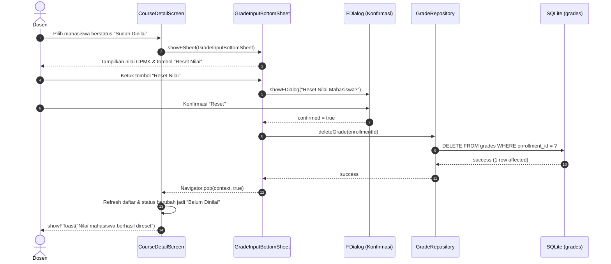
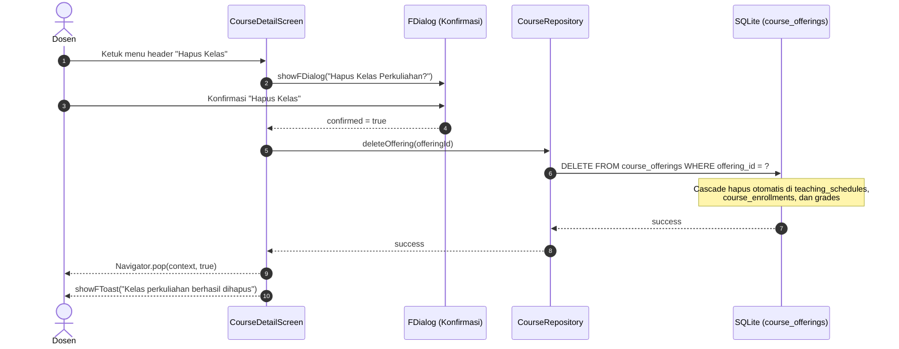
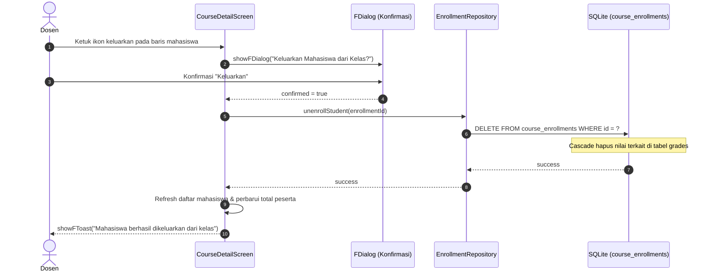
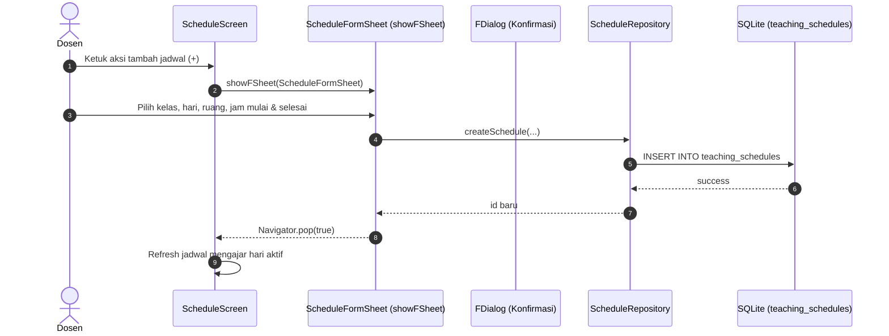

# Full CRUD Across All Modules Implementation Plan

> **For agentic workers:** REQUIRED SUB-SKILL: Use superpowers:subagent-driven-development (recommended) or superpowers:executing-plans to implement this plan task-by-task. Steps use checkbox (`- [ ]`) syntax for tracking.

**Goal:** Menerapkan fungsionalitas CRUD (Create, Read, Update, Delete) secara penuh pada seluruh 5 modul utama aplikasi PoDo: Penilaian Mahasiswa CPMK, Kelas Perkuliahan & Mata Kuliah, Pendaftaran Mahasiswa ke Kelas (Enrollment), Jadwal Mengajar Dosen, serta Verifikasi Biodata Mahasiswa.

**Architecture:** Arsitektur modular berbasis fitur (*feature-based*) yang mematuhi pola ketat **Seed -> SQLite -> Repository -> Forui UI**. Setiap operasi mutasi data (Create, Update, Delete) dieksekusi melalui transaksi SQLite dengan dukungan `PRAGMA foreign_keys = ON` dan *cascade deletion*, divalidasi dengan pengujian otomatis Flutter TDD (Unit & Widget Test), serta menggunakan komponen resmi Forui (`FButton`, `showFSheet`, `showFDialog`, `FTextField`, `FCard`, `FBadge`).

**Tech Stack:** Flutter, Dart, Forui (`forui`), SQLite (`sqflite` & `sqflite_common_ffi`), `path`.

**Spec / Rules:** `AGENTS.md` (Bagian 1, 2, 3, 5, 7, 9.1–9.8).

---

## 1. Use Case Diagram



---

## 2. Sequence Diagram

### A. Reset / Hapus Nilai CPMK (Delete Grade)


### B. Hapus Kelas Perkuliahan & Cascade (Delete Course Offering)


### C. Keluarkan Mahasiswa dari Kelas (Unenroll Student)


### D. CRUD Jadwal Mengajar (Create, Update, Delete Schedule)


---

## 3. Widget & Component Decision Matrix

| Fitur / Elemen UI | Sumber Komponen | Komponen Terpilih | Alasan Pemilihan & Referensi |
|---|---|---|---|
| **Tombol Reset Nilai** | Forui | `FButton` (`variant: FButtonVariant.destructive` atau `outline`) | Aksi destruktif untuk menghapus nilai CPMK kembali ke status kosong |
| **Konfirmasi Reset/Hapus** | Forui | `FDialog` via `showFDialog` | Dialog modal konfirmasi standar Forui untuk mencegah penghapusan tidak disengaja |
| **Menu Opsi Kelas** | Forui | `FHeaderAction` (ikon titik tiga atau trash) | Aksi header terintegrasi pada `FHeader.nested` untuk edit/hapus kelas |
| **Form Edit Kelas** | Forui | `showFSheet` (`AddClassOfferingSheet` mode edit) | Modal bottom sheet untuk mengubah nama kelas atau tahun akademik |
| **Aksi Keluarkan Mahasiswa** | Forui | `FTappable` + `Icon(FLucideIcons.userMinus)` | Aksi kontekstual pada item kartu mahasiswa di CourseDetail |
| **Form Tambah/Edit Jadwal** | Forui | `showFSheet` (`ScheduleFormSheet`) | Form overlay pemilihan kelas, hari, ruang, dan jam tanpa route baru |
| **Input Jam & Ruangan** | Forui | `FTextField` | Kolom masukan teks waktu (format HH:mm) dan kode ruangan |
| **Pilihan Kelas pada Jadwal** | Forui | `FSelect` | Komponen seleksi Forui untuk memilih offering/kelas dosen |
| **Tombol Hapus Jadwal** | Forui | `FButton` (`variant: FButtonVariant.destructive`) | Tombol hapus pada detail/edit jadwal |

---

## 4. Data Layer & SQLite Contract

### Skema Tabel Terkait:
- `course_offerings`: Primary key `offering_id`. Foreign key `course_code` (CASCADE), `lecturer_id` (CASCADE).
- `course_enrollments`: Primary key `id`. Unique `(offering_id, student_nim)`. Foreign keys ON DELETE CASCADE.
- `grades`: Primary key `id`. Unique `enrollment_id`. Foreign key `enrollment_id` ON DELETE CASCADE.
- `teaching_schedules`: Primary key `id`. Unique `(offering_id, day_of_week, start_time)`. Foreign key `offering_id` ON DELETE CASCADE.
- `students`: Primary key `nim`. Foreign key referensi di `course_enrollments`.

### Kontrak Method Repository Baru:
```dart
// 1. GradeRepository
Future<void> deleteGrade(int enrollmentId); // Menghapus nilai mahasiswa

// 2. CourseRepository
Future<void> updateOffering(CourseOffering offering); // Memperbarui nama kelas/periode
Future<void> deleteOffering(String offeringId); // Menghapus offering (cascade)
Future<void> updateCourse(Course course); // Memperbarui master mata kuliah
Future<void> deleteCourse(String courseCode); // Menghapus master mata kuliah (cascade)

// 3. EnrollmentRepository
Future<void> unenrollStudent(int enrollmentId); // Mengeluarkan mahasiswa dari kelas

// 4. ScheduleRepository
Future<void> updateSchedule(TeachingSchedule schedule); // Memperbarui ruang/jam jadwal
Future<void> deleteSchedule(int id); // Menghapus jadwal mengajar
```

---

## 5. Task Breakdown (Flutter TDD)

### Task 1: Modul Penilaian CPMK — Implementasi Reset / Hapus Nilai (Delete Grade)
**Files:**
- Modify: `lib/features/grades/repositories/grade_repository.dart`
- Modify: `lib/features/grades/widgets/grade_input_bottom_sheet.dart`
- Test: `test/features/grades/repositories/grade_repository_test.dart`
- Test: `test/features/grades/widgets/grade_input_bottom_sheet_test.dart`

- [ ] **Step 1: Write failing test untuk deleteGrade di repository dan tombol reset di bottom sheet**
  - Pastikan test memeriksa `deleteGrade(enrollmentId)` menghapus record dari tabel `grades`.
  - Pastikan widget test memeriksa tombol "Reset Nilai" muncul jika mahasiswa sudah memiliki nilai, dan memunculkan dialog konfirmasi.
- [ ] **Step 2: Run test to verify it fails**
  - Run: `flutter test test/features/grades/repositories/grade_repository_test.dart test/features/grades/widgets/grade_input_bottom_sheet_test.dart`
- [ ] **Step 3: Implement minimal code**
  - Tambahkan tombol "Reset Nilai" dengan varian outline/destructive pada `GradeInputBottomSheet`.
  - Hubungkan dengan konfirmasi `showFDialog` dan `GradeRepository.instance.deleteGrade`.
- [ ] **Step 4: Verify test passes**
  - Run: `flutter test test/features/grades/repositories/grade_repository_test.dart test/features/grades/widgets/grade_input_bottom_sheet_test.dart`
- [ ] **Step 5: Run analyze**
  - Run: `flutter analyze`
- [ ] **Step 6: Commit**
  - `git commit -m "feat(grades): implement delete and reset grade functionality with confirmation dialog"`

---

### Task 2: Modul Kelas Perkuliahan — Implementasi Update & Delete Offering
**Files:**
- Modify: `lib/features/courses/repositories/course_repository.dart`
- Modify: `lib/features/courses/screens/course_detail_screen.dart`
- Modify: `lib/features/courses/widgets/add_class_offering_sheet.dart`
- Test: `test/features/courses/repositories/course_repository_test.dart`
- Test: `test/features/courses/screens/course_detail_screen_test.dart`

- [ ] **Step 1: Write failing test untuk updateOffering dan deleteOffering di repository**
  - Uji update data kelas (nama kelas, tahun akademik, semester).
  - Uji delete kelas beserta verifikasi cascade deletion pada enrollments dan schedules terkait.
- [ ] **Step 2: Run test to verify it fails**
  - Run: `flutter test test/features/courses/repositories/course_repository_test.dart`
- [ ] **Step 3: Implement repository methods**
  - Tambahkan `updateOffering(CourseOffering offering)` dan `deleteOffering(String offeringId)`.
- [ ] **Step 4: Write failing widget test untuk aksi Edit dan Hapus Kelas di CourseDetailScreen**
  - Uji adanya menu edit dan hapus pada header `CourseDetailScreen`.
  - Uji dialog konfirmasi hapus kelas yang memanggil `deleteOffering` dan navigasi kembali ke `CourseListScreen`.
- [ ] **Step 5: Implement UI components di CourseDetailScreen & AddClassOfferingSheet**
  - Tambahkan dukungan mode edit pada `AddClassOfferingSheet` (`initialOffering`).
  - Tambahkan tombol edit dan tombol hapus kelas dengan dialog konfirmasi Forui `FDialog`.
- [ ] **Step 6: Verify all course tests pass**
  - Run: `flutter test test/features/courses/repositories/course_repository_test.dart test/features/courses/screens/course_detail_screen_test.dart`
- [ ] **Step 7: Run analyze & commit**
  - `git commit -m "feat(courses): implement update and delete course offering with cascade cleanup"`

---

### Task 3: Modul Peserta Kelas — Implementasi Keluarkan Mahasiswa (Unenroll Student)
**Files:**
- Modify: `lib/features/grades/repositories/enrollment_repository.dart`
- Modify: `lib/features/courses/screens/course_detail_screen.dart`
- Test: `test/features/grades/repositories/enrollment_repository_test.dart`
- Test: `test/features/courses/screens/course_detail_screen_test.dart`

- [ ] **Step 1: Write failing test untuk unenrollStudent di repository**
  - Uji `unenrollStudent(enrollmentId)` menghapus relasi di `course_enrollments` dan menghapus data nilai terkait.
- [ ] **Step 2: Run test to verify it fails**
  - Run: `flutter test test/features/grades/repositories/enrollment_repository_test.dart`
- [ ] **Step 3: Implement unenrollStudent di EnrollmentRepository**
  - Jalankan `db.delete('course_enrollments', where: 'id = ?', whereArgs: [enrollmentId])`.
- [ ] **Step 4: Write failing widget test untuk tombol keluarkan mahasiswa di CourseDetailScreen**
  - Uji adanya aksi unenroll pada item mahasiswa dan dialog konfirmasi sebelum eksekusi.
- [ ] **Step 5: Implement UI tombol keluarkan mahasiswa pada kartu mahasiswa**
  - Tambahkan ikon aksi `FLucideIcons.userMinus` dengan dialog konfirmasi `FDialog`.
  - Refresh daftar mahasiswa dan kartu statistik setelah mahasiswa berhasil dikeluarkan.
- [ ] **Step 6: Verify tests pass**
  - Run: `flutter test test/features/grades/repositories/enrollment_repository_test.dart test/features/courses/screens/course_detail_screen_test.dart`
- [ ] **Step 7: Run analyze & commit**
  - `git commit -m "feat(enrollment): implement unenroll student from course offering with confirmation dialog"`

---

### Task 4: Modul Jadwal Mengajar — Implementasi Create, Update, dan Delete Schedule
**Files:**
- Create: `lib/features/schedule/widgets/schedule_form_sheet.dart`
- Modify: `lib/features/schedule/repositories/schedule_repository.dart`
- Modify: `lib/features/schedule/screens/schedule_screen.dart`
- Test: `test/features/schedule/repositories/schedule_repository_test.dart`
- Test: `test/features/schedule/screens/schedule_screen_test.dart`
- Test: `test/features/schedule/widgets/schedule_form_sheet_test.dart`

- [ ] **Step 1: Write failing tests untuk updateSchedule dan deleteSchedule di ScheduleRepository**
  - Uji perubahan ruangan, jam, dan hari pada record jadwal.
  - Uji penghapusan jadwal berdasarkan ID.
- [ ] **Step 2: Implement updateSchedule dan deleteSchedule di ScheduleRepository**
- [ ] **Step 3: Create ScheduleFormSheet untuk tambah dan edit jadwal**
  - Menggunakan `showFSheet` dengan pemilihan kelas yang diampu dosen, pemilihan hari, kolom ruangan, serta waktu mulai dan selesai.
  - Terapkan validasi waktu dan penanganan konflik jadwal unik.
- [ ] **Step 4: Integrate ScheduleFormSheet ke ScheduleScreen**
  - Tambahkan tombol aksi tambah jadwal (+) pada header `ScheduleScreen`.
  - Tambahkan opsi edit dan hapus jadwal (dengan konfirmasi dialog `FDialog`) pada setiap kartu jadwal.
- [ ] **Step 5: Verify schedule tests pass**
  - Run: `flutter test test/features/schedule/`
- [ ] **Step 6: Run analyze & commit**
  - `git commit -m "feat(schedule): implement full CRUD for teaching schedules with form sheet and confirmation"`

---

### Task 5: Audit & Verifikasi Penuh Seluruh Modul (Full Regression)
**Files:**
- Full test suite: `test/`

- [ ] **Step 1: Jalankan analisis kode statis menyeluruh**
  - Run: `flutter analyze`
  - Expected: No issues found!
- [ ] **Step 2: Jalankan seluruh suite test otomatis**
  - Run: `flutter test`
  - Expected: 175+ tests PASS (0 failure)
- [ ] **Step 3: Build rilis APK final**
  - Run: `flutter build apk`
  - Expected: `app-release.apk` berhasil ter-build tanpa error.
- [ ] **Step 4: Final commit**
  - `git commit -m "chore: complete full CRUD implementation and verification across all modules"`

---

## 6. Verification Checklist

- [ ] Seluruh diagram Mermaid dirender dengan benar tanpa sintaks error.
- [ ] Tidak ada penggunaan widget Material/Cupertino yang menggantikan Forui.
- [ ] Seluruh operasi database menggunakan repository dan transaksi SQLite yang aman.
- [ ] Konfirmasi dialog (`showFDialog`) wajib menyertai setiap aksi penghapusan data (Delete).
- [ ] `flutter analyze` menghasilkan 0 error dan 0 warning.
- [ ] `flutter test` lulus 100% pada seluruh modul.
