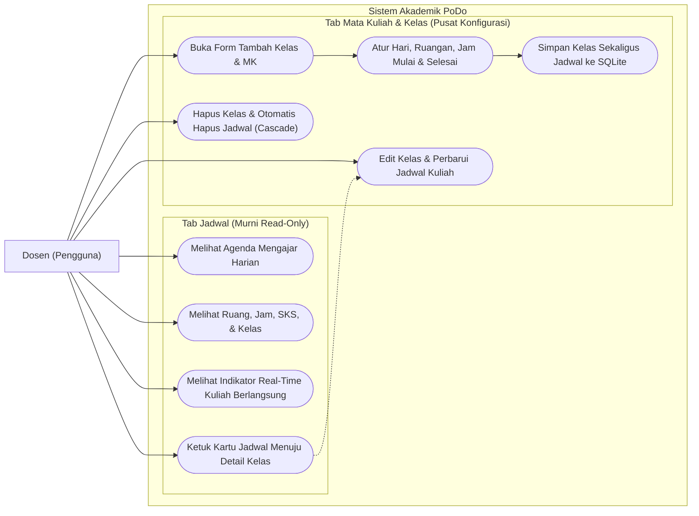
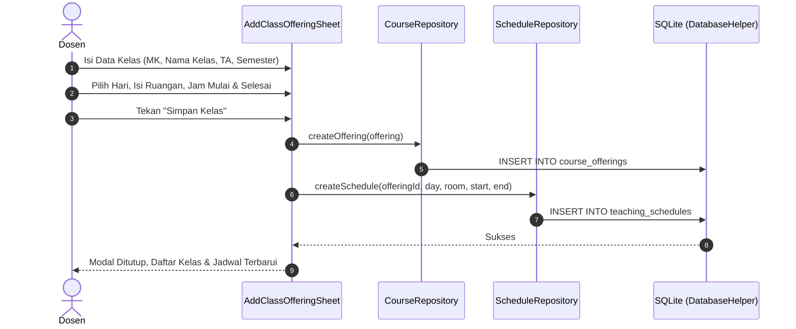
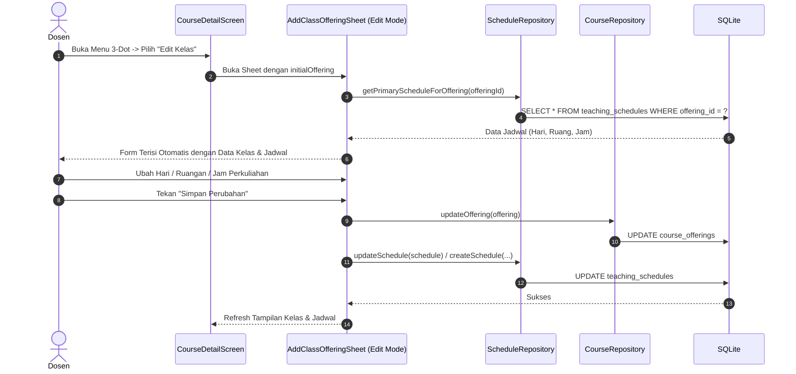
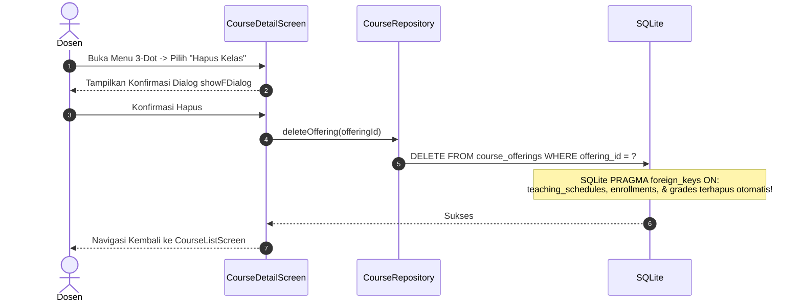

# Integrasi Penuh Pengelolaan Jadwal ke Kelas & Mata Kuliah (Pure Read-Only Jadwal Screen)

> **Dokumen Rencana Implementasi PoDo**  
> **Tanggal:** 2026-11-07  
> **Target:** Penyatuan manajemen waktu, hari, dan ruangan ke Form Tambah & Edit Kelas (`AddClassOfferingSheet`), penghapusan aksi edit/hapus/tambah dari Halaman Jadwal (`ScheduleScreen` menjadi murni *Read-Only*), serta cascade deletion jadwal saat kelas dihapus.

---

## 1. Header Rencana

- **Tujuan Utama:** Menghilangkan aksi mutasi (tambah, edit, hapus) dari tab Jadwal (`ScheduleScreen`), dan menyatukan seluruh konfigurasi waktu, ruangan, dan hari mengajar ke dalam siklus hidup kelas (`AddClassOfferingSheet`). Saat kelas dibuat, jadwal dibuat. Saat kelas diedit, jadwal diedit. Saat kelas dihapus, jadwal otomatis terhapus (*cascade delete*).
- **Arsitektur:** Feature-based (`features/courses`, `features/schedule`), Forui-first Design System, SQLite Database via Repository pattern.
- **Tech Stack:** Flutter 3.38+ / Dart 3.10+, Forui (`forui`), `sqflite`, `sqflite_common_ffi` (testing).
- **Aturan Wajib:**
  - Tanpa karakter middle dot (`•`) di UI string, kode, atau pengujian.
  - Solid matte pastel colors dari `context.appColors`.
  - Forui-first component hierarchy: `FSelect`, `FTextField`, `FButton`, `FHeader`, `FTappable`.
  - Git commit bebas atribut AI / *no co-authored-by*.

---

## 2. Use Case Diagram



---

## 3. Sequence Diagram

### A. Tambah Kelas dengan Jadwal Terintegrasi



### B. Edit Kelas & Jadwal



### C. Hapus Kelas (Cascade Delete Jadwal)



---

## 4. Matriks Keputusan Komponen & Widget

| Area | Kebutuhan UI | Pilihan Widget | Alasan & Desain |
|---|---|---|---|
| `ScheduleScreen` (Header) | Judul halaman saja, tanpa aksi | `FHeader.nested` tanpa `suffixes` | Menghilangkan tombol `+` agar halaman murni read-only. |
| `ScheduleScreen` (Kartu) | Kartu jadwal perkuliahan read-only | `Container` + `FTappable` (kartu utuh) | Hapus icon pensil (edit) & trash (hapus); kartu tetap bisa diketuk untuk membuka detail kelas. |
| `AddClassOfferingSheet` | Pilihan Hari Perkuliahan | `FSelect<String>` | Pilihan terstruktur 6 hari (Senin s.d. Sabtu) dengan label jelas. |
| `AddClassOfferingSheet` | Input Ruangan | `FTextField` | Input teks dengan placeholder informatif (contoh: `KU3.01`, `LAB-02`). |
| `AddClassOfferingSheet` | Input Jam Mulai & Jam Selesai | `FTextField` (bersebelahan) | Format 24-jam `HH:MM` dengan validasi jam mulai < jam selesai. |
| `AddClassOfferingSheet` | Header Bagian Jadwal | `Row` + `Icon(FLucideIcons.calendarClock)` + `Text` | Memisahkan blok informasi kelas dan blok jadwal secara visual tanpa batas tumpuk. |
| `CourseDetailScreen` | Ringkasan Jadwal Kelas | Sub-card di kartu header kelas | Menampilkan hari, jam, dan ruangan kelas agar dosen langsung mengetahui waktu perkuliahan di detail kelas. |

---

## 5. Kontrak Data Layer & SQLite

### Tabel `teaching_schedules`
Relasi foreign key yang sudah aktif di SQLite:
```sql
CREATE TABLE teaching_schedules (
  id INTEGER PRIMARY KEY AUTOINCREMENT,
  offering_id TEXT NOT NULL,
  day_of_week TEXT NOT NULL,
  room TEXT NOT NULL,
  start_time TEXT NOT NULL,
  end_time TEXT NOT NULL,
  UNIQUE(offering_id, day_of_week, start_time),
  FOREIGN KEY (offering_id) REFERENCES course_offerings (offering_id) ON DELETE CASCADE
);
```

### Metode Tambahan pada `ScheduleRepository`:
1. `Future<TeachingSchedule?> getPrimaryScheduleForOffering(String offeringId)`:
   Mengambil jadwal utama (pertama) untuk offering terkait.
2. `Future<List<TeachingSchedule>> getSchedulesByOffering(String offeringId)`:
   Mengambil seluruh daftar jadwal yang terikat ke offering tersebut.

---

## 6. Rencana Tugas & Siklus Flutter TDD

### Task 1: Menambahkan Query Helper Jadwal per Offering di `ScheduleRepository`
- **File:** `lib/features/schedule/repositories/schedule_repository.dart`
- **Test:** `test/features/schedule/repositories/schedule_repository_test.dart`
- **Langkah:**
  1. Buat/perbarui test untuk `getPrimaryScheduleForOffering` dan `getSchedulesByOffering`.
  2. Implementasikan method di `ScheduleRepository`.
  3. Verifikasi test repository lulus (`flutter test test/features/schedule/repositories/`).

### Task 2: Integrasi Field Jadwal ke dalam `AddClassOfferingSheet` (Create & Edit)
- **File:** `lib/features/courses/widgets/add_class_offering_sheet.dart`
- **Test:** `test/features/courses/widgets/add_class_offering_sheet_test.dart`
- **Langkah:**
  1. Tambahkan state untuk:
     - `_selectedDay` (default `'Senin'`).
     - `_roomController` (text field controller).
     - `_startTimeController` (default `'08:00'`).
     - `_endTimeController` (default `'10:30'`).
     - `_existingScheduleId` (`int?`).
  2. Pada `initState()`, jika `widget.initialOffering != null`, panggil `ScheduleRepository.instance.getPrimaryScheduleForOffering(...)` dan isi controller & state jadwal.
  3. Pada form UI, tambahkan blok "Jadwal Perkuliahan":
     - `FSelect<String>` untuk Hari.
     - `FTextField` untuk Ruangan.
     - Row dengan dua `FTextField` untuk Jam Mulai & Jam Selesai.
  4. Pada `_saveOffering()`, validasi format jam dan ruangan.
  5. Simpan offering ke `CourseRepository`, lalu simpan/update jadwal ke `ScheduleRepository`.
  6. Tulis widget test yang memverifikasi bahwa submit sheet menyisipkan/memperbarui data di `teaching_schedules`.

### Task 3: Jadikan `ScheduleScreen` Murni Read-Only
- **File:** `lib/features/schedule/screens/schedule_screen.dart`
- **Test:** `test/features/schedule/screens/schedule_screen_test.dart`
- **Langkah:**
  1. Hapus `suffixes: [FHeaderAction(...)]` dari `FHeader.nested` di `ScheduleScreen` (tidak ada tombol `+`).
  2. Hapus icon pensil (edit) dan icon tong sampah (hapus) dari kartu jadwal `_buildScheduleCard`.
  3. Hapus method `_openAddScheduleSheet`, `_openEditScheduleSheet`, dan `_deleteSchedule` dari `_ScheduleScreenState`.
  4. Hapus import yang tidak terpakai (`schedule_form_sheet.dart`).
  5. Perbarui `test/features/schedule/screens/schedule_screen_test.dart`:
     - Verifikasi tidak ada icon `FLucideIcons.plus`.
     - Verifikasi tidak ada icon `FLucideIcons.pencil` atau `FLucideIcons.trash2`.
     - Verifikasi tapping kartu jadwal tetap menavigasikan ke `CourseDetailScreen`.
  6. Jalankan `flutter test test/features/schedule/screens/schedule_screen_test.dart`.

### Task 4: Tampilkan Informasi Jadwal di Header `CourseDetailScreen`
- **File:** `lib/features/courses/screens/course_detail_screen.dart`
- **Test:** `test/features/courses/screens/course_detail_screen_test.dart`
- **Langkah:**
  1. Muat jadwal kelas saat `_loadOfferingDetails()` menggunakan `ScheduleRepository.instance.getPrimaryScheduleForOffering(...)`.
  2. Tampilkan badge / baris info jadwal pada kartu ringkasan kelas (misal: Icon kalender + `'Senin, 08:00 - 10:30 | Ruang KU3.01'`).
  3. Verifikasi kartu detail menampilkan jadwal dengan rapi.

### Task 5: Pembersihan & Verifikasi Regresi Menyeluruh
- **Langkah:**
  1. Periksa apakah `ScheduleFormSheet` masih dibutuhkan (karena seluruh pembuatan & pengeditan jadwal kini melalui `AddClassOfferingSheet`). Jika `ScheduleFormSheet` sudah usang, arsipkan/hapus atau sesuaikan tesnya.
  2. Jalankan `flutter analyze` (target 0 issues).
  3. Jalankan `flutter test` (seluruh suite test harus lulus 100%).
  4. Buat commit git atomik sesuai konvensi tanpa teks AI / attribution.

---

## 7. Checklist Ulasan Mandiri

- [ ] Apakah halaman jadwal sudah murni read-only tanpa tombol tambah, edit, atau hapus?
- [ ] Apakah form tambah kelas memuat input Hari, Ruangan, Jam Mulai, dan Jam Selesai?
- [ ] Apakah submit tambah kelas menyimpan offering dan teaching schedule sekaligus?
- [ ] Apakah form edit kelas memuat jadwal kelas tersebut dan memperbaruinya saat disimpan?
- [ ] Apakah penghapusan kelas otomatis menghapus jadwal terkait (cascade delete)?
- [ ] Apakah tidak ada karakter middle dot (`•`) di UI dan string?
- [ ] Apakah seluruh pengujian otomatis (`flutter test`) lulus 100% dan analisis bersih (`flutter analyze`)?
